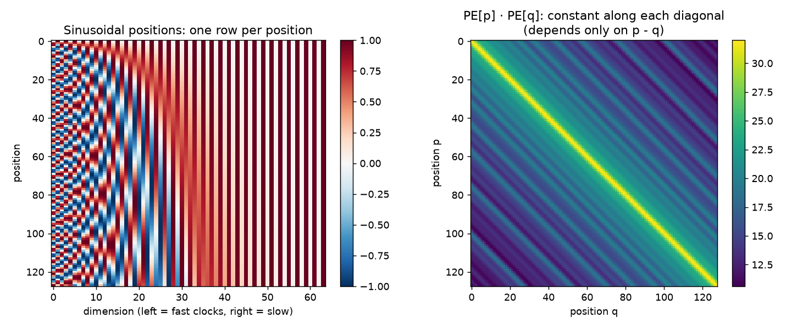
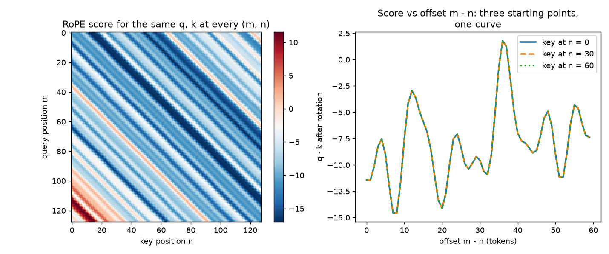
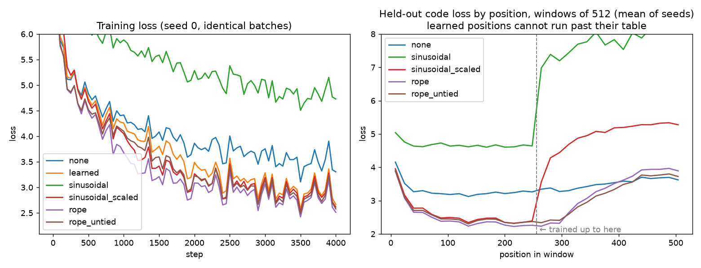

# Stage 03 — Embeddings and Position

The tokenizer from Stage 01 turns text into a list of integers, like
`[1017, 279, 8192, ...]`. A neural network cannot do much with those numbers as
they are. Token 1017 is not "bigger" than token 279 in any meaningful way. The
numbers are only names. This stage answers two questions:

1. **How does a name become something a network can compute with?** We swap
   each id for a learned vector (an *embedding*).
2. **How does the model know what order the tokens came in?** Attention, the
   core of the transformer, has no idea of order. We look at three ways to add
   it: learned positions (GPT-2), sinusoids (the original 2017 transformer), and
   rotations (**RoPE**, used by Llama and almost every modern model).

```
 text ──tokenizer──▶ ids (B, T) ──embedding──▶ vectors (B, T, C) ──+ position──▶ transformer
                     [1017, 279, ...]         one row per token       which slot is this?
```

`B` = batch size, `T` = sequence length (tokens per row), `C` = model width
(numbers per token vector). These letters are used on every tensor line in the
code.

---

## 1. From ids to vectors: the lookup table

### The picture

An embedding is a table with one row per token in the vocabulary. To embed
token 3, you read row 3. That is all it does when the model runs.

```
              C = 4 numbers per token
           ┌──────────────────────────┐
 id 0      │ 0.12 -0.40  0.03  0.88   │
 id 1      │-0.71  0.05  0.62 -0.10   │
 id 2      │ 0.33  0.91 -0.27  0.04   │
 id 3  ──▶ │-0.05 -0.66  0.48  0.19   │ ──▶ vector for token 3
 ...       │          ...             │
 id 8195   │ 0.21 -0.13 -0.94  0.50   │
           └──────────────────────────┘
              V = 8,196 rows (our tokenizer)
```

The numbers start random. Training moves them until tokens used in similar
ways end up with similar rows. Nobody tells the model that `" self"` and
`" cls"` are related. Gradient descent finds that it lowers the loss to put
them near each other.

### The formal version: a one-hot matrix multiply

Write token `i` as a **one-hot** vector: length `V`, all zeros except a 1 at
position `i`. Multiplying it by the table `W` (shape `V × C`) picks out row `i`:

```
one_hot(3) = [0, 0, 0, 1, 0, ..., 0]        (1, V)
one_hot(3) @ W = W[3]                       (1, V) @ (V, C) → (1, C)
```

So **an embedding layer is a linear layer with no bias, applied to one-hot
inputs.** Libraries implement it as indexing (`W[ids]`) because building a
`V`-wide vector of zeros for every token wastes memory: 8,196 floats to select
one row.

Seeing it as a matmul tells us how it learns. The gradient of a matmul with
respect to `W` is `one_hot.T @ grad_out`. Every row of `one_hot.T` is zero
except the rows of tokens that appeared. So **only the rows of tokens in the
batch get a gradient.** A token that never appears in training keeps its random
initial vector forever. That is one more reason the tokenizer should not have
learned tokens that the training data never uses.

### Size

Our tokenizer has `V = 8,196` rows. The cost in parameters is `V × C`:

| width `C` | embedding params | share of a 40M model |
|---|---|---|
| 256 | 2.10M | 5% |
| 512 | 4.20M | 10% |
| 768 | 6.29M | 16% |

GPT-2's vocabulary is 50,257. At `C = 768` its table alone is 38.6M
parameters, almost a third of the 124M model. A small vocabulary keeps more of
our budget in the layers that do the thinking. That was part of the Stage 01
decision.

---

## 2. Weight tying: the same table on the way out

At the end of the model, the last vector for each position has to become a
score for every token in the vocabulary (the *logits*). That is another
`C × V` matrix, the **output head** or **unembedding**:

```
hidden (B, T, C) @ W_out (C, V) → logits (B, T, V)
```

`W_out` has the same shape as the embedding table, transposed. **Weight
tying** uses the same matrix for both: `W_out = W_emb.T`.

Why this makes sense: the input table says "token `i` looks like this vector",
and the output head scores token `i` by how close the final hidden vector is to
row `i` (a dot product). Both ask "what does token `i` look like in this
space?" Tying forces one answer to both questions.

What it buys:
- **Parameters.** One table instead of two: 4.2M saved at `C = 512`.
- **Rare tokens.** A token that is rarely the *input* is still trained every
  time it is a candidate *output*, which is every step. Every row of the output
  head gets a gradient on every step, because softmax touches all `V` scores.
  Tying passes that signal to the input side.

Who uses it: GPT-2 ties. Llama 1 and 2 do not. Recent small models (Llama 3.2
1B and 3B, Qwen2.5 0.5B and 1.5B, Gemma) tie, because at small sizes the table
is a big share of the parameters. We tie, and measure the difference in §8.

---

## 3. Why position is needed at all

### Attention sees a set, not a sequence

Stage 04 builds attention properly. For this stage, one fact is enough: in
attention, each token's output is a weighted average of all tokens' vectors.
The weights come from dot products between token vectors. **Nothing in that
calculation looks at where a token is.**

So if you shuffle the input tokens, the outputs come back shuffled the same way
and are otherwise identical. In maths: for any permutation matrix `P`,
`Attention(P·X) = P·Attention(X)`. This is called **permutation
equivariance**. We test it exactly in `test_embeddings.py`.

What that means in practice. These two lines contain exactly the same tokens:

```python
a = b - c
c = b - a
```

Without position information, attention cannot tell them apart. To it, both
are the bag `{a, =, b, -, c}`. For code, where `x = y` and `y = x` do opposite
things, that is fatal.

### A loophole: the causal mask

A language model uses a **causal mask**: token `t` may only look at tokens
`0..t`, never at the future. The mask breaks the symmetry above. Token 0 sees 1
token, token 9 sees 10. A model can, in principle, work out roughly where it is
by how "diluted" its average is. Haviv et al. (2022) showed causal language
models with *no* position information ("NoPE") still learn something about
order this way. So the honest prediction for our ablation is not "no position →
cannot learn", but:

- **No mask, no position:** cannot see order at all (proved by the test).
- **Causal mask, no position:** sees order weakly and indirectly. Should train,
  but worse. §8 measures how much worse.

---

## 4. Scheme 1: learned absolute positions (GPT-2)

The simplest idea: a second lookup table, indexed by position instead of token
id. Slot 0 gets row 0, slot 1 gets row 1, and so on. Add it to the token
vector:

```
x = tok_emb[ids] + pos_emb[0..T-1]
    (B, T, C)       (T, C)  ── broadcast over the batch
```

GPT-2 does exactly this with 1,024 position rows.

**Strengths.** Nothing to design. The model learns whatever position signal is
useful.

**What breaks.**
- **No position beyond the table.** GPT-2 has rows 0..1023. Position 1024 has
  no row, so the model cannot even run on longer input.
- **Late positions train less.** Every training window uses position 0, but only
  windows of full length reach position 1023. With document packing (Stage 02)
  every window is full, so this costs us little. It matters for models trained
  on short, padded examples.
- **Nothing ties positions together.** Row 500 and row 501 are learned
  separately. The model has to discover that they are neighbours.
- **Absolute, not relative.** "The token 3 places back" is what matters for
  most grammar and code (`def f(` → `)`), but the model only gets "I am at 517,
  that token is at 514". It has to learn to subtract.

---

## 5. Scheme 2: sinusoidal positions (the 2017 transformer)

### The picture: a row of clocks

Picture `C/2` clocks, each with one hand, all ticking at different speeds. The
fastest clock's hand goes round once every ~6 positions. The slowest takes
about 63,000 positions per turn. To encode position `p`, write down where every
hand points: its `sin` and `cos`.

```
pair 0  (fast)   ◷ ◶ ◵ ◴ ◷ ◶ ◵ ◴ ...   changes every token: fine detail
pair 1           ◷ ◷ ◶ ◶ ◵ ◵ ◴ ◴ ...
...
pair C/2-1 (slow) ◷ ◷ ◷ ◷ ◷ ◷ ◷ ◷ ...   barely moves: coarse "which region"
```

This works like the hands of a real clock. The second hand tells you the
second, the hour hand tells you roughly the time of day. Together they name
every moment uniquely.

### The formula

For position `p` and pair index `i = 0 .. C/2 - 1`:

```
ω_i        = 1 / 10000^(2i / C)          # angular speed of clock i
PE[p, 2i]   = sin(p · ω_i)
PE[p, 2i+1] = cos(p · ω_i)
```

`ω_0 = 1` radian per token (one turn per 2π ≈ 6.3 tokens). The slowest,
`ω_{C/2-1} ≈ 1/10000`, takes ≈ 62,800 tokens per turn. No parameters. `PE` is
added to the token embedding exactly like the learned table.

### Why sines and cosines and not just `p`

- **Bounded.** Every value is in [-1, 1], whatever `p` is. Feeding in a raw `p`
  of 50,000 would swamp the token vectors.
- **Moving by `k` is a fixed rotation.** Turning a clock hand by `k·ω` is a 2×2
  rotation, the same one at every starting point. So `PE[p + k] = R_k · PE[p]`,
  where `R_k` depends only on `k`. In principle a layer can learn "look `k` back"
  once and use it everywhere.
- **Similarity depends only on distance.** `PE[p] · PE[q] = Σ_i cos((p - q)·ω_i)`.
  Only the gap `p - q` appears. We plot this in §7.

**What still breaks.** The position is *added* to the token vector, so the two
are mixed together before attention sees them. They must also be the **same
size**: a sinusoid vector has length √(C/2) whatever happens, so the 2017 paper
multiplies token vectors by √C first. Forget that, and position drowns the
token. We forgot it, and §8 shows the cost. The model has to untangle "what"
from "where" itself. And past the training length, attention meets
combinations of clock positions it never saw in training. Sinusoids can
*compute* any position, but the model has not *learned* what to do there.

---

## 6. Scheme 3: RoPE, rotary position embedding (Llama and most models since)

### The idea in one sentence

Do not add position to the token vector. Instead, **rotate** the query and key
vectors by an angle proportional to their position, right before the attention
dot product. Then the dot product sees only the *difference* in angles, which
is the *distance* between the tokens.

### The picture in 2D

Take a query `q` at position `m` and a key `k` at position `n`. Each is a 2D
arrow. Rotate `q` by `m·θ` and `k` by `n·θ`:

```
        q rotated by m·θ
         ↗
        /  angle between them = (m - n)·θ + (original angle)
       /  ↗ k rotated by n·θ
      / /
     o───────
```

The dot product of two arrows depends only on their lengths and the angle
between them. Rotating both by the same extra amount changes nothing. So if
both tokens move 100 places to the right, the score is the same. **Only
`m - n` matters.**

### Worked example (small numbers)

Let `q = k = (1, 0)` and `θ = 0.5` radians per token.

| q at | k at | q angle | k angle | score = cos(difference) |
|---|---|---|---|---|
| m = 3 | n = 1 | 1.5 | 0.5 | cos(1.0) = 0.540 |
| m = 10 | n = 8 | 5.0 | 4.0 | cos(1.0) = 0.540 |
| m = 3 | n = 3 | 1.5 | 1.5 | cos(0.0) = 1.000 |

Same gap of 2, same score. That is the whole trick.

### More than two dimensions

A head of size `d` (say 64) is split into `d/2` pairs. Each pair is its own 2D
plane, rotated at its own speed, using the same clock speeds as sinusoids:

```
θ_i = base^(-2i/d),  i = 0 .. d/2 - 1,   base = 10000
```

For pair `i` at position `m`, with angle `a = m·θ_i`:

```
[x'_{2i}  ]   [cos a  -sin a] [x_{2i}  ]
[x'_{2i+1}] = [sin a   cos a] [x_{2i+1}]
```

Applied to `q` and `k` only, never to `v`. It has no parameters.

### The complex-number view

A 2D pair `(x, y)` can be written as one complex number `x + iy`. Rotating by
angle `a` is multiplying by `e^{ia}`. So RoPE is:

```
q̃_m = q · e^{i m θ}       k̃_n = k · e^{i n θ}
score = Re( q̃_m · conj(k̃_n) ) = Re( q · conj(k) · e^{i (m - n) θ} )
```

`m` and `n` only appear as `m - n`. This is the proof in one line, and Meta's
reference Llama code implements RoPE this way, with `torch.view_as_complex`.

### Two layouts, one idea (a trap)

There are two common ways to choose which dimensions form a pair:

- **Interleaved:** pairs are `(0,1), (2,3), (4,5), ...`. This is the paper and
  Meta's complex-number code.
- **Half-split:** pairs are `(0, d/2), (1, d/2+1), ...`. This is HuggingFace's
  `rotate_half`.

Both are correct RoPE. They are not interchangeable: loading weights trained
with one layout into code using the other gives a broken model with no error
message. The two differ only by a fixed shuffle of dimensions, and we test that
claim exactly. We build both and check the half-split one against HuggingFace's
`apply_rotary_pos_emb`.

### Why RoPE won

- **Relative by construction.** The model does not have to learn subtraction.
- **Position stays out of the residual stream.** Nothing is added to the token
  vector, so "what" and "where" are not mixed. Position only affects *who
  attends to whom*.
- **No parameters, and no table to run out of.** Any position can be computed.

### What it does not fix (honest version)

RoPE is often said to "extrapolate", meaning it handles sequences longer than
training. That is only partly true. The slow pairs turn so little during
training that, beyond the training length, they reach angles the model has
never seen, and quality drops. That is why long-context models use RoPE *plus*
a fix: position interpolation, NTK scaling, YaRN. Stage 14 covers those. What
RoPE does give: no hard wall (unlike a learned table), and graceful rather than
total failure. §8 measures it on our model.

---

## 7. Pictures from the real code

Both figures are produced by `stages/03_embeddings/run.py plots`.

**Sinusoidal table** (`docs/visuals/03_sinusoidal.png`): rows are positions,
columns are dimensions. The left columns (fast clocks) flicker, the right ones
(slow clocks) barely change. Beside it, the dot product `PE[p] · PE[q]` as a
heatmap: constant along every diagonal, because it depends only on `p - q`.



**RoPE scores** (`docs/visuals/03_rope_offset.png`): one fixed random `q` and
`k` (head size 64), placed at every pair of positions `(m, n)` from 0 to 127.
The score heatmap has stripes along the diagonals. Beside it, score against
offset `m - n` for three different starting positions. The three curves lie
exactly on top of each other.



---

## 8. Experiment: break position on purpose

### Setup

A tiny causal language model, identical in every run except how it gets
position:

- 4 layers, width 256, 4 heads of 64, MLP 4× wide, context 256 tokens.
- Our tokenizer (8,196 rows), our data: 85% code, 15% English, shuffled windows.
- 4,000 steps × 32 windows × 256 tokens = 32.8M tokens, AdamW (peak lr 1e-3,
  warmup then cosine), bf16. About 130-145 s per run on the RTX 4060 Laptop.
- 3 seeds per variant. A seed changes both the initial weights and the batch
  order; all variants with the same seed see identical batches.

Attention and the block are built properly in Stages 04-05. Here they are a
compact preview (`stages/03_embeddings/tiny_lm.py`), using PyTorch's built-in
attention kernel, because attention is not what this stage measures.

Variants:

| run | position scheme | tied head |
|---|---|---|
| `none` | nothing (relies on the causal mask) | yes |
| `learned` | GPT-2 table, 256 rows | yes |
| `sinusoidal` | fixed clocks, added | yes |
| `sinusoidal_scaled` | fixed clocks, added, token vectors × √C first | yes |
| `rope` | rotation of q, k | yes |
| `rope_untied` | rotation of q, k | no (separate head) |

Measured: validation loss on held-out code at the end, and loss per position
on windows **twice** the training length (512), to see what happens past the
edge. `sinusoidal_scaled` was not in the original plan. It was added after
the first sweep, for the reason in the results below.

### Results

Mean ± standard deviation over 3 seeds, held-out code, 512 windows of 256
tokens (131k tokens). Lower is better. A loss of 2.52 means the model gives the
correct next token, on average, probability e^-2.52 ≈ 8%; uniform guessing over
8,196 tokens would be ln(8196) = 9.01.

| run | params | val loss (T = 256) | positions 0-255 of a 512 window | positions 256-511 | jump past the edge |
|---|---|---|---|---|---|
| `none` | 5,257,728 | 3.350 ± 0.013 | 3.302 | 3.508 | +0.21 |
| `learned` | 5,323,264 | 2.689 ± 0.012 | cannot run | cannot run | — |
| `sinusoidal` (as first written) | 5,257,728 | **4.723 ± 0.080** | 4.677 | 7.790 | +3.11 |
| `sinusoidal_scaled` | 5,257,728 | 2.633 ± 0.001 | 2.614 | 4.939 | +2.32 |
| `rope` | 5,257,728 | **2.523 ± 0.010** | 2.509 | 3.291 | +0.78 |
| `rope_untied` | 7,355,904 | 2.598 ± 0.009 | 2.580 | 3.191 | +0.61 |

Source: `results/03_embeddings/ablation.json`. Figure:
`docs/visuals/03_ablation.png` (training curves, and loss at every position of
a 512-token window).



**Seed noise is about ±0.01.** Every gap discussed below is at least 5× that
(the smallest, scaled sinusoids vs learned, is 0.056).

### What the numbers say

**1. Position matters a lot, and the causal mask is a poor substitute.** No
position at all: 3.350. Any working scheme: 2.52-2.69. The gap (0.83 for RoPE)
is the largest effect in the table. The NoPE model is not hopeless: it beats
broken sinusoids by 1.4 and trains steadily, so the causal mask does leak some
order, as §3 predicted. But at this size and training length it is far behind.

**2. Sinusoids as first written were worse than no position at all** (4.723 vs
3.350). This was a bug in our setup, not in the idea. The sinusoid vector for a
position has length √(C/2) = 11.3. Our token vectors start with length 0.32
(256 numbers of size ~0.02). Added together, position outweighs the token
**35 to 1**. The model sees mostly *where* and barely *what*, and it has to
spend training growing the token vectors to compete. The 2017 paper multiplies
token embeddings by √C before adding the sinusoids. We had left that out. With
it (`sinusoidal_scaled`), loss drops to 2.633, better than learned positions.
The learned table never had this problem: it starts at the same 0.02 scale as
the tokens.

**3. RoPE wins inside the training length**: 2.523, which is 0.11 better than
scaled sinusoids and 0.17 better than learned positions, with no position
parameters at all. The learned table spends 65,536 parameters (256 × 256) and
does worse.

**4. Tying the head helps at this size.** Untying adds 2.10M parameters (+40%)
and makes the loss *worse*, 2.598 vs 2.523. The tied table gets a training
signal from both ends of the model on every step. Untied, the input table only
learns from the tokens that appear in each batch.

**5. Nobody extrapolates well.** Past position 255, every scheme gets worse.
In detail:
- **Learned**: cannot run at all. The hard wall.
- **Sinusoidal (scaled)**: breaks immediately. Loss 2.44 at positions 250-255,
  3.56 at 256-271, 5.28 at the end of the window. The model has never seen
  these position vectors added to a token, and they disturb every layer.
- **RoPE**: fine for about 40 tokens past the edge (2.23 at positions 256-271,
  no worse than inside), then climbs to 3.89 at the end. Why the delay: RoPE
  only sees *distances*. A token at position 270 mostly attends to nearby
  tokens, at distances it has seen thousands of times. Only its attention to
  the very first tokens uses distances above 255, which it never saw. As the
  position grows, more of what it attends to is at unseen distances.
- **None**: degrades least (+0.21), because there is no position signal to go
  out of range. Only the causal mask's "how many tokens can I see" changes.
  It is still worse in absolute terms than RoPE at every position below ~400.

So "RoPE extrapolates" is true only in the weak sense of §6: no wall, and a
gradual slope instead of a cliff. Stage 14 covers the fixes real long-context
models use.

**6. Early positions are hard for everyone.** In the RoPE model, loss at
position 0 is 5.32 and at position 255 it is 2.15. The first token of a window
has no context. Every later token has more to go on. This is why validation
loss always depends on the context length it was measured at.

### The ablation the curriculum asked for

"Train with no positional info; show it cannot learn word order." Measured
answer: with a causal mask, it *can* learn some order, but it pays 0.83 nats of
loss for not being told. Without a mask, it provably cannot see order at all
(`test_attention_without_position_is_permutation_equivariant`).

---

## 9. Build order

1. `stages/03_embeddings/embeddings.py`: token embedding (as indexing and as
   one-hot matmul), learned positions, sinusoidal table, RoPE (interleaved,
   half-split, complex), tied output head.
2. `stages/03_embeddings/test_embeddings.py`: acceptance criteria below.
3. `stages/03_embeddings/tiny_lm.py`: the preview model with a switchable
   position scheme.
4. `stages/03_embeddings/run.py`: `plots` and `ablation`.

### Acceptance criteria

- Indexing, one-hot matmul and `nn.Embedding` give identical outputs **and**
  identical gradients. Rows of unused tokens get exactly zero gradient.
- Attention without a mask and without position is permutation-equivariant
  (exact, up to float error). Adding any position scheme breaks it.
- Sinusoidal: values in [-1, 1]; `PE[p] · PE[q]` depends only on `p - q`;
  `PE[p + k] = R_k · PE[p]` for a fixed rotation.
- RoPE: preserves vector length; score depends only on `m - n` (to 1e-5);
  interleaved equals the complex-number version; half-split equals
  HuggingFace `apply_rotary_pos_emb`; the two layouts differ only by a
  dimension shuffle.
- Tied head: output weight *is* the embedding tensor (same storage), and the
  parameter count drops by exactly `V × C`.

---

## 10. What we found

Dated entries in `docs/JOURNAL.md` (2026-10-29). The short version:

| What | Number | Lesson |
|---|---|---|
| Any position vs none | 2.52-2.69 vs 3.35 val loss | The causal mask leaks some order, but nowhere near enough. |
| Sinusoids, no √C scaling | 4.72, worse than no position | A position signal 35× louder than the token drowns it. Check the size of everything you add together. |
| Sinusoids, with √C | 2.63, beats learned (2.69) | A one-line detail from the 2017 paper was worth 2.1 nats. |
| RoPE | 2.52, best, zero parameters | Relative position inside attention beats absolute position added to the input. |
| Untied head | +2.1M params, loss 2.60 vs 2.52 | At small sizes, tying is free quality. |
| Past training length | RoPE OK for ~40 tokens, then +0.8 | "Extrapolates" means "no wall", not "works". |
| float32 RoPE angles | score drift 1.4e-5 at position 127 | The angle equals the position in radians; float32 rounds it. Harmless at 256 tokens, real at 100k. |
| Seed noise | ±0.01 | Three seeds made every claim above checkable. One seed would not have. |

**The habit this chapter teaches: when two things are added, check that they
are the same size.** The sinusoid bug produced no error, no NaN and no crash.
The loss went down every step. It went down to the wrong place, and only the
comparison against other variants showed it. Stage 05 (residual streams and
normalization) returns to this: almost every "it trains but badly" bug in a
transformer is a scale bug.
