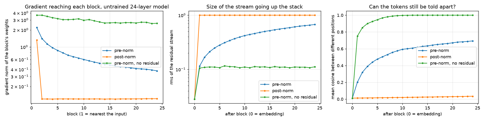
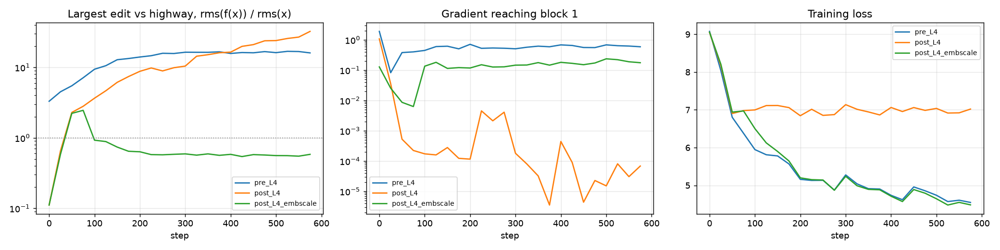
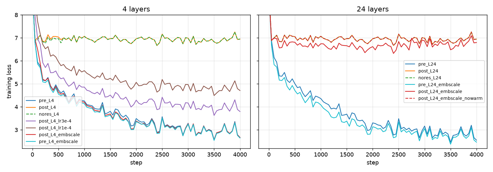
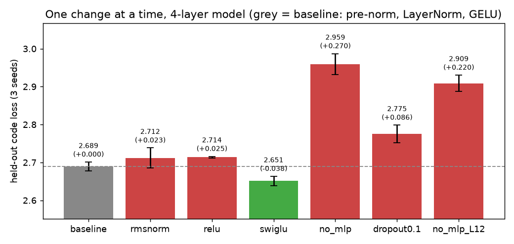

# Stage 05 — The Transformer Block

Stage 04 built attention: the one place where tokens exchange information. A
language model is not one attention layer, though. It is the same unit, the
**block**, stacked 12, 24 or 96 times. GPT-2 small has 12 blocks; Llama 3 8B
has 32.

The tiny model in Stages 03 and 04 already had blocks in it. We used them as a
preview and did not explain them. This stage takes the block apart:

- the **residual connection**, which makes deep stacks trainable at all;
- the **normalisation** (LayerNorm, then RMSNorm), which keeps the numbers in
  a sane range;
- **where** the normalisation goes (pre-norm or post-norm), which decides
  whether 24 layers train;
- the **MLP**, which holds two thirds of the block's parameters;
- the **activation function** inside it (ReLU → GELU → SwiGLU);
- **dropout**, and why big pretraining runs switch it off.

Then we check our block against Hugging Face's GPT-2 block number for number,
and break each piece on purpose.

Shape letters as before: `B` batch, `T` tokens, `C` model width, `H` heads.

---

## 1. The picture

One block, GPT-2 style:

```
              x  (B, T, C)    ← the residual stream coming in
              │
      ┌───────┤
      │       ▼
      │   LayerNorm
      │       ▼
      │   attention          tokens talk to each other (Stage 04)
      │       ▼
      └──────(+)              add, do not replace
              │
      ┌───────┤
      │       ▼
      │   LayerNorm
      │       ▼
      │      MLP              each token works alone: C → 4C → C
      │       ▼
      └──────(+)
              │
              ▼
              x  (B, T, C)    ← same shape out, so blocks stack
```

Two sublayers, each wrapped the same way: **normalise, transform, add back.**
The input and output have the same shape, `(B, T, C)`, which is the only reason
blocks can be stacked like bricks.

The two sublayers have different jobs. **Attention moves information between
tokens.** The **MLP processes each token on its own**, with no view of the
others. A useful rough picture: attention gathers what a token needs from
the context, the MLP thinks about what it gathered.

---

## 2. The residual connection: add, do not replace

### The idea

Without a residual, a layer **replaces** its input: `x ← f(x)`. With one, it
**adds to** its input: `x ← x + f(x)`.

That small change has a big consequence. Each block no longer has to produce a
complete new representation. It only has to produce a **correction**, an edit
to what is already there. A block that has nothing useful to say can output
close to zero and pass its input through untouched.

This gives the model a different shape. Think of one long vector per token,
the **residual stream**, running from the embedding at the bottom to the output
head at the top. Every block reads the stream, computes something, and
**writes its result back by adding it**. Nothing is ever overwritten.

```
 embedding ──► (+) ──► (+) ──► (+) ──► (+) ──► ... ──► final norm ──► head
                ▲       ▲       ▲       ▲
              attn₁   mlp₁    attn₂   mlp₂     each reads the stream,
                                               adds its contribution
```

### Why it matters: the gradient needs a road

Training pushes a gradient backwards from the loss to every weight. Without
residuals, the gradient arriving at layer 1 has passed **through** every layer
above it, and each layer multiplies it by its own derivative.

Suppose each layer, on average, shrinks the gradient to 0.8 of its size.
Through 24 layers: `0.8^24 = 0.0047`. Layer 1 receives half a percent of the
signal layer 24 got, and learns about 200× slower. If each layer instead grows
it by 1.2: `1.2^24 = 79`. The gradient explodes. Getting exactly 1.0 from every
layer, all the time, is not something you can arrange.

With a residual, the derivative of `x + f(x)` with respect to `x` is
`1 + f'(x)`. The `1` is a direct path: **the gradient from the top reaches
every layer unchanged**, plus whatever extra the layers add. The product of
`(1 + small)` terms does not collapse towards zero the way a product of
`small` terms does.

```
 no residual:   ∂loss/∂x₁ = f'₂₄ · f'₂₃ · ... · f'₁                 product of 24 factors
 residual:      ∂loss/∂x₁ = (1 + f'₂₄)(1 + f'₂₃) ... (1 + f'₁)
                          = 1 + (sum of single terms) + (pairs) + ...
                            ▲
                            this 1 is the highway
```

(Here `f'` is really a matrix, a Jacobian, and the `1` is the identity matrix.
The argument is the same.)

**What breaks without it:** deep stacks, we expected; a 4-layer network
should survive. That prediction turned out wrong. Without residuals, *both*
our 4-layer and 24-layer models learned nothing about context (§10c), and
the reason was not the one above, at least not first (§10a).

---

## 3. Normalisation: keep the numbers in range

### The problem

The residual stream is a running sum. Every block adds something to it, so its
size tends to grow as it goes up the stack. And each sublayer would like its
input at a predictable scale: attention scores, for example, depend on the size
of `q` and `k` (Stage 04 §3). An input that is 10× larger at layer 20 than at
layer 1 means each layer sees numbers of a different size.

The fix is to **normalise** each token's vector before a sublayer reads it:
rescale it to a standard size, every time.

### LayerNorm (GPT-2, the original transformer)

For one token's vector `x` of length `C`:

1. subtract the mean of its `C` numbers, so they centre on 0;
2. divide by their standard deviation, so they have spread 1;
3. multiply by a learned vector `γ` (gain) and add a learned `β` (bias), so the
   model can undo the scaling where it wants to.

```
LayerNorm(x) = γ · (x − mean(x)) / sqrt(var(x) + ε)  +  β          x: (C,), γ, β: (C,)
```

`ε` (1e-5 in GPT-2) stops a division by zero when every entry is equal.

Worked example, `C = 4`, `γ = 1`, `β = 0`:

```
x            = [2, 4, 6, 8]
mean         = 5,   var = 5,   std = 2.236
x − mean     = [−3, −1, 1, 3]
÷ std        = [−1.342, −0.447, 0.447, 1.342]
```

Add 100 to every entry, `[102, 104, 106, 108]`, and LayerNorm gives exactly the
same answer. Multiply by 10, same answer. **LayerNorm ignores where the vector
sits and how large it is; it keeps only its shape.**

Note the direction: LayerNorm normalises **across the `C` features of one
token**, never across tokens or across the batch. Each token is normalised on
its own, which is why it works the same at training and inference and for any
batch size. (BatchNorm, common in vision, normalises across the batch. It is a
poor fit for language models, where batch statistics would mix tokens from
unrelated sequences.)

### RMSNorm (Llama, Mistral, Qwen, nearly everything since 2023)

RMSNorm drops step 1 and the `β`. It divides by the root-mean-square and
nothing else:

```
RMSNorm(x) = γ · x / sqrt(mean(x²) + ε)
```

Same example:

```
x            = [2, 4, 6, 8]
mean(x²)     = (4 + 16 + 36 + 64) / 4 = 30,   rms = 5.477
x ÷ rms      = [0.365, 0.730, 1.095, 1.461]
```

The output is not centred: its entries are all positive, because the input's
were. RMSNorm fixes the **size** of the vector and leaves its offset alone. Add
100 to every entry and RMSNorm's answer changes, to
`[0.971, 0.990, 1.009, 1.028]`: nearly constant, because the offset of 100 now
dominates the vector.

**Why RMSNorm won.** Zhang and Sennrich (2019) found that the re-centring step
contributes little: models trained with RMSNorm match LayerNorm quality, and
the operation is cheaper (one reduction instead of two, no `β`). The cost
difference is real but small next to a matmul, and a fused LayerNorm kernel
narrows it further. We measure both the quality and the speed (§10d, §10e)
rather than repeat the claim.

**What breaks without normalisation at all:** the stream's scale drifts with
depth, and the learning rate that suits layer 1 does not suit layer 20. We do
not run that ablation separately; the post-norm experiment below shows what
mis-placed normalisation does, which is the more interesting failure.

---

## 4. Pre-norm vs post-norm: where the norm goes

There are two ways to combine a norm with a residual.

```
 post-norm (2017 paper, BERT)              pre-norm (GPT-2, Llama, everything modern)

   x ──┬──► f ──► (+) ──► Norm ──► out        x ──┬──► Norm ──► f ──► (+) ──► out
       └────────────┘                             └──────────────────┘

   out = Norm(x + f(x))                      out = x + f(Norm(x))
```

They look like a minor rearrangement. They are not.

**In post-norm, the norm sits on the highway.** Every layer's output passes
through a normalisation before it reaches the next layer, and so does every
gradient on the way back. The clean `1` of §2 becomes "1, then rescaled by a
LayerNorm", 24 times over. The direct path from the loss to layer 1 exists, but
it is no longer clean.

**In pre-norm, the highway is untouched.** The norm sits on the side road that
feeds `f`. The stream itself is never normalised between blocks, so the
gradient at the top reaches the bottom through nothing but additions.

Xiong et al. (2020) analysed this at initialisation and found that in
post-norm, the gradients of the **last** layers are large, which is why
post-norm models need a careful learning-rate warmup and diverge without one.
In pre-norm the gradient is well-behaved at every depth, and warmup matters
much less.

**The prediction for our experiment (§10b):** at 4 layers, both train. At 24
layers with the same learning rate, pre-norm trains and post-norm struggles or
diverges. We also measure the gradient reaching each layer at initialisation
(§10a), which is where the difference starts.

**What pre-norm costs.** Two things, both honest:

1. Because the stream is never normalised, the model needs **one extra norm at
   the very end**, before the output head (`ln_f` in GPT-2). Forget it and the
   head reads an un-normalised, depth-dependent scale.
2. The stream keeps growing with depth, so a late block's contribution is a
   smaller fraction of the total than an early block's. Some argue that deep
   pre-norm models make poor use of their last layers for this reason. It is a
   known trade-off, accepted because the alternative does not train.

---

## 5. The MLP: where most of the parameters live

The MLP (also called the FFN, feed-forward network) is two linear layers with
a nonlinearity between them, applied to each token separately:

```
MLP(x) = W₂ · act(W₁ · x + b₁) + b₂

x:  (B, T, C)
W₁: C → 4C        (B, T, C)  → (B, T, 4C)      expand
act               (B, T, 4C)                   bend
W₂: 4C → C        (B, T, 4C) → (B, T, C)       project back
```

Every token goes through the same weights, independently. No token sees any
other inside the MLP; that is attention's job.

**Size.** Attention has four `C × C` matrices (`q`, `k`, `v`, output): `4C²`.
The MLP has `C × 4C` plus `4C × C`: `8C²`. **Two thirds of a block's weights
are in the MLP.** At our `C = 256`: 262,144 in attention, 524,288 in the MLP.

**Why 4×?** It is the ratio the 2017 paper used, and nobody has found a reason
to move far from it for dense models. There is no derivation behind it; it is a
convention that works.

**What the MLP is for, roughly.** One interpretation (Geva et al., 2021) reads
each of the `4C` hidden units as a pattern detector: a row of `W₁` is a
"key" that fires on some pattern in the token's vector, and the matching column
of `W₂` is the "value" written into the stream when it fires. Under this view
the MLP is a large key-value memory, and it is where much of a model's stored
knowledge seems to live. Treat this as a useful picture, not a proof.

**What breaks without it:** the block becomes attention only. Attention mixes
existing vectors with weights that sum to 1; on its own it has very little
capacity to transform what a token carries. We measure the damage (§10d).

---

## 6. Activation functions: ReLU → GELU → SwiGLU

Without a nonlinearity between `W₁` and `W₂`, the two would collapse into one
matrix (`W₂ W₁`), and the MLP would be a single linear map. The activation is
what lets it compute something a matrix cannot.

Values at a few points (computed with PyTorch):

| x | −3 | −2 | −1 | −0.5 | 0 | 0.5 | 1 | 2 | 3 |
|---|---|---|---|---|---|---|---|---|---|
| ReLU | 0 | 0 | 0 | 0 | 0 | 0.50 | 1.00 | 2.00 | 3.00 |
| GELU | −0.004 | −0.046 | −0.159 | −0.154 | 0 | 0.346 | 0.841 | 1.954 | 2.996 |
| SiLU | −0.142 | −0.238 | −0.269 | −0.189 | 0 | 0.311 | 0.731 | 1.762 | 2.858 |

```
  ReLU                     GELU                      SiLU
     │      ╱                 │      ╱                  │      ╱
     │    ╱                   │    ╱                    │    ╱
     │  ╱                     │  ╱                      │  ╱
 ────┼╱─────            ──────┼╱──────           ─╮────┼╱──────
     │                     ╰─╯│                     ╰──╯│
  hard corner at 0     small dip below 0        deeper dip below 0
```

**ReLU**, `max(0, x)`. Cheap and simple. Its weakness: for negative inputs the
gradient is exactly 0, so a unit pushed into the negative region for every
input stops learning for good (a "dead" unit).

**GELU**, `x · Φ(x)`, where `Φ` is the normal distribution's cumulative
function. A smooth ReLU: almost 0 for very negative `x`, almost `x` for very
positive, and a gentle curve in between with a small negative dip. The
gradient is never exactly 0, so units do not die. GPT-2 uses it. GPT-2's
version is a **tanh approximation** (`0.5x(1 + tanh(√(2/π)(x + 0.044715x³)))`,
called `gelu_new` in Hugging Face). It differs from the exact GELU by at most
about 0.0004 at the points above, but matching GPT-2's weights number for
number (§9) needs the same one.

**SwiGLU** (Shazeer, 2020; Llama and most models since). It changes the MLP's
shape, not only the function. Instead of one expansion it makes **two**, and
multiplies them:

```
SwiGLU-MLP(x) = W₂ · ( silu(W_gate · x) ⊙ (W_up · x) )

W_gate: C → h       W_up: C → h       W₂: h → C          ⊙ is elementwise multiply
silu(z) = z · sigmoid(z)
```

The idea is a **gate**: `W_up · x` is the content, and `silu(W_gate · x)`
decides, unit by unit, how much of it gets through. The gate depends on the
input, so the MLP can switch units on and off per token.

Three matrices instead of two would mean 50% more parameters at the same
hidden size. To compare fairly, SwiGLU shrinks the hidden size to
`h = (2/3) · 4C = 8C/3`, which brings it back to `≈ 8C²`. At `C = 256`:
`h = 682`, parameters `3 · 256 · 682 = 523,776` versus 524,288 for the GELU MLP.
Within 0.1%.

Why does gating help? Honestly, nobody has a crisp answer. Shazeer's paper
reported it worked better and wrote: "We offer no explanation as to why these
architectures seem to work; we attribute their success, as all else, to divine
benevolence." We measure whether it helps at our scale (§10d).

---

## 7. Dropout, and why it is usually 0 now

**Dropout** zeroes a random fraction `p` of activations during training (and
scales the survivors by `1/(1 − p)` so the expected value is unchanged). At
inference it does nothing. Each step trains a slightly different sub-network,
which stops the model leaning too hard on any one unit.

Its purpose is to fight **overfitting**: memorising the training data instead
of learning what generalises. That happens when a model sees the same examples
many times.

Big pretraining runs see most of their data **once**. There is nothing to
memorise yet, so there is no overfitting for dropout to fight, and it only adds
noise to every step. GPT-2 (2019) used `p = 0.1`; Llama, and most large models
since, use 0. Our runs see each token at most about once, so the prediction is
that dropout makes our loss **worse** (§10d). It comes back in later stages
where data is small and repeated (SFT, Stage 16).

In a GPT-2 block, dropout sits in three places: on the attention weights, on
the attention output before the residual add, and on the MLP output before its
residual add. Our `Block` puts it on the two sublayer outputs, and leaves the
attention weights alone (our Stage 04 attention has no dropout); at `p = 0`
the two are identical.

---

## 8. One block, by the numbers

For `C = 256`, `H = 4` (our test model), GELU MLP, LayerNorm, with biases:

| part | shapes | parameters |
|---|---|---|
| `ln1` | γ, β: (C,) | 512 |
| attention `qkv` | (C, 3C) + bias 3C | 197,376 |
| attention `proj` | (C, C) + bias C | 65,792 |
| `ln2` | γ, β | 512 |
| MLP `fc` | (C, 4C) + bias 4C | 263,168 |
| MLP `proj` | (4C, C) + bias C | 262,400 |
| **block total** | | **789,760** |

The rule of thumb is `12C²` per block (786,432 here); biases and norms add the
last 0.4%. A test asserts this count.

---

## 9. Checking ourselves against a reference

Two oracles, both from Hugging Face `transformers` and used only for
comparison:

1. **`GPT2Block`.** Copy its weights into our pre-norm, LayerNorm, GELU-tanh
   block and compare outputs. One trap: GPT-2's linear layers are a `Conv1D`
   class that stores weights as `(in, out)`, while `nn.Linear` stores
   `(out, in)`. Copying without a transpose gives the right shapes for square
   matrices and the wrong answer. Same lesson as the wrong reshape in Stage 04.
2. **`LlamaMLP`** for SwiGLU and **`nn.RMSNorm`** / **`LlamaRMSNorm`** for
   RMSNorm.

Plus `nn.LayerNorm` and `F.gelu` for the hand-written pieces.

---

## 10. Experiments

All training runs use the Stage 04 recipe so numbers are comparable:
`C = 256`, 4 heads of 64, learned positions, tied head, `T = 256`, `B = 32`,
4,000 steps (32.8M tokens, 85% code / 15% English), AdamW (β = 0.9, 0.95,
weight decay 0.1), peak learning rate 1e-3 with 100 warmup steps and cosine
decay to 10%, gradient clipping at 1.0, bf16 autocast. Metric: loss on 512
held-out code windows. The baseline is pre-norm, LayerNorm, GELU, no dropout,
4 layers: the Stage 04 `d64` model.

### 10a. Gradients at initialisation (`run.py grads`)

Before training anything: three untrained 24-layer models (pre-norm,
post-norm, pre-norm with both residual adds removed), one real batch each
(`B = 8`, `T = 256`, fp32), averaged over 5 seeds. Three measurements per layer:

- the gradient norm reaching each block's weights;
- the size (rms) of the residual stream after each block;
- the **mean cosine similarity between different positions** of the same
  sequence after each block. Near 0 means the tokens' vectors still differ.
  Near 1 means every position carries the same vector, and the model can no
  longer tell `for` from `return`.



| model (24 layers, untrained) | grad, block 1 | grad, block 24 | stream rms after block 24 | position cosine after block 24 |
|---|---|---|---|---|
| pre-norm | 2.21 | 0.38 | 0.67 | 0.69 |
| post-norm | 1.32 | 0.12 | 1.00 | 0.03 |
| pre-norm, **no residual** | **3.65** | **2.63** | 0.11 | **1.000** |

Source: `results/05_block/grads.json`.

**The gradients did not vanish, in any of the three.** §2 predicted that
without residuals the gradient reaching block 1 would shrink like `0.8^24`.
Measured, the no-residual model has the *largest* gradients of the three,
and they are nearly the same at the bottom as at the top (3.65 vs 2.63). The
reason is the norm in front of every sublayer. LayerNorm's output size does
not depend on its input's size, and on the way back it divides the gradient by
the input's rms. Whenever a layer shrinks the signal, the next norm scales it
back up, in both directions. So the "product of small factors" never forms.

**What did break is the last column.** Without residuals, the positions'
vectors become almost the same after **one** block (cosine 0.75), 0.989 by
block 8, and **1.000** (to three places) from block 12 on. Each token's identity is gone. The
cause is attention itself: at initialisation the scores are near zero, so each
head takes close to a plain average of the tokens before it, and averages of
overlapping sets are similar to each other. With a residual, the token's own
vector rides along on the highway past every average. Without one, the average
*replaces* it, 24 times. This is called **rank collapse** (Dong et al., 2021:
attention without skip connections loses rank doubly exponentially with depth).

So the large gradients of the no-residual model are large and useless: they
are the same for every position, because every position looks the same. The
only thing such a model can learn is which tokens are common overall. §10c
shows whether training rescues it.

**Post-norm starts out calm.** From block 2 on, every post-norm block gets the
almost the same gradient (0.119 to 0.122), and the tokens stay distinct (cosine 0.03). That
is the opposite of the "post-norm gradients misbehave at init" story in §4. The
reason is our small initialisation (std 0.02): each sublayer's output is tiny
next to the normalised stream (rms 1), so `Norm(x + f(x)) ≈ x` and the model
starts as a near-identity chain. Xiong et al. analysed a larger init, where
`f(x)` is as large as `x`. Whether post-norm stays calm once training grows
the weights is what §10b measures.

**Pre-norm's lower blocks get the biggest gradients** (2.21 at block 1, 0.38 at
block 24). The same LayerNorm effect: the stream starts tiny (the embedding's
rms is 0.028) and grows to 0.67, and the norm in front of each sublayer divides
the gradient by the size of the stream at that depth. Pre-norm's stream also
becomes more alike across positions (cosine 0.69 at the top). Each block adds
a similar averaged vector to every position, and the token's own embedding
(rms 0.028) is small next to those additions. It does not collapse to 1,
because the embedding is still in the sum. Stage 06's initialisation choices
(including scaling each block's output by `1/√(2·n_layer)`) are partly about
this.

### 10b. Pre-norm vs post-norm at depth (`run.py depth`, `run.py diagnose`)

One seed per variant (a 24-layer run takes ~18 minutes; the failures are far
larger than seed noise, which is ±0.012 at 4 layers). First, the plain
comparison, with our usual small embeddings:

| | 4 layers | 24 layers |
|---|---|---|
| pre-norm | **2.685** | **2.567** |
| post-norm | 6.856 | 6.857 |
| pre-norm, no residual (§10c) | 6.856 | 6.856 |

Source: `results/05_block/depth.json`.

**Post-norm failed at 4 layers as well as 24, and it did not diverge.** No
loss went to infinity. Every failed run reached about 6.9 by step 50 and sat
there for the remaining 3,950 steps.

That number has a meaning. If a model ignores its input entirely, the best
it can do is predict how common each token is in general. The cross-entropy
of those plain token frequencies (from the 85/15 training mix) on the same
512 validation windows is **6.860**. The failed models are at **6.856**. They
have learned the token frequencies and nothing else: not the previous token,
not even the current one.

**Why they get stuck there.** The frequency answer is the same whatever the
input is, a *constant* function. Once the top of the network outputs a
near-constant, its derivative with respect to its input is close to zero, and
that cuts the gradient to every block below. The gradient reaching block 1 in
post-norm fell from 1.1 at step 0 to **2.7e-9** by step 1000 (4 layers) and
**1.2e-12** (24 layers). The blocks that would have to learn to use context
get no signal to learn from. The trap closes itself.

**Why post-norm walks into it: the edits outgrow the highway.** `run.py
diagnose` logged, every 25 steps, the size of each sublayer's edit next to
the residual path it is added to, `rms(f(x)) / rms(x)`.



- **Post-norm (orange):** edits start at 0.02-0.11 of the residual and grow to
  **2-24×** by step 500. In post-norm every gradient passes through
  `Norm(x + f(x))`, which divides it by the size of `x + f(x)`. When the edit
  dwarfs `x`, the path back to earlier layers shrinks by that factor at every
  sublayer. That is the clean `1` of §2 being crushed.
- **Pre-norm (blue):** edits are even *larger* (up to 16× at block 1) and it
  does not matter, because no norm sits on the residual path. The gradient
  goes around the edits, not through them.
- **Post-norm with the token embedding multiplied by `√C` (green):** the
  2017 paper did this. Our embeddings start at rms 0.028; times `√256 = 16`
  they start at about 0.32. Both post-norm runs touch the frequency plateau
  near step 50 (edits 2.4×, block-1 gradient down to 6e-3). The `√C` run
  **climbs out by step 100**: its edits shrink back to 0.3-0.6× and the
  gradient recovers. The small-embedding run never does.

So in our setup, the immediate cause of post-norm's failure was our small
embeddings. Stage 03 met `√C` as a way to balance token and position vectors;
it turns out to have been holding up post-norm too.

**The fair depth test** therefore uses the 2017 recipe (`√C` embeddings) for
both:

| (√C embeddings) | 4 layers | 24 layers |
|---|---|---|
| pre-norm | 2.685 | **2.469** |
| post-norm | **2.693** | **6.700** |
| post-norm, no warmup | | 6.856 |



This is the result the curriculum predicted. **At 4 layers post-norm trains
as well as pre-norm** (2.693 vs 2.685). **At 24 layers it fails** (6.700,
barely below the frequency floor; the gradient at block 1 was 8e-12 from step
500 on), while pre-norm trains to 2.469. Without warmup, post-norm does not
even leave the floor. Each extra post-norm sublayer is one more place where
the gradient can be divided down; 48 of them are too many.

Two more measurements:

- **A lower learning rate only slows the slide.** Post-norm, 4 layers, small
  embeddings: lr 3e-4 → 3.822, lr 1e-4 → 4.698. Both escape the plateau but
  learn far more slowly than pre-norm at 1e-3 (2.685). This is post-norm's
  reputation: it can be trained, with care, and the care costs.
- **`√C` also helped pre-norm at depth**: 2.469 vs 2.567 at 24 layers (one
  seed each), and made no difference at 4 layers (2.685 vs 2.685). This fits
  §10a: in a deep pre-norm stack, a tiny embedding is swamped by 48 additions,
  and the positions start out too alike. Stage 06 revisits initialisation.

### 10c. Remove the residual (`run.py depth`)

No residual, pre-norm: **6.856 at 4 layers, 6.856 at 24.** Both are at the
frequency floor, the same as failed post-norm. The gradient to block 1 by step
1000 was 5e-10 (4 layers) and **3.8e-19** (24 layers).

Put this next to §10a. At initialisation, the gradients were healthy (3.65 at
block 1) and the tokens were already indistinguishable (cosine 1.000). Once
training starts, the model takes the only thing it can learn from inputs
that all look the same, the token frequencies, and that constant answer
cuts the gradient to zero. So the textbook story, "vanishing gradients", does
happen, but **second**: rank collapse comes first and causes it.

Removing the residual cost more than anything else in this book so far:
+4.17 loss. For comparison, removing position information entirely in Stage
03 cost +0.66.

### 10d. Norm, activation, MLP and dropout (`run.py sweep`)

Back to 4 layers and three seeds, changing one thing at a time from the
baseline (pre-norm, LayerNorm, GELU, no dropout).



| variant | params | val loss (3 seeds) | vs baseline |
|---|---|---|---|
| baseline | 5,323,264 | 2.689 ± 0.012 | |
| RMSNorm | 5,320,960 | 2.712 ± 0.027 | +0.023 |
| ReLU | 5,323,264 | 2.714 ± 0.002 | +0.025 |
| **SwiGLU** | 5,316,096 | **2.651 ± 0.012** | **−0.038** |
| no MLP | 3,220,992 | 2.959 ± 0.028 | +0.270 |
| no MLP, 12 layers (parameter-matched) | 5,334,528 | 2.909 ± 0.022 | +0.220 |
| dropout 0.1 | 5,323,264 | 2.775 ± 0.024 | +0.086 |

Source: `results/05_block/sweep.json`.

**Cross-check.** The baseline is the Stage 04 `d64` model rebuilt from this
stage's parts, including our own LayerNorm in place of `nn.LayerNorm`.
Stage 04: 2.689 ± 0.012. Here: 2.689 ± 0.012.

**SwiGLU is the clear win**: −0.038 on every seed, with 7,168 fewer
parameters (no MLP biases, and `h = 682` instead of 1,024). Of the "modern"
changes, this is the one that pays at our scale.

**RMSNorm: no measurable difference.** +0.023 with a seed spread of ±0.027.
We read this as a tie, which is what Zhang and Sennrich reported. RMSNorm is
adopted for its cost (§10e), not for quality.

**ReLU is a little worse than GELU** (+0.025), consistently (spread ±0.002).

**The MLP is not optional.** Without it, +0.270. Is that only because the
model lost 2.1M parameters? The 12-layer attention-only model has the same
non-embedding parameter count as the baseline (3.17M vs 3.16M), and is still
+0.220 worse, and slower (350 s vs 250 s per run). Attention averages vectors
that already exist; the MLP transforms each one. Spending the same parameters
on more attention does not replace that.

**Dropout hurts, as predicted**: +0.086. It hurts training loss too (3.03 vs
2.86 at the last step), so this is not a trade of training fit for
generalisation; it is just noise. Each token was seen once, there was nothing
to overfit.

### 10e. Is RMSNorm faster? (`run.py speed`)

Forward + backward of one norm over 8,192 rows (`8 × 1024` tokens), bf16, in
milliseconds. A `C × C` linear layer on the same input is shown for scale.

| C | LayerNorm (ours) | RMSNorm (ours) | `nn.LayerNorm` | `nn.RMSNorm` | LN (ours, compiled) | RMS (ours, compiled) | Linear C×C |
|---|---|---|---|---|---|---|---|
| 256 | 1.18 | 0.60 | 0.42 | 0.30 | 0.22 | 0.18 | 0.54 |
| 768 | 3.22 | 1.73 | 0.68 | 0.59 | 0.67 | 0.51 | 3.38 |
| 2048 | 9.52 | 5.23 | 1.89 | 1.89 | 1.91 | 1.73 | 14.73 |
| 4096 | 18.20 | 10.55 | 3.92 | 3.91 | 3.62 | 3.53 | 36.82 |

Source: `results/05_block/speed.json`.

- **Written out in plain PyTorch, RMSNorm is ~1.8× faster** than LayerNorm:
  fewer operations, and each one is a separate pass over memory. That showed
  in training: the RMSNorm runs took 228 s against 250 s, 9% of the whole run,
  because our hand-written norms are slow.
- **As fused kernels, the gap mostly closes**: 28% at `C = 256`, nothing at
  `C ≥ 2048`. A norm reads and writes each number once either way; at that
  point memory traffic, not arithmetic, sets the time.
- **Either norm is small next to the matmuls** at real widths: at
  `C = 4096`, 3.9 ms against 36.8 ms for *one* `C × C` matmul, and a block has
  the equivalent of twelve.

So "RMSNorm is cheaper" is true, and matters most where norms are not fused.
Large models adopted it because it is never worse and sometimes cheaper, not
because it is a big speed-up.

---

## 11. Build order and acceptance criteria

1. `stages/05_block/block.py`: `LayerNorm`, `RMSNorm`, `gelu_tanh`, `MLP`,
   `SwiGLU`, `Block` (configurable: norm, activation, pre/post, residual,
   dropout).
2. `stages/05_block/test_block.py`.
3. `stages/05_block/model.py`: the Stage 04 tiny model with our `Block`.
4. `stages/05_block/run.py`: `grads`, `depth`, `diagnose`, `sweep`, `speed`,
   `plot`, `summary`.

Acceptance criteria (as tests):

- Our `LayerNorm` equals `nn.LayerNorm`; our `RMSNorm` equals `nn.RMSNorm`;
  outputs and gradients, to 1e-5.
- LayerNorm output has mean 0 and variance 1 per token; RMSNorm output has
  mean square 1.
- `gelu_tanh` equals `F.gelu(approximate="tanh")`.
- Our pre-norm GELU block with GPT-2 weights copied in equals HF `GPT2Block`.
- Our `SwiGLU` equals HF `LlamaMLP`; its parameter count is within 1% of the
  GELU MLP's.
- A block whose two output projections are zero is the identity (the residual
  passes the input through).
- The block is causal: changing a future token changes no earlier output.
- Block parameter count equals the table in §8.

---

## 12. What we found

Dated entries in `docs/JOURNAL.md` (2026-11-06). The short version:

| What | Number | Lesson |
|---|---|---|
| Our block vs HF `GPT2Block` | equal to 1e-5 | Needs `Conv1D` transposed, the tanh GELU, and a mask the block does not build itself. |
| Our LayerNorm in a real run | 2.689 ± 0.012, = Stage 04 exactly | Hand-written pieces must match in training too. |
| No residual, untrained, 24 layers | gradients flat (3.65 → 2.63); position cosine **1.000** by block 12 | The tokens merge before any gradient vanishes. |
| No residual, trained | **6.856** at 4 and 24 layers = token-frequency loss 6.860 | Rank collapse leads to a constant answer, and the gradient dies after it. |
| Post-norm, small embeddings | 6.856 at 4 and 24 layers | Edits grew to 2-24× the residual; gradient to block 1 fell to 1e-9. |
| Post-norm, `√C` embeddings | **2.693** at 4 layers, **6.700** at 24 | The curriculum's claim, once the 2017 recipe is complete. |
| Pre-norm at 24 layers | 2.567 (2.469 with `√C`) | The design that does not care how big the edits get. |
| SwiGLU | **−0.038**, fewer parameters | The modern change that pays at our scale. |
| RMSNorm | +0.023 ± 0.027 (a tie); 1.8× faster unfused, equal fused at C ≥ 2048 | Adopted for cost, not quality. |
| No MLP (parameter-matched) | +0.220 | Attention cannot stand in for the MLP. |
| Dropout 0.1 | +0.086, train loss worse too | Nothing to overfit on single-pass data. |
| Tied model, targets = inputs | 8.46 vs 9.07 at step 0 | A copy-input bug looks like learning in a tied model. |

**The habit this chapter teaches: know the number that means "learned
nothing".** For our data it is 6.86, the loss of predicting token frequencies.
Three different broken models landed on it to three decimal places. A run
that plateaus there is not slow; it is broken, and the fix is in the
architecture, not in more steps.

The second habit: **a recipe is a bundle.** Post-norm worked in 2017 inside a
recipe that also scaled embeddings by `√C` and used warmup. Take one part away
and another stops working, silently. Pre-norm is popular partly because it
does not depend on the rest of the recipe being right.
