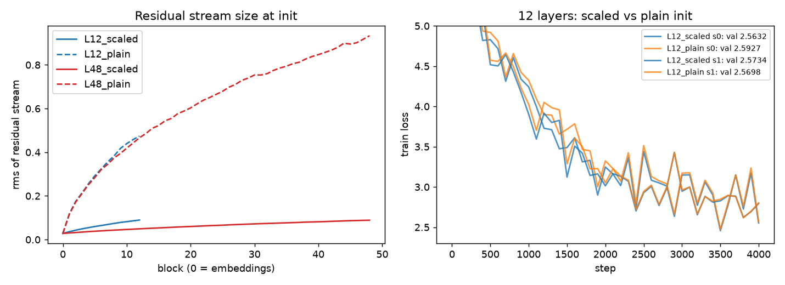
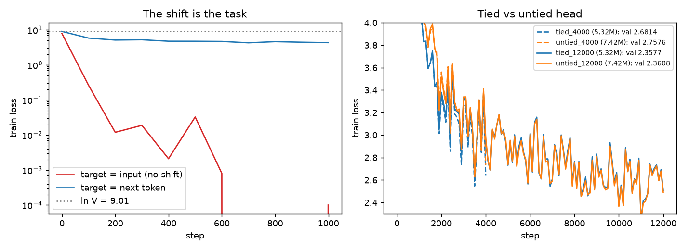

# Stage 06 — Assembling GPT

Stages 03 to 05 built the parts: token and position embeddings, attention, the
block. This stage puts them together into one complete model, the **GPT**
class, and proves it is right in the strongest way available to us: we load
OpenAI's real GPT-2 weights into our own code and check that it produces the
same numbers Hugging Face's GPT-2 does.

Once that check passes, every later stage can trust the model. A bug found in
Stage 11 after 40 hours of training will not be "is the model even wired
correctly?", because this stage answered that.

Five things are new here:

- the **whole forward pass**, from token ids to a loss;
- the **shift** between inputs and targets, which is the entire trick that
  turns "a network" into "a language model";
- **counting parameters by hand**, per component, and matching the count;
- **initialisation**: why every weight starts at std 0.02, and why some start
  smaller;
- **loading someone else's weights**, which is where naming and layout bugs
  live.

Shape letters as before: `B` batch, `T` tokens, `C` model width, `H` heads,
`L` layers (blocks), `V` vocabulary size.

---

## 1. The picture

```
 token ids   (B, T)          e.g. [[ 563, 1029,   40, 8192, ...]]
     │
     ▼
 wte[ids]    (B, T, C)       token embedding: one row per id        (Stage 03)
     +
 wpe[0..T-1] (T, C)          learned position embedding, broadcast  (Stage 03)
     │
     ▼
 ┌─────────┐
 │ block 1 │                 LayerNorm → attention → add            (Stage 04-05)
 │ block 2 │                 LayerNorm → MLP       → add
 │   ...   │
 │ block L │
 └─────────┘
     │       (B, T, C)       the residual stream
     ▼
 ln_f                        one last LayerNorm (pre-norm needs it, Stage 05 §4)
     │
     ▼
 lm_head     (B, T, V)       logits: one score per vocabulary entry, per position
     │                       (weights tied to wte: the same table, read backwards)
     ▼
 cross-entropy against the ids shifted left by one  →  one number, the loss
```

Every piece except the last line has been built and tested already. This stage
adds the outer frame and the loss, and names everything the way GPT-2 does so
real weights drop in.

---

## 2. The shift: the whole autoregressive trick

A language model is trained to answer one question at every position: **given
the tokens so far, what comes next?**

Take a 5-token window from the data:

```
data:      def   add   (    a    ,
position:   0     1    2    3    4
```

We feed the first four tokens as **input** and ask for the last four as
**targets**:

```
input:     def   add   (    a          ids[:, :-1]   (B, T)
target:    add   (     a    ,          ids[:, 1:]    (B, T)
```

At position 0 the model sees `def` and must predict `add`. At position 1 it
sees `def add` and must predict `(`. And so on. One window of `T+1` tokens
gives `T` separate training examples, all computed in one forward pass.

Two things make this work, and both are required:

1. **The shift.** Target at position `t` is the token at `t+1`.
2. **The causal mask** (Stage 04 §4). Position `t` cannot see positions after
   `t`. Without it, position 0 could look at position 1, which *is* its
   target.

**What breaks without the shift?** If target = input, position `t` is asked to
predict the token it is already looking at. The model learns to copy its input,
which is trivially easy: the loss heads towards zero. Then you try to generate
text, and it has never learned to predict anything new. We do this on purpose
in §8c and measure it.

**What breaks without the mask, keeping the shift?** Position `t` attends to
`t+1` and copies it. Same disaster, different route. Stage 04 already showed
this as a test.

The loss is the average of the `B × T` per-position cross-entropies:

```
logits  (B, T, V)  ─flatten→  (B·T, V)
targets (B, T)     ─flatten→  (B·T,)
loss = mean over B·T of  −log softmax(logits)[target]
```

At initialisation every logit is near zero, so softmax is close to uniform
and the loss is `ln V`. For our 8,196-token vocabulary that is **9.01**; for
GPT-2's 50,257 it is **10.82**. A first-step loss far from `ln V` means
something is wrong before training even started. (Stage 05 found one such
thing: a tied head nudges the loss down to 8.46 if you accidentally feed the
inputs as targets.)

---

## 3. Counting parameters by hand

A parameter count you cannot reproduce on paper is a number you do not
understand. Here is GPT-2 small: `V = 50,257`, `C = 768`, `L = 12`,
`T_max = 1,024`.

| Part | Formula | GPT-2 small |
|---|---|---|
| token embedding `wte` | `V·C` | 38,597,376 |
| position embedding `wpe` | `T_max·C` | 786,432 |
| per block: 2 LayerNorms | `2 · 2C` | 3,072 |
| per block: attention `c_attn` (q, k, v) | `C·3C + 3C` | 1,771,776 |
| per block: attention `c_proj` | `C·C + C` | 590,592 |
| per block: MLP `c_fc` | `C·4C + 4C` | 2,362,368 |
| per block: MLP `c_proj` | `4C·C + C` | 2,360,064 |
| **one block** | `12C² + 13C` | **7,087,872** |
| all 12 blocks | `L(12C² + 13C)` | 85,054,464 |
| final LayerNorm `ln_f` | `2C` | 1,536 |
| output head `lm_head` | tied: 0 | 0 |
| **total** | | **124,439,808** |

This is the "124M" in GPT-2 124M.

Three things to notice:

- **The `12C²` rule.** Attention has four `C×C` matrices (q, k, v, out); the
  MLP has two `C×4C` matrices, which is eight. Four plus eight is twelve. Every
  bias and norm together is `13C`, which is 0.14% of a block at `C = 768`.
- **The embedding is 31% of GPT-2 small.** 38.6M of 124.4M parameters are the
  token table. At small sizes the vocabulary dominates. This is why our 8,196
  vocabulary was worth choosing carefully (Stage 01 §9): with GPT-2's 50,257,
  a 30M-parameter model would spend 13M of it on the table at `C = 256`.
- **Tying saves `V·C`.** An untied head would add another 38.6M, a 31%
  increase, for a matrix that holds the same kind of information as `wte`
  (Stage 03 §2).

**Non-embedding parameters.** Scaling-law papers (Stage 10) count parameters
*without* the embeddings, because the table costs memory but almost no compute
per token (a lookup is not a matmul). GPT-2 small has 85.1M non-embedding
parameters. Keep both numbers in mind: memory sees all 124M, FLOPs mostly see
85M.

Our own Stage 05 model, `V = 8,196`, `C = 256`, `L = 4`, `T_max = 256`:

```
wte    8196·256                    = 2,098,176
wpe     256·256                    =    65,536
blocks 4·(12·256² + 13·256)        = 3,159,040
ln_f   2·256                       =       512
total                              = 5,323,264
```

The training runs in Stage 05 reported exactly 5,323,264. The test in this
stage checks the formula against `sum(p.numel())` for several shapes, so the
two can never drift apart.

---

## 4. Initialisation

Before training, every weight needs a starting value. "Random" is not enough;
the *size* of the random numbers decides whether training starts at all.

### 4a. Why std 0.02

GPT-2 draws every linear and embedding weight from a normal distribution with
standard deviation **0.02**, and sets biases to zero and LayerNorm gains to
one.

Where does 0.02 come from? A common rule (Xavier/Glorot) says a `C → C` matmul
keeps its input's size if weights have std `1/√C`. At `C = 768` that is
**0.036**; at `C = 1,600` (GPT-2 XL) it is 0.025. So 0.02 is "a bit smaller
than Xavier for every GPT-2 size", fixed once instead of recomputed per width.
It is a convention that works, not a law.

Why it matters: the LayerNorm before each sublayer rescales the input to size
1 anyway (Stage 05 §3), so the exact weight size mostly decides how *large
each block's edit to the residual stream is*. Small edits on a stream of size
~0.03 (the embedding) keep every block close to the identity at the start,
which is the calm starting point Stage 05 measured for pre-norm.

### 4b. The residual-scaled init: `std = 0.02 / √(2L)`

Each block adds two things to the residual stream: the attention output and the
MLP output. After `L` blocks, `2L` random contributions have been summed.

Sums of independent random numbers grow: the variance adds up, so the
standard deviation grows like `√(number of terms)`. With `2L` additions of
size `s` each:

```
rms(stream after L blocks) ≈ √( rms(embed)² + 2L · s² )
```

At `L = 12`, that is 24 additions, a √24 ≈ 4.9× growth in the part of the
stream that came from the blocks. At `L = 48` (GPT-2 XL), √96 ≈ 9.8×.

GPT-2's fix: scale the init of the two layers that **write into the residual
stream** (attention's `c_proj` and the MLP's `c_proj`) by `1/√(2L)`. Then the
total added variance is `2L · (s/√(2L))² = s²`, the same as **one** layer's
worth, whatever the depth.

```
std(c_proj) = 0.02 / √(2L)
  L =  4  →  0.0071
  L = 12  →  0.0041
  L = 48  →  0.0020
```

Why only those two? They are the last matmul before the `+`. Every other
weight's output goes through a norm or a nonlinearity before reaching the
stream, so its size is partly corrected on the way.

**What breaks without it?** In theory, a deep pre-norm network starts with a
residual stream dominated by noise from the blocks rather than the token
embedding, and the later blocks each see a slightly bigger stream, so their
relative edits are smaller (pre-norm divides by the stream size on the way
back, Stage 05 §4). In practice, for 12 layers at our scale, we predict the
effect is small: Stage 05 trained 24 pre-norm layers without it. §8b
measures both the starting stream and the final loss.

### 4c. What we do not do

The 2017 paper multiplied token embeddings by `√C` (Stage 05 §10c). GPT-2 does
not, and we do not either: with pre-norm, Stage 05 measured that it made no
difference (2.6852 → 2.6850 at 4 layers), and post-norm was the only design
that needed it.

---

## 5. Names, so real weights fit

Loading weights means matching every one of our tensors to one of theirs, by
name and by shape. The simplest way to make that boring and safe is to **use
GPT-2's names** in our own module:

```
transformer.wte.weight             (V, C)        token embedding
transformer.wpe.weight             (T_max, C)    position embedding
transformer.h.{i}.ln_1.weight/bias (C,)
transformer.h.{i}.attn.c_attn.*    (C, 3C)       q, k, v together
transformer.h.{i}.attn.c_proj.*    (C, C)
transformer.h.{i}.ln_2.weight/bias (C,)
transformer.h.{i}.mlp.c_fc.*       (C, 4C)
transformer.h.{i}.mlp.c_proj.*     (4C, C)
transformer.ln_f.weight/bias       (C,)
lm_head.weight                     (V, C)        = wte.weight (tied)
```

Hugging Face's file stores names without the `transformer.` prefix. Three
traps, two of which Stage 05 already met:

1. **`Conv1D` stores weights transposed.** GPT-2's original code used a
   "1-D convolution" that is a linear layer storing its weight as
   `(in, out)`. PyTorch's `nn.Linear` stores `(out, in)`. Every `c_attn`,
   `c_proj` and `c_fc` weight needs `.T`. The square `c_proj` in attention
   is the dangerous one: `(768, 768)` transposed has the same shape, so a
   missing `.T` raises no error and gives wrong numbers.
2. **The mask is stored as a weight.** Older checkpoints carry
   `attn.bias` and `attn.masked_bias`: not biases, but the causal mask
   saved as a buffer. They are not parameters and must be skipped.
3. **The head is tied.** The file has no separate `lm_head.weight`, or has
   one equal to `wte`. Copying `wte` and pointing the head at it is enough.

The loader in this stage refuses to finish if any of our parameters was not
filled, or any of theirs was not used. Silent partial loads are the classic
bug: a model with one block left at random init still produces plausible-
looking logits.

---

## 6. What "the same numbers" means

Our model and Hugging Face's are different code doing the same arithmetic in a
different order. In float32 they will not match bit for bit. Each matmul
rounds differently; 12 blocks of that compounds.

The test therefore asks for agreement within a tolerance, on real text:

- **max absolute difference of the logits** below `1e-3` (logits are of size
  ~100 for GPT-2, so this is a relative error near `1e-5`);
- **the same loss** to 4 decimal places;
- **the same argmax** at every position.

A wrong transpose or a missing layer gives differences of size 1 to 100, not
`1e-4`. The gap between "rounding" and "bug" is several orders of magnitude,
which is what makes this test useful.

---

## 7. Build order and acceptance criteria

`stages/06_gpt/gpt.py` holds the explicit version. `llmfs/model/gpt.py` holds
the same model in the form every later stage imports.

1. `GPTConfig` dataclass: `vocab_size, block_size, n_layer, n_head, n_embd,
   tie, scaled_init, flash`.
2. `GPT` with GPT-2's module names, our LayerNorm and attention.
3. `count_params_by_hand(cfg)` from the table in §3.
4. `GPT.from_pretrained("gpt2")` reading the safetensors file directly.

Acceptance criteria (as tests in `stages/06_gpt/test_gpt.py`):

- hand count = actual count, for GPT-2 small and five other shapes, tied and
  untied;
- GPT-2 small with real weights: logits match HF `GPT2LMHeadModel` within
  `1e-3`, loss to 4 decimals, identical argmax;
- the loader fails loudly on a missing or extra tensor;
- initial loss within 0.1 of `ln V` with random targets;
- `c_proj` weights have std `0.02/√(2L)` when `scaled_init` is on;
- the manual attention path and the `flash` (SDPA) path agree to `1e-5`;
- causality: changing token `t+1` does not change logits at `t`.

---

## 8. Experiments

### 8a. GPT-2 reproduced

`GPT.from_pretrained("gpt2")` builds our class, reads OpenAI's safetensors
file and copies 148 tensors in (four transposed per block, the mask buffers
skipped). On the test sentence in `test_gpt.py` (CPU, float32), our logits
match Hugging Face's `GPT2LMHeadModel` within `1e-3`, with the same argmax at
every position and the same loss to `1e-4`.

Then we ran both on 200 windows of our own validation code (about 650 GPT-2
tokens each), on the GPU. The largest logit difference was **0.055**. That is
50 times the test tolerance, so it looked like a bug.

It is not one. The same windows in **float64** differ by **2e-11**: the two
implementations compute the same function. In float32 our model is 0.015 away
from its own float64 answer on the worst window, and so is Hugging Face's.
The cause is what GPT-2 keeps in its residual stream:

```
max |value| in the residual stream, worst window, per block
embed   1     2     3      4      5      6    ...  11     12     after ln_f
  4.5  114   604  2479   2650   2796   2893  ...  3021   3023    405
```

From block 3 on, a few dimensions hold values near **3,000**, while typical
values are around 1. Float32 keeps about 7 significant digits, so a number
near 3,000 is stored to about `3e-4`. Every matmul that reads the stream
inherits that, and 12 blocks of different summation orders add it up. These
are **massive activations** (Sun et al. 2024): a handful of fixed dimensions
that trained transformers use as large constant offsets. They come back in
Stage 21, where they are why naive int8 quantization of activations fails.

The lesson for the test: a tolerance that holds on short text can fail on long
real text for a reason that is not a bug. The check that separates the two is
float64. Agreement to `1e-11` there means the arithmetic is identical.

**GPT-2's score on our data.** Loss per token cannot be compared across
tokenizers (GPT-2's 50,257 tokens are not ours), but **bits per byte** can:
total loss in bits divided by the bytes of text predicted. On the same 200
decoded windows:

| | GPT-2 124M (WebText) | bytes per token, ours |
|---|---|---|
| our val code | **1.394 bits/byte** | 3.13 |
| our val English (FineWeb-Edu) | **1.064 bits/byte** | 3.35 |

GPT-2 finds our English much easier than our code: WebText had little code.
§8d compares our own small model on identical text.

### 8b. Residual-scaled init

**At initialisation**, one real batch, size of the residual stream (rms) after
each block:

```
                 embed   block 1   block 4   block 8   block 12   block 48
L=12, plain      0.028    0.117     0.256     0.383     0.474        -
L=12, scaled     0.028    0.036     0.055     0.074     0.090        -
L=48, plain      0.028    0.115     0.251     0.374     0.467      0.933
L=48, scaled     0.028    0.030     0.037     0.043     0.049      0.089
```

With plain std 0.02 everywhere, the blocks' contributions swamp the token
embedding immediately: after one block the stream is 4× its starting size, and
after 12 blocks 17×. The token's own identity is a small fraction of what the
upper blocks see. With the `1/√(2L)` scaling, the stream grows 3.2× over 12
blocks and also 3.2× over 48: the depth-independence the derivation in §4b
promised. (It is not the "one layer's worth" growth exactly, because attention
outputs are not independent of each other, but the scaling with `L` is gone.)

**After training**, 12 layers, 4,000 steps, two seeds each:

| init | seed 0 | seed 1 | mean |
|---|---|---|---|
| plain std 0.02 | 2.5927 | 2.5698 | 2.581 |
| scaled `0.02/√24` | 2.5632 | 2.5734 | 2.568 |

A 0.013 advantage for the scaled init, about the size of the seed-to-seed
spread (0.010-0.023). As predicted in §4b: at 12 layers, pre-norm absorbs the
difference. The scaled runs were ahead early (step 100: 5.86/5.89 vs
6.05/6.05) and the gap closed. We keep the scaled init because it costs
nothing and its benefit grows with depth, not because we measured a big win.



### 8c. No shift

Same 4-layer model, 1,000 steps, with `target = input` instead of the next
token:

| | train loss at step 1000 | next-token val loss | copy-task val loss |
|---|---|---|---|
| no shift | **0.0001** | **21.86** | 0.0003 |
| with shift (normal) | 4.31 | 4.09 | - |

Without the shift, the loss collapses to zero by step 700: copying the token
you can see is trivial. On the real task, predicting the *next* token, the
same model scores **21.86**, far worse than guessing uniformly (9.01). It is
confidently wrong: it puts nearly all its probability on the current token,
which is almost never the next one. Its greedy output from `def add(a, b):`
is the last token of the prompt (an indent) repeated forever. The normal model
at the same 1,000 steps already writes `def get_to_to_to...`: bad, but
next-token bad.

The starting loss of the no-shift run was 7.90, not 9.01: Stage 05's tied-head
effect again (an untied model's logit for its own input token is not
favoured; a tied one's is).



### 8d. Tied vs untied head

The 4-layer model, `C = 256`, with and without a separate output matrix:

| | params | val loss, 4,000 steps | val loss, 12,000 steps |
|---|---|---|---|
| tied | 5,323,264 | **2.6814** | **2.3577** |
| untied | 7,421,440 (+39%) | 2.7576 (+0.076) | 2.3608 (+0.003) |

The untied head adds `V·C = 2,098,176` parameters, 39% more, and at 4,000
steps it is clearly **worse**: +0.076, the same gap Stage 03 measured (2.523
vs 2.598, +0.075). Stage 03 left open whether that gap was a lasting cost or
slow learning. At three times the training, it shrinks to **0.003**, inside
seed noise. So it is slow learning: an untied output matrix starts random and
must learn, from scratch, a table that a tied model gets for free from its
input embeddings. Given enough steps, it catches up, but no further. Tying is
the right default for small models on a budget: same final quality, 2.1M
fewer parameters, and much faster early progress.

**Ours vs GPT-2 on the same text.** Bits per byte on identical 256-token
windows (`run.py bpb`):

| bits per byte, 256-token windows | GPT-2 124M | ours, 5.3M, 12k steps |
|---|---|---|
| our val **code** | 1.522 | **1.066** |
| our val **English** | **1.122** | 1.774 |

Our model has 23× fewer parameters and was trained for 12 minutes, and it
spends **30% fewer bits** on our code than GPT-2. On English, GPT-2 is far
ahead. Neither result is surprising once said out loud: GPT-2 saw 40 GB of web
text and very little Python; ours saw ~100M tokens drawn 85% from *this*
code distribution (the val split is held out, but from the same sources).
Specialisation beats size on the specialist's home ground. It is also a
warning for later stages: a small in-domain model can look strong on
in-domain loss and still know almost nothing. (These windows are shorter than
§8a's, so GPT-2's numbers here are higher: less context per prediction.)

---

## 9. What we found

| Question | Answer, measured |
|---|---|
| Does our GPT equal GPT-2? | Yes. Logits match HF within 1e-3 on short text; on long real text the fp32 gap reaches 0.055, and float64 shows it is rounding (2e-11) |
| Why the fp32 gap? | GPT-2's residual stream holds values near 3,000 from block 3 on: massive activations |
| Does the hand count hold? | 124,439,808 for GPT-2 small; equal to `numel()` for 10 shapes, tied and untied |
| What does the scaled init change? | At init, stream growth over depth goes from 17× (12 layers) / 33× (48) to 3.2× at both. After training, 12 layers: −0.013, within seed noise |
| What happens without the shift? | Train loss → 0.0001; next-token loss 21.86, worse than uniform (9.01); greedy output repeats the last token |
| Tied vs untied? | Untied: +39% parameters, +0.076 worse at 4k steps, +0.003 at 12k. The Stage 03 penalty is slow learning, not a lasting cost |
| Ours vs GPT-2? | On our code, our 5M model needs 1.07 bits/byte, GPT-2 124M 1.52. On English, GPT-2 wins 1.12 to 1.77 |

Two habits from this stage:

- **When implementations disagree, go to float64 before going bug-hunting.**
  The difference between "rounding" and "bug" is many orders of magnitude,
  but only once rounding is taken out of the picture.
- **Quote numbers from results files, not memory.** The first draft of §4c
  misquoted a Stage 05 result by 25× (journal).
