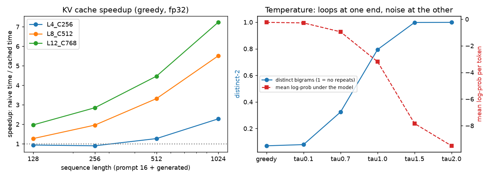

# Stage 07 — Generation and Decoding

Until now our models have only ever been *scored*: give it text, measure how
surprised it is. A language model is only useful once it *writes*. This stage
turns the model's output, a score for every vocabulary entry, into text. It
also makes that fast, using the **KV cache**.

What is in this stage:

- the **autoregressive loop**: predict one token, append it, repeat;
- **greedy** decoding and why it goes wrong;
- **temperature**, **top-k**, **top-p** and the **repetition penalty**: the
  knobs on every LLM API;
- the **KV cache**: why the simple loop redoes almost all its work, how to
  stop that, and what it costs in memory;
- **prefill** vs **decode**, the two phases that Stage 23 builds on.

Shape letters: `B` batch, `T` tokens, `C` width, `H` heads, `d = C/H`, `L`
layers, `V` vocabulary.

---

## 1. The loop

The model gives, at every position, a score (a **logit**) for every possible
next token. To write, we only need the scores at the **last** position:

```
prompt ids     [def, ␣add, (, a]                        (1, 4)
  model        → logits (1, 4, V)
  take last    → logits[:, -1]   (1, V)  "what follows 'a'?"
  pick a token → ","                                     how? §2-§5
  append       → [def, ␣add, (, a, ,]                    (1, 5)
  model again  → logits (1, 5, V) ...
```

One token per step, each step feeding on everything written so far. That is
what **autoregressive** means: the output becomes the next input.

When does it stop? Three reasons, checked every step:

1. the model picks the end-of-text token (id 8192 for us);
2. a length limit is reached (`max_new_tokens`, or the position table runs
   out: our models have learned positions only up to `block_size`);
3. a stop string appears (for code: a blank line followed by `def`, which
   means the function is finished).

---

## 2. Greedy: always take the top score

The obvious choice: pick `argmax(logits)`, the single most likely token. It is
deterministic and needs no random numbers.

It is also bad, in a specific way. A model trained on lots of text knows that
after `return x` a newline is likely, after the newline `return` is likely
again... The most likely next token, chosen again and again, falls into
**loops**:

```
def get_to_to_to_to_to_to_to_to_to_to_to_to_to_to ...
```

That line is real. It is the greedy output of our 1,000-step Stage 06 model.

Why loops? Once a phrase has appeared, the model's own context makes it more
likely to appear again: repeating what is in the context is one of the first
patterns a language model learns (Stage 04 found a "previous-token" head
early). Greedy has no way to step off the loop, because there is no
randomness to step off with.

There is a deeper reason too. **The single most likely sequence is not a
typical sequence.** Human text is full of slightly surprising words. Always
choosing the least surprising one gives text that is flat and repetitive,
and nothing like the text the model was trained on.

---

## 3. Sampling, and temperature

Instead of taking the top token, **draw** one at random, with each token's
chance equal to its softmax probability:

```
p = softmax(logits)            (V,)  sums to 1
next = random choice with probabilities p
```

Now a token with probability 0.3 is chosen 30% of the time. The output looks
like the training data, surprises included.

**Temperature** controls how adventurous the draw is. Divide every logit by a
number `τ` before the softmax:

```
p = softmax(logits / τ)
```

A worked example with three tokens, logits `[2.0, 1.0, 0.0]`:

| τ | logits / τ | probabilities |
|---|---|---|
| 0.1 | [20, 10, 0] | [1.0000, 0.0000, 0.0000] |
| 0.5 | [4, 2, 0] | [0.867, 0.117, 0.016] |
| 1.0 | [2, 1, 0] | [0.665, 0.245, 0.090] |
| 2.0 | [1, 0.5, 0] | [0.506, 0.307, 0.186] |

- **τ → 0**: the top token takes all the probability. This *is* greedy.
- **τ = 1**: the model's own distribution, unchanged.
- **τ → ∞**: every token equally likely. Pure noise.

Why dividing works: softmax depends only on *differences* between logits.
Dividing by τ shrinks (τ > 1) or stretches (τ < 1) every difference by the
same factor.

**What breaks at each end?** Low temperature brings back greedy's loops. High
temperature samples tokens the model thinks are nearly impossible. One bad
token derails everything after it, because each step feeds on the last. §8c
catalogues both on our model.

---

## 4. Top-k and top-p: cut off the tail

Even at τ = 1 there is a problem. A vocabulary of 8,196 tokens has thousands
of tokens that each get a tiny probability, say 0.00005. Individually they
almost never get picked. Together they can hold 5-10% of the probability, so
roughly every 15th token is drawn from "things the model thinks are nonsense".

The fix is to **delete the tail** before drawing.

**Top-k:** keep the `k` highest-scoring tokens, set the rest to `-∞`, then
softmax.

```
logits  [5.1, 4.9, 2.0, 1.1, 0.3, ...]   k = 2
kept    [5.1, 4.9, -∞,  -∞,  -∞, ...]   → only two tokens can be drawn
```

The weakness: a fixed `k` is wrong in both directions. After `import` there
may be 200 sensible next tokens; after `for i in ran` there is one (`ge`).
`k = 40` cuts off good options in the first case and lets 39 bad ones in the
second.

**Top-p (nucleus sampling)**, Holtzman et al. 2019: sort tokens by
probability, keep the smallest set whose probabilities add up to at least
`p`, drop the rest.

```
sorted probs   0.62  0.21  0.09  0.04  0.02  ...    p = 0.9
running sum    0.62  0.83  0.92  ...
kept           ✓     ✓     ✓      (0.92 ≥ 0.9, stop)   → 3 tokens
```

When the model is confident, the nucleus is one or two tokens. When it is
unsure, the nucleus is wide. The cut adapts to the situation, which top-k
cannot do.

An implementation detail that is easy to get wrong: the token that *crosses*
the threshold must be kept. Otherwise a single token with probability 0.95
would be dropped at `p = 0.9`, leaving nothing. The test checks this case.

---

## 5. The repetition penalty

A blunt instrument against loops (Keskar et al. 2019, the CTRL paper): for
every token already in the context, make its logit less attractive:

```
logit > 0  →  logit / penalty
logit < 0  →  logit · penalty          penalty ≈ 1.1 – 1.3
```

The two cases exist because dividing a *negative* logit by 1.2 would move it
up, making it *more* likely. Multiplying moves it down.

For code this needs care. Code is *supposed* to repeat: variable names,
`self`, indentation, closing brackets. A strong repetition penalty makes a
model avoid writing `x` a second time in `x = x + 1`. We measure it rather
than assume it helps.

---

## 6. The KV cache

### 6a. The waste in the simple loop

Each step of the loop in §1 runs the model on the **whole** sequence so far,
then throws away everything except the last position's logits. To write token
500, it recomputes attention, MLPs and everything else for tokens 1-499,
exactly as it did one step earlier.

Count the work. Writing `N` tokens one step at a time processes
`1 + 2 + ... + N ≈ N²/2` token-positions in total, where only `N` were needed.
At `N = 512` that is 256× more positions than necessary.

### 6b. What actually changes between steps

Look at what a new token needs. In each layer, its query `q` must be compared
with the **keys** `k` of every earlier token, and it averages their
**values** `v` (Stage 04 §2). The earlier tokens' keys and values **do not
change** when a new token arrives. The causal mask guarantees it: no token
can look forward, so nothing about token 3 depends on token 500.

So we can compute each token's `k` and `v` **once**, store them, and reuse
them forever. That store is the **KV cache**.

```
step t (one new token):
   x_t  (B, 1, C)
   q_t, k_t, v_t = c_attn(x_t)        only the new token's three vectors
   cache.k[:, :, t] = k_t             append
   cache.v[:, :, t] = v_t
   attend q_t over cache.k[:, :, :t+1]   (B, H, 1, d) vs (B, H, t+1, d)
   → one row of attention, not a T×T matrix
```

The queries are not cached: each query is used once, by its own token, at the
step it is made.

### 6c. Prefill and decode

Generation now has two phases:

- **Prefill.** Run the whole prompt at once (an ordinary forward pass over
  `T` tokens), filling the cache. Many tokens at a time keeps the GPU busy:
  this phase is limited by **compute**.
- **Decode.** One token per step. Each step does very little arithmetic
  (`B` tokens, not `B·T`), but must read every weight and the whole cache
  from GPU memory. This phase is limited by **memory bandwidth**, not
  arithmetic.

That split is the central fact of LLM serving (Stage 23). Time to first token
is mostly prefill; time per output token is mostly decode.

### 6d. What the cache costs

Per token, the cache holds one `k` and one `v` vector of width `C` per layer:

```
bytes per token = 2 (k and v) · L · C · bytes per number
```

| Model | L | C | per token (bf16) | 1,024 tokens | 32k tokens |
|---|---|---|---|---|---|
| ours, Stage 05 | 4 | 256 | 4 KB | 4 MB | 128 MB |
| workhorse | 8 | 512 | 16 KB | 16 MB | 512 MB |
| GPT-2 small / capstone | 12 | 768 | 36 KB | 36 MB | 1.1 GB |
| Llama 2 7B (MHA) | 32 | 4096 | 512 KB | 512 MB | 16 GB |

For a 7B model at long context, the cache is bigger than the weights. That is
why Stage 12's GQA and Stage 14's MLA exist: both shrink this number.

### 6e. A subtle trap: the outputs must be identical

A KV-cache decoder is the same mathematics as the simple loop, reorganised.
At a fixed random seed it must produce the **same tokens**. If it does not,
the cache has a bug. The most common ones:

- the new token gets position 0 instead of position `t` (positions must come
  from the cache length, not from the new chunk's length);
- the causal mask during a multi-token prefill after a cache already exists
  (each new query must see the old keys plus the new ones up to itself);
- writing into the cache at the wrong offset.

Floating point is the honest caveat. Computing attention for one query
against `t` keys sums numbers in a different order than computing it as one
row of a `T×T` matrix, so the logits differ at the `1e-6` level. With greedy
decoding that almost never changes a token. With sampling it can, if a random
draw lands right on a boundary. The test compares logits within a tolerance,
and the experiment compares sampled tokens at a fixed seed.

---

## 7. Build order and acceptance criteria

`stages/07_generation/sample.py` (the explicit version), with the cache in
`llmfs/model/gpt.py` (`KVCache`, `forward(..., cache=...)`).

- `apply_temperature`, `top_k_filter`, `top_p_filter`,
  `apply_repetition_penalty`, `sample_next`;
- `generate_naive(model, ids, n)`: the loop of §1;
- `generate_cached(model, ids, n)`: prefill then decode with the cache.

Acceptance criteria (`test_sample.py`):

- temperature matches the worked table in §3;
- top-k keeps exactly k tokens; top-p keeps the crossing token, and a single
  0.95 token survives p = 0.9;
- repetition penalty moves negative and positive logits both *down*;
- cached logits equal full-recompute logits within 1e-4 at every step;
- cached and naive generation give identical tokens greedily, and at a fixed
  seed with sampling;
- generation stops on end-of-text.

---

## 8. Experiments

### 8a. KV-cache speedup

Randomly initialised models (speed does not depend on training), batch 1,
fp32, a 16-token prompt, greedy decoding to the total length shown. The
naive loop already uses `last_only` (it only computes the output head for the
last position), so the comparison isolates the cache.

| model | length 128 | 256 | 512 | 1,024 | cached tokens/s |
|---|---|---|---|---|---|
| 4 layers, C=256 (5M) | 0.94× | 0.90× | **1.27×** | 2.28× | ~1,420 at every length |
| 8 layers, C=512 (30M) | 1.27× | 1.96× | **3.32×** | 5.51× | ~750 → 655 |
| 12 layers, C=768 (92M) | 1.97× | 2.85× | **4.47×** | 7.23× | ~427 → 306 |

At every one of the 36 settings, the cached decoder produced **exactly the
same tokens** as the naive loop, greedy and sampled at a fixed seed.

The curriculum's expectation of "5-20× at length 512" is not met: we see 1.3×
to 4.5×. The reason is in the last column. For the 4-layer model, cached
decoding runs at ~1,420 tokens/s **whatever the length**: 0.7 ms per token, a
fixed cost. That is the cost of *launching* dozens of small GPU kernels from Python
for one token, not of doing arithmetic. The naive loop, meanwhile, recomputes
up to 1,024 positions per step, but a GPU processes 1,024 positions of a
5M-parameter model almost as fast as one: it was idle anyway. So the
"wasted" `N²/2` work of §6a is real, but at this size it is nearly free,
and the cache saves something that was barely costing anything.

The speedup grows with the model (more arithmetic per position, so
recomputation hurts more) and with length (more positions to recompute).
The 92M model at length 1,024 gets 7.2×. For a 7B model the cached step is
dominated by reading the weights, and the cache's advantage is the
10-100× of the textbook. Stage 09 (fused kernels) and Stage 23 (batching
several requests per step) attack the fixed per-step overhead that dominates
here.

### 8b. Cache memory, measured

Extra GPU memory during cached generation (fp32 cache), against the formula
`2 · L · C · 4 bytes · tokens` from §6d:

| model | tokens | formula | measured peak extra |
|---|---|---|---|
| 4L, C=256 | 1,024 | 8.39 MB | 8.70 MB |
| 8L, C=512 | 1,024 | 33.55 MB | 34.18 MB |
| 12L, C=768 | 1,024 | 75.50 MB | 76.43 MB |

The formula accounts for all but 0.3-0.9 MB, which is the logits and the
temporaries of one decode step.

### 8c. Temperature 0.1 / 1.0 / 2.0, and the other knobs

The Stage 06 4-layer model (12k steps), four prompts × five seeds, 200
tokens each. Two numbers per setting: **distinct-2**, the fraction of
adjacent token pairs that are unique (1.0 = never repeats a pair, low =
loops), and the **mean log-probability** the model itself assigns to what it
wrote (close to 0 = very predictable to itself; −9 = uniform guessing).

| setting | distinct-2 | mean log-prob | parses as Python |
|---|---|---|---|
| greedy | 0.07 | −0.24 | 25% |
| τ = 0.1 | 0.08 | −0.28 | 20% |
| τ = 0.7 | 0.32 | −0.95 | 5% |
| τ = 1.0 | 0.79 | −3.19 | 0% |
| τ = 1.5 | 1.00 | −7.83 | 0% |
| τ = 2.0 | 1.00 | −9.51 | 0% |
| τ = 1.0, top-k 40 | 0.53 | −1.56 | 0% |
| τ = 1.0, top-p 0.9 | 0.65 | −2.34 | 0% |
| τ = 0.7, repetition 1.3 | 0.94 | −2.84 | 0% |
| greedy, repetition 1.3 | 0.54 | −0.84 | 0% |

What each end looks like, from `def is_prime(n):`:

```
greedy:       def is_prime(n):
                  return n

              def is_prime(n):
                  return n
              ... (the same three lines until the budget runs out)

τ = 2.0:      self. supported future()Reader elementFilesXRowEndallements function
                    defabspathety kwargsStream txNoPoonent OutLoader records...
```

- **Low temperature loops.** Greedy and τ = 0.1 are almost identical: at
  τ = 0.1 the top token takes nearly all the probability (§3's table).
  Distinct-2 of 0.07 means 93% of token pairs are repeats. The mean
  log-prob of −0.24 says the model finds its own loop extremely likely: each
  repetition makes the next one more likely, the trap of §2.
- **High temperature is noise.** At τ = 2.0 the mean log-prob is −9.5, worse
  than uniform guessing over the vocabulary (−9.01): the model is mostly
  drawing from the tail of near-impossible tokens. Every pair is new, and none
  of it is code.
- **"Parses" is a trap metric.** The greedy loop parses 25% of the time,
  higher than any sampled setting, because `def is_prime(n): return n`
  repeated is valid Python. Validity is not quality.
- **Truncation works as advertised**: top-k 40 and top-p 0.9 at τ = 1.0 cut
  the mean surprise from −3.19 to −1.56 and −2.34 while keeping most of the
  variety.
- **The repetition penalty breaks loops and makes things up.** Greedy with
  penalty 1.3 escapes the `is_prime` loop and writes a plausible-looking test
  class, but every reused name is now penalised, so it invents new ones.

A 5M model does not write working code at any setting, so this measures
the knobs, not the model. The same table is worth repeating on the Stage 11
models (Stage 22 uses greedy for pass@1 and τ = 0.8 for pass@10).



---

## 9. What we found

| Question | Answer, measured |
|---|---|
| Is the cached decoder exact? | Same tokens as the naive loop in all 36 settings, greedy and sampled |
| KV-cache speedup at length 512? | 1.27× (5M), 3.32× (30M), 4.47× (92M); 7.2× for 92M at 1,024 |
| Why below the 5-20× expectation? | Batch-1 decoding of small models is bound by a fixed per-step overhead (~0.7 ms of kernel launches and Python), not by arithmetic |
| Does the cache cost what §6d says? | Within 0.3-0.9 MB of `2·L·C·bytes·T` |
| Low temperature? | Loops: distinct-2 0.07, log-prob −0.24 |
| High temperature? | Noise: log-prob −9.5, worse than uniform |
| Does "parses as Python" measure quality? | No: the greedy loop parses most often |

One habit from this stage: **measure where the time goes before believing a
speedup estimate.** Counting FLOPs predicted a large win; the GPU was not
limited by FLOPs.
