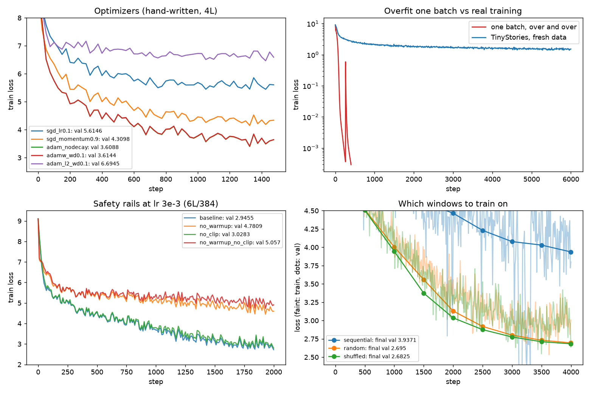

# Stage 08 — The Training Loop

Every stage so far trained small models with a short loop copied from stage to
stage. It worked, but it was never explained. This stage opens it up. The
training loop is where most silent bugs in deep learning live: a model with a
broken loop still produces a falling loss curve, just a worse one, and nothing
crashes to tell you.

What is in this stage:

- the optimizer, built up from **SGD** to **Adam** to **AdamW**, written by
  hand and checked against PyTorch's;
- what Adam's two state tensors *are*;
- the **learning-rate schedule**: warmup, then cosine decay, and why each part
  exists;
- **gradient clipping**;
- **gradient accumulation**: a large batch on 8 GB;
- the two mandatory sanity checks: **the loss at step 0**, and **overfitting
  one batch**;
- a 10M-parameter model on **TinyStories**, the fast smoke test that makes a
  broken loop obvious in 20 minutes;
- the ablations: no warmup, no clipping, and three ways of choosing which
  windows of data to train on.

The loop built here, `llmfs/train/trainer.py`, is the one every later stage
uses, including the 125M capstone run.

---

## 1. The loop in one picture

```
            ┌──────────────────────────────────────────────────────────┐
            │  for step in range(steps):                               │
            │      lr = schedule(step)                 §4              │
            │      for micro in range(accum):          §6              │
            │          x, y = next batch               (B, T) each     │
            │          loss = model(x, y) / accum      forward         │
            │          loss.backward()                 grads add up    │
            │      clip grads to norm 1.0              §5              │
            │      optimizer.step()                    §2-§3           │
            │      zero grads                                          │
            │      every N steps: eval, log, checkpoint                │
            └──────────────────────────────────────────────────────────┘
```

Each line is a decision. Each one, done wrong, gives a model that still
trains, only worse.

---

## 2. From SGD to Adam

### 2a. SGD: walk downhill

The gradient `g` of the loss with respect to a weight `θ` says which direction
increases the loss, and how steeply. Stochastic gradient descent steps the
other way:

```
θ ← θ − lr · g
```

"Stochastic" because `g` is computed on one batch, not the whole dataset, so
it is a noisy estimate of the true direction.

Two problems with plain SGD on a transformer:

1. **One learning rate for very different weights.** An embedding row for a
   rare token gets a gradient once every thousand batches; a LayerNorm gain
   gets one every step. Gradient sizes across a transformer's weights differ
   by factors of 100 or more. A learning rate small enough for the big ones
   barely moves the small ones.
2. **Noise.** Each batch's gradient points in a slightly different direction.
   Steps zigzag.

### 2b. Momentum: average the direction

Keep a running average of recent gradients, and step along that:

```
m ← β₁ · m + (1 − β₁) · g          β₁ = 0.9: roughly the last 10 steps
θ ← θ − lr · m
```

The zigzags cancel in the average; the consistent direction adds up. This is
Adam's **first state tensor**, `m`: one number per weight, the same shape as
the weights.

### 2c. Adam: a learning rate per weight

Also keep a running average of the **squared** gradient:

```
v ← β₂ · v + (1 − β₂) · g²          β₂ = 0.95 for us (0.999 in the paper)
```

`√v` is the typical size of this weight's gradient. Dividing by it puts every
weight's step on the same scale:

```
θ ← θ − lr · m / (√v + ε)
```

A weight whose gradients are always tiny gets the same size of step as one
whose gradients are large. That fixes problem 1. `v` is Adam's **second state
tensor**. Together `m` and `v` are why Adam costs 8 extra bytes per parameter
in fp32 (Stage 00 measured 96 MB of optimizer state for a 12.6M model).

**Bias correction.** `m` and `v` start at zero, so for the first few steps
they are too small: after one step, `m = 0.1 · g`. Adam divides by
`1 − β^t` to undo that:

```
m̂ = m / (1 − β₁ᵗ)      v̂ = v / (1 − β₂ᵗ)
θ ← θ − lr · m̂ / (√v̂ + ε)
```

At step 1, `m̂ = g` and `v̂ = g²`, so the update is `lr · g/|g| = ± lr` for
**every** weight. Every weight moves by the full learning rate, whatever its
gradient. Keep that in mind for §4.

Why β₂ = 0.95 rather than the paper's 0.999? A longer average (0.999 ≈ the
last 1,000 steps) reacts slowly when gradients suddenly grow, so the step
`m/√v` can briefly become very large. That is a known source of loss spikes in
large language models. 0.95 (the last ~20 steps) is the GPT-3 / Llama choice.

### 2d. AdamW: weight decay, done right

**Weight decay** pulls every weight slightly towards zero each step. It stops
weights from growing without limit and acts as a mild regulariser.

The old way to do it was to add an L2 penalty `½ · wd · θ²` to the loss. Its
gradient is `wd · θ`, which joins `g`... and then goes through Adam's division
by `√v`. So a weight with large gradients gets *less* decay, and one with small
gradients gets *more*. The decay strength now depends on the gradient
history, which nobody asked for.

**AdamW** (Loshchilov & Hutter, 2019) **decouples** the decay. It shrinks the
weight directly, outside Adam's normalisation:

```
θ ← θ − lr · wd · θ                 decay: the same fraction for every weight
θ ← θ − lr · m̂ / (√v̂ + ε)          Adam step
```

Which weights get decay? Matrices (linear weights, embeddings) do; **biases and
LayerNorm gains do not**. A LayerNorm gain of 1 is a meaningful value; pulling
it towards 0 shrinks the signal at every layer. Biases are few and cheap. Our
loop puts every tensor with `dim ≥ 2` in the decay group and the rest in a
no-decay group.

§8a checks our hand-written AdamW against `torch.optim.AdamW`, step by step,
and shows how far L2-in-the-loss drifts from it.

---

## 3. What the numbers are

Our settings, kept from Stage 03 onwards and now explained:

| Setting | Value | Why |
|---|---|---|
| β₁ | 0.9 | momentum over ~10 steps |
| β₂ | 0.95 | second moment over ~20 steps: reacts fast to gradient growth (§2c) |
| ε | 1e-8 | avoids divide-by-zero; small next to any real `√v` |
| weight decay | 0.1 | GPT-3 / Llama value |
| peak lr | 1e-3 (small models), 6e-4 (124M) | smaller models tolerate larger steps |
| warmup | 100-2,000 steps | §4 |
| min lr | 10% of peak | §4 |
| clip | 1.0 | §5 |

---

## 4. The learning-rate schedule

```
lr
 │      ╭──────╮
 │     ╱        ╲___
 │    ╱             ╲___
 │   ╱                  ╲____
 │  ╱                        ╲______  ← 10% of peak
 │ ╱
 └─┴──────────────────────────────────── step
   warmup        cosine decay
```

**Warmup: start small, grow linearly to the peak.** Three reasons:

1. **Step 1 moves every weight by ±lr** (§2c). At lr = 1e-3, every weight,
   most of which have std 0.02, moves 5% of its typical size in the same
   step, regardless of how informative its gradient was.
2. **`v` is a poor estimate early.** With β₂ = 0.95 it averages about 20
   steps; for the first few it is based on one or two noisy gradients. A
   weight that happened to get a small gradient early gets a huge effective
   step `m/√v` later.
3. **The early landscape is the steepest.** At init the loss is 9 and falling
   fast; gradients are large and change direction quickly.

Warmup lets `v` fill up and the model leave the steep region before full-size
steps begin. **What breaks without it:** the loss jumps in the first hundred
steps, sometimes recovers, sometimes settles on a worse path. §8d measures it.

**Cosine decay: end small.** Near the end of training, the model is near a
good point, and large steps jump around it rather than settling in. Lowering
the learning rate lets it settle. The cosine shape spends a long time near the
peak (fast progress) and then drops smoothly:

```
lr(t) = min + (peak − min) · ½ (1 + cos(π · progress))
```

Most of the final loss improvement in a run comes from this decay. We stop at
10% of peak rather than 0, which is the Chinchilla convention.

---

## 5. Gradient clipping

Sometimes one batch produces a gradient much larger than usual: an unusual
document, a rare token, a sharp spot in the loss landscape. Adam's
normalisation absorbs some of it, but `v` adapts over ~20 steps, so one huge
gradient still gives one huge step.

**Clipping by global norm** caps the size of the whole gradient, all
parameters together, viewed as one long vector:

```
norm = √( Σ over every parameter of Σ g² )
if norm > 1.0:  g ← g · (1.0 / norm)        same direction, capped length
```

It keeps the direction and limits the length. In a healthy run the norm sits
below 1 most of the time, and clipping only acts on the rare spikes. If the
norm is above the threshold on *most* steps, the threshold is effectively a
second learning rate, which is worth knowing. We log the norm every step so
we can see which case we are in.

---

## 6. Gradient accumulation: a big batch on a small GPU

The batch size that trains well (hundreds of thousands of tokens per step for
a 125M model) does not fit in 8 GB. Activations for `B = 32, T = 1024` in a
125M model are several GB on their own.

But a gradient is an **average** over the examples in the batch, and averages
can be computed in pieces. Run 4 micro-batches of 8, call `.backward()` on
each, and PyTorch **adds** the gradients into `.grad`. Divide each
micro-batch's loss by 4 first, and the sum of four quarter-gradients is the
average over all 32:

```
∇ (L₁ + L₂ + L₃ + L₄)/4  =  (∇L₁ + ∇L₂ + ∇L₃ + ∇L₄)/4
```

That is the same gradient a batch of 32 gives, with only 8 sequences' worth of
activations in memory at once. It costs time, not quality: four forward and
backward passes for one optimizer step.

**The trap:** forgetting to divide by the number of micro-batches. Then the
gradient is 4× too large, which is like a 4× learning rate. Clipping hides
most of it, so the run still trains. §8a tests that accumulated gradients
equal one big batch to float precision.

---

## 7. Sanity checks before trusting a run

**Check 1: the loss at step 0** should be `ln V` (9.01 for us) with random
targets (Stage 06 §2). Too high: the init is too big, logits are not near
zero. Too low: something leaks information about the target.

**Check 2: overfit one batch.** Take a single batch and train on it, over and
over. A model with millions of parameters can memorise 8 sequences, so the
loss must go to almost zero. If it does not, something between the data and
the weights is broken: the shift, the mask, the optimizer, the learning rate,
`zero_grad`. This test takes seconds and catches most loop bugs. It is the
first thing to run on any new training code.

**Check 3: the smoke test.** A small model on easy data, where the output
can be judged by eye. That is TinyStories (§8c): short children's stories
with a vocabulary a 3-year-old knows. A working 10M model writes grammatical
little stories after ~20 minutes. A broken loop writes word salad, and you
see it before wasting a day on code data.

### Reading a loss curve

| Shape | Usual cause |
|---|---|
| flat at `ln V` | no learning: lr 0, frozen params, detached graph |
| drops fast, then flat high | lr too low, or the model learned only unigram statistics (Stage 05 found 6.86) |
| jagged, loss jumps up then recovers | lr too high, no warmup, no clipping |
| goes to NaN | overflow (fp16 without loss scaling), lr far too high, log of zero |
| train falls, val rises | overfitting: too many epochs on too little data |
| sudden drop at a batch boundary | data order: one source after another, not mixed |

---

## 8. Experiments

### 8a. AdamW by hand, and gradient accumulation

**Correctness.** Our `AdamW` (`stages/08_training/optim.py`) against
`torch.optim.AdamW`, 25 steps on a small GPT, same data:

- in float32 the weights drift apart to **2e-4**;
- in float64, **4e-13**.

The float32 gap is the same story as Stage 06 §8a: identical arithmetic in a
different order rounds differently, and training amplifies small
differences. Adam is especially sensitive, because it *divides* by `√v`:
a weight whose gradient is near zero gets a step of size `±lr` from a
tiny, rounding-dominated gradient. The test runs in float64.

Gradient accumulation: four micro-batches of 2 with the loss divided by 4
give the same gradients as one batch of 8 to `1e-6`. Without the division, the
gradient is exactly 4.0× too large (`test_accumulation_without_divide_is_4x`).

**Five optimizers, same model and data.** The 4-layer model, 1,500 steps,
B=32, T=256, all with the same warmup + cosine schedule and clipping, using
our hand-written versions:

| optimizer | val loss | weight norm (matrices) |
|---|---|---|
| SGD, lr 0.1 | 5.615 | 41.6 |
| SGD + momentum 0.9 | 4.310 | 48.5 |
| Adam, no decay | 3.609 | 103.7 |
| **AdamW**, decay 0.1 | 3.614 | 98.7 |
| Adam + L2 in the loss, 0.1 | **6.695** | **1.4** |

- **Momentum** is worth 1.3 nats here: plain SGD zigzags.
- **Adam** is worth another 0.7 over momentum, from per-weight step sizes.
  SGD at lr 0.1 moves the big-gradient weights reasonably and barely moves
  the rest (§2a, problem 1).
- **AdamW vs Adam** at 1,500 steps: the same loss within 0.006. Decoupled
  decay of 0.1 shrinks the weights by 5% over this short run, with no effect
  on loss yet. Its job is long-run regularisation, not early speed.
- **L2 in the loss at the same 0.1 is a disaster**: val loss 6.69, close to
  the unigram floor of 6.86 (Stage 05), and the weights collapse to a norm of
  1.4. The penalty's gradient `0.1·θ` is the same sign for a weight step
  after step, so Adam's normalisation turns it into a steady step of about
  `lr` towards zero for **every** weight, a far stronger pull than intended.
  Coupled L2 needs a coefficient hundreds of times smaller with Adam. AdamW's
  decoupling is not a refinement; at the same number it is a different
  algorithm.

### 8b. Overfitting one batch

One batch of 8 sequences × 256 tokens, the 4-layer model, lr 1e-3, trained
on repeatedly:

```
step    0: 9.029     (ln V = 9.01: initialisation is right)
step   50: 2.985
step   72: < 1.0
step   96: < 0.1
step  129: < 0.01
step  399: 0.0003
```

5.3M parameters memorise 2,048 tokens in about 130 steps. The loop, the
shift, the mask and the optimizer are wired correctly. This check takes 10
seconds, and it is the first thing to run on any new training code.

It also produced the only true **loss spike** of this stage, unasked:

```
step  255     256     257     258     259     260     261     262     270     290
loss  0.00038 0.00037 0.00036 0.00036 0.00579 0.57919 0.44423 0.58706 0.06283 0.00674
```

A 1,600× jump in two steps, and 30 steps to recover. Nothing in the data
changed: it is the same batch every step. The cause is Adam itself (§2c).
As the loss approaches zero, the gradients become tiny and noisy, and so does
`v`, the running average of their squares. The step is `m/√v`: a tiny
gradient divided by the root of a tiny average is **not** a tiny step. It is
about `±lr` for every weight, in directions set by noise. Constant lr 1e-3,
no clipping and no schedule here, so nothing damps it. This is the mechanism
behind many late-training spikes in real runs, where some weights' gradients
become small. It is one reason for the cosine decay, and for `ε` not being
vanishingly small in some recipes.

### 8c. The TinyStories smoke test

10,103,040 parameters (6 layers, C=320, 5 heads), our code tokenizer, 2 of 4
TinyStories train shards (313M tokens), 6,000 steps of 32 × 256 tokens:
49M tokens, **11.5 minutes** on the 4060. Validation loss **1.510**.

The same prompt, "Once upon a time", sampled (τ = 0.8, top-p 0.95) during
training:

```
step 0     Once upon a timelanrain supported futureorationReader elementFilesXRow ...
           (random weights: a random walk through the vocabulary, mostly code tokens)

step 200   Once upon a time, there was a girl named Lily loved to playing in her
           pill and wanted to turned toys to playing and named Lily. Lily.
           (the genre's opening, names, quotes; grammar broken)

step 1000  Once upon a time, there was a little dog. The dog wanted to keep the dog
           all of the way back. The dog told the dog, and the dog could sat away.
           (grammatical sentences, no tracking of who is who)

step 6000  Once upon a time, there was a little boy named Timmy. Timmy loved to play
           with his toys all day long. One day, Timmy's mom took him to the zoo to
           see all the animals. Timmy was very happy because he loved his toy ball.
           They walked to the zoo, and Timmy saw many animals. The zookeeper said,
           "Let's go and play with the animals. It's fun!"
```

By the end: grammatical, a named character carried across sentences, dialogue
with correct quoting, a plausible story arc. Also visibly 10M parameters: the
zoo visit is motivated by a toy ball, and other samples loop ("She felt the
sun on her face. She felt the sun on her face."). This is what "coherent"
means at this scale, and it is enough: **a broken loop could not produce
step 6000's text.** The loop is ready for code.

Each sample above is a free diagnostic. Word salad after 1,000 steps would
point at the data or the shift; a sample that never changes would point at
the learning rate; garbage after a resume would point at the checkpoint
(Stage 11).

### 8d. No warmup, no clipping

At our usual lr of 1e-3, the 4-layer model trains fine without either rail,
which would make a dull ablation. So this one uses a 6-layer, C=384 model
(14M) at **lr 3e-3**, 2,000 steps on code, where the rails have something to
do:

| variant | val loss | max grad norm | steps with grad norm > 1 |
|---|---|---|---|
| warmup 200 + clip 1.0 | **2.946** | 7.0 (step 0) | 7% |
| no clipping | 3.028 (+0.08) | 7.0 (step 0) | 5% |
| no warmup | 4.781 (+1.84) | 17.6 | 67% |
| neither | 5.057 (+2.11) | 32.6 | 80% |

The loss at the first steps tells the story:

```
step          0      10      20      30      50     100     200     500    1000
baseline    9.10    8.26    7.55    6.80    5.97    5.59    4.97    4.55    3.68
no warmup   9.10    7.11    7.00    6.99    6.52    6.31    5.50    5.47    5.21
```

**No warmup does not cause a spike. It causes a stall.** With the full
3e-3 from step 0, every weight moves `±lr` on the first step (§2c). The loss
drops to **7.0 within 10 steps**, faster than the warmed-up run, and then sits
there for 30 more steps: 7.0 is close to the **unigram plateau** (6.86, Stage
05), the loss of predicting each token by its overall frequency. The early
oversized steps have pushed the model into a state that knows token
frequencies and nothing else, and it climbs out slowly. After 2,000 steps it is
still 1.8 nats behind, and its gradient norm is above 1 on two thirds of the
steps: it never settles.

**No clipping costs a little here** (+0.08), because with warmup the gradient
norm exceeds 1 on only 7% of steps, mostly at the very start. Clipping is
insurance against rare events, and this run had few. Remove warmup **and**
clipping and the two failures compound: gradient norms reach 32.6 around step
1,000 and the run ends at 5.06.

**What we expected and did not see:** a classic loss spike (a jump up that
recovers). At this scale, the failure mode of missing warmup is getting stuck
early, not blowing up. Spikes need longer, larger runs; Stage 11 watches for
them.

### 8e. Which windows to train on

The curriculum listed this for Stage 02, which deferred it here because it
needs a loop to observe. Three ways to pick the next training window from a
2.2B-token file:

- **sequential**: windows in file order. Files from the same repository,
  topic or source sit next to each other, so consecutive batches are similar.
- **random offsets** (nanoGPT): any start, with replacement. Stage 02 §10
  showed one epoch's worth of draws leaves ~37% of tokens unseen.
- **shuffled windows** (ours): every non-overlapping window once per epoch,
  in random order.

The 4-layer model, 4,000 steps of 32 × 256 tokens (85/15 code/English):

| sampler | val code | val English | batch-to-batch train loss std (last 1k steps) |
|---|---|---|---|
| sequential | 3.937 | 5.253 | **0.74** |
| random offsets | 2.695 | 4.539 | 0.16 |
| shuffled windows | **2.683** | **4.516** | 0.16 |

**Sequential is a disaster: +1.25 nats.** With windows in file order, the 32
rows of a batch are 32 *consecutive* windows: 8,192 tokens of one or two files.
Each step's gradient points at whatever one repository looks like, the next
step's at the next repository. The train loss jumps around 4.6× more from step
to step, and the model spends its updates chasing the latest file instead of
the average. This is the reason every pipeline shuffles, and it is a failure
that a falling loss curve does not reveal on its own: sequential's curve
falls too, just slowly.

**Random vs shuffled: a tie** (0.012). Stage 02 §10 showed random offsets
leave 37% of the data unseen *after one epoch's worth of draws*. These runs
draw 128k windows out of 5.2M: 2.5% of an epoch. At that fraction, random
draws almost never repeat, and both samplers are effectively fresh data. The
difference Stage 02 predicted can only show up near and beyond one epoch,
which is Stage 10 and 11 territory. We keep the shuffled sampler because it
is exactly as good here and strictly better there, and its state is two
integers.



---

## 9. What we found

| Question | Answer, measured |
|---|---|
| Does our AdamW equal PyTorch's? | 4e-13 in float64; 2e-4 in float32 after 25 steps (rounding, amplified by Adam's division) |
| Is accumulation exact? | Equal gradients to 1e-6; forgetting the ÷4 makes them exactly 4.0× too big |
| What does each optimizer step buy? | SGD 5.61 → momentum 4.31 → Adam 3.61 (1,500 steps) |
| AdamW vs Adam + L2 at 0.1? | 3.61 vs **6.69**: coupled L2 crushes the weights (norm 98.7 → 1.4) |
| Overfit one batch? | < 0.01 by step 129 |
| TinyStories smoke test? | 10.1M params, 11.5 min, val 1.510, coherent short stories |
| No warmup at lr 3e-3? | +1.84: an early stall at the unigram plateau (~7.0), not a spike |
| No clipping? | +0.08: clipping acted on only 7% of steps |
| Sequential data order? | +1.25, with 4.6× noisier batches |
| Random vs shuffled windows? | Tie (2.695 vs 2.683) at 2.5% of an epoch |

Two habits from this stage:

- **Run the one-batch overfit test before anything else.** Ten seconds, and
  it exercises every piece of the loop.
- **An ablation that changes nothing at the default settings is not a
  negative result yet.** Warmup and clipping looked unnecessary at lr 1e-3;
  at 3e-3 one of them was worth 1.8 nats. Test rails where they bear load.
