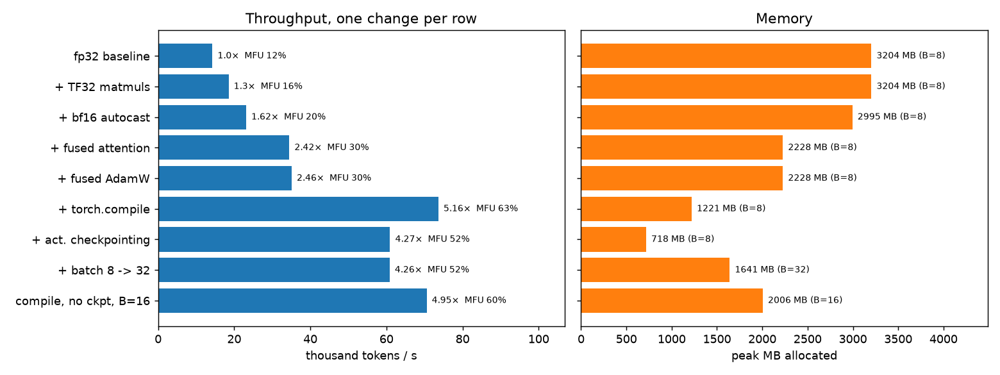

# Stage 09 — Making It Fast

Stage 08 gave us a training loop that is correct. This stage makes it fast.
Speed is not a luxury here: the capstone run in Stage 11 has a budget of
about two days on one laptop GPU. A loop running at a third of the possible
speed turns two days into six.

The rule for this stage: **one change at a time, measured.** We take one model
and one batch shape, and stack the optimisations one by one. Each row of the
final table records throughput (tokens per second) and peak memory, so every
speedup can be attributed to exactly one change.

What is in this stage:

- number formats: **fp32**, **TF32**, **fp16**, **bf16**, and why bf16 needs
  no loss scaling;
- `torch.autocast`: which operations run in low precision and which do not;
- **fused attention** (FlashAttention / SDPA): the tiling trick that never
  stores the `T×T` matrix;
- **`torch.compile`** and kernel fusion;
- **activation checkpointing**: trading compute for memory;
- **fused AdamW**;
- **MFU**, the honest efficiency number;
- profiling: where the time actually goes.

---

## 1. Where the time goes: two kinds of work

A GPU does two things: arithmetic, and moving numbers between its memory and
its compute units. Every operation is limited by one of them.

- **Matrix multiplies** do `2·m·n·k` arithmetic operations on `m·k + k·n`
  numbers. For big matrices that is hundreds of operations per number moved.
  They are limited by **arithmetic** ("compute-bound").
- **Elementwise operations** (add, GELU, LayerNorm, softmax, dropout) do one
  or a few operations per number. They read a tensor, do almost nothing, and
  write it back. They are limited by **memory bandwidth** ("memory-bound").

A transformer's FLOPs are almost all in the matmuls. But a naive
implementation spends a surprising share of its *time* in elementwise
operations, each one a separate trip to memory. Most of this stage is about
cutting those trips: fewer bytes per number (bf16), fewer separate kernels
(fusion), and never writing big intermediate tensors (fused attention).

### Counting FLOPs for training

For a transformer with `N` non-embedding parameters, the forward pass costs
about `2N` FLOPs per token (one multiply and one add per weight), and the
backward pass about twice that. So **training costs about `6N` FLOPs per
token**. Attention adds a term that grows with `T`:

```
FLOPs per token ≈ 6N + 12 · L · T · C
```

(forward `QKᵀ` and `AV` are `2·T·C` each per layer, ×3 for the backward pass.)
We use this to compute MFU in §7. Stage 10 uses the same formula as `C ≈ 6ND`.

---

## 2. Number formats

Every number on the GPU has a format. Fewer bits means less memory, less
bandwidth, and, on tensor cores, much faster matmuls.

```
         sign  exponent  mantissa     range          precision
fp32      1      8         23        ~1e-38..3e38    ~7 digits
tf32      1      8         10        same as fp32    ~3 digits    (matmul inputs only)
bf16      1      8          7        same as fp32    ~2-3 digits
fp16      1      5         10        ~6e-5..65504    ~3 digits
```

The **exponent** decides the *range* (how big and how small a number can
be). The **mantissa** decides the *precision* (how many digits are kept).

**TF32** is not a storage format. It is a mode in which the tensor cores read
fp32 inputs but use only 10 mantissa bits for the multiply. One line of code
turns it on (`torch.backends.cuda.matmul.allow_tf32 = True`), and matmuls get
faster with no other change.

**fp16 vs bf16.** Both are 16 bits. fp16 keeps more precision but has a tiny
range: anything below about `6e-5` becomes zero, and anything above 65,504
overflows. Gradients in a deep network are often smaller than `6e-5`. In fp16
they quietly round to zero and that part of the network stops learning. The
fix, **loss scaling**, multiplies the loss by, say, 1024 before the backward
pass, so the gradients are 1024× larger and stay in range, then divides them
again before the optimizer step. It works, but it needs a scaler that watches
for overflow and adjusts.

**bf16** ("brain float") keeps fp32's 8-bit exponent and so fp32's whole
range, and drops precision instead. Small gradients stay representable. **No
loss scaling is needed.** The cost is precision: bf16 has about 3 significant
digits, so `1 + 0.001 = 1` in bf16. That is why weights and optimizer states
stay in fp32 even when the compute is bf16: thousands of tiny updates would
round away.

### What `autocast` actually does

`torch.autocast("cuda", dtype=torch.bfloat16)` does not convert the model. It
intercepts each operation:

- **matmuls and convolutions** run in bf16: the big win;
- **reductions and numerically delicate ops** (softmax, log-softmax,
  cross-entropy, LayerNorm's statistics, sums) run in fp32;
- the **weights stay fp32** in memory, and are cast to bf16 copies on the fly
  for each matmul.

Our model's loss computes `cross_entropy(logits.float(), ...)`: the `.float()`
is belt-and-braces, so the log-softmax over 8,196 entries never runs in bf16.

---

## 3. Fused attention: never store the `T×T` matrix

Stage 04 measured the cost of naive attention: four `T×T` tensors per head
alive at once, out of memory at `T = 16k`. FlashAttention (Dao et al. 2022)
computes exactly the same output without ever storing the `T×T` matrix.

The trick is the softmax. Softmax over a row needs the row's maximum and its
sum of exponentials, which seems to need the whole row at once. It does not:
both can be computed **in pieces** and corrected as more pieces arrive.

```
process keys in blocks of, say, 64:
   running max m, running sum s, running output o
   for each block:
       scores = q · kᵀ_block                       (small: 64 numbers per query)
       m_new = max(m, max(scores))
       rescale old s and o by exp(m − m_new)       fix what was computed with the old max
       s = s + Σ exp(scores − m_new)
       o = o + exp(scores − m_new) · v_block
   output = o / s
```

Each block of keys is loaded into the GPU's small, very fast on-chip memory
once, used, and discarded. The full `T×T` matrix never exists. Memory goes
from `O(T²)` to `O(T)`; the arithmetic is the same (a little more, for the
rescaling); the time drops because the slow round trips to main memory are
gone. The backward pass recomputes the blocks instead of storing them.

PyTorch exposes this as `F.scaled_dot_product_attention`, which picks a
FlashAttention or memory-efficient kernel when it can. Stage 04 checked it
equals our hand-written attention to 1e-5. Our model's `flash=True` switch
uses it.

---

## 4. `torch.compile` and kernel fusion

Each PyTorch operation in eager mode is a separate GPU kernel. `x + y` reads
`x` and `y` from memory and writes the result. Then `gelu` reads that result
and writes another. A chain of five elementwise operations means five round
trips to memory, with almost no arithmetic in between.

`torch.compile(model)` traces the Python code into a graph, then **fuses**
chains of elementwise operations into single kernels that read once, do all
the arithmetic in registers, and write once. It also picks matmul
configurations and removes Python overhead.

The costs: the first steps are slow (compilation takes tens of seconds to
minutes), errors become harder to read, and anything that changes shape each
step (like our KV-cache decoding) triggers recompilation. We compile the
training step only.

---

## 5. Activation checkpointing: trade compute for memory

The backward pass needs the forward pass's intermediate tensors (the
**activations**). They are stored during the forward pass and consumed during
the backward. For a transformer, activation memory grows with
`B × T × C × L` and is usually larger than the weights.

**Activation checkpointing** stores only each block's *input*, throws away
everything inside the block, and recomputes the block's forward pass during
the backward pass when its activations are needed.

- Memory: from "every intermediate of every block" to "one tensor per block,
  plus one block's intermediates at a time".
- Cost: one extra forward pass per block, so roughly 1 + 1/3 ≈ **+33%
  compute** (forward is ~1/3 of forward+backward).

It does not make a fixed batch faster. It makes a **larger batch fit**, and a
larger batch often uses the GPU better. We measure whether that trade pays on
8 GB.

---

## 6. Fused AdamW

The optimizer step touches every parameter, its gradient, and its two state
tensors: four tensors per parameter, read and written, with a few operations
each. Pure memory traffic. The default implementation runs a loop of small
kernels per parameter tensor; `fused=True` does the whole update for all
parameters in a few large kernels. For small models with many tensors this is
a visible saving; for big ones it is a few percent.

---

## 7. MFU: the honest number

Tokens per second depends on the model: a 10M model runs faster than a 125M
one on the same GPU, so "100k tokens/s" says nothing on its own. **Model FLOPs
Utilization** (Chowdhery et al., PaLM 2022) asks: what fraction of the GPU's
peak arithmetic is spent on useful model FLOPs?

```
MFU = (tokens/s × FLOPs per token) / peak FLOPs/s
```

"Useful" means the `6N + 12LTC` count from §1. Recomputation for activation
checkpointing does **not** count, which is the point: MFU rewards speed, not
busy-work.

**Which peak?** The datasheet number for a laptop GPU depends on clocks and
power limits the datasheet does not know. We measure our own peak: the
best bf16 throughput of a large square matmul on this GPU, with this driver.
It is an achievable ceiling rather than a theoretical one, so our MFU is
honest in a conservative direction: published MFU numbers use the datasheet
peak and would look lower.

Good large-scale training runs reach 40-60% MFU. Small models on one GPU do
worse, because their matmuls are too small to fill the GPU.

---

## 8. Build order and acceptance criteria

`stages/09_efficiency/bench.py` builds the model once per configuration and
times training steps after warm-up. Configurations, stacked in order:

1. fp32, hand-written attention, unfused AdamW: the baseline;
2. + TF32 matmuls;
3. + bf16 autocast;
4. + fused attention (SDPA);
5. + fused AdamW;
6. + `torch.compile`;
7. + activation checkpointing, then double the batch.

Acceptance criteria:

- every row reports tokens/s, peak MB and MFU;
- loss after 50 steps from the same seed agrees across rows to within the
  precision change (fp32 vs bf16 differs; SDPA vs manual must not);
- the stack reaches ≥ 3× the baseline (curriculum target 3-5×);
- a profiler trace of one step names the top kernels.

---

## 9. Experiments

### 9a. Our peak

A 4,096 × 4,096 matmul, repeated, on this laptop GPU:

| format | TFLOP/s |
|---|---|
| fp32 | 5.48 |
| TF32 | 10.43 |
| **bf16** | **23.63** |
| fp16 | 24.76 |

bf16 tensor cores do 4.3× the arithmetic of plain fp32 on this chip. That
ratio is the ceiling on what mixed precision alone can buy. **MFU below is
computed against our measured 23.63**, which is achievable rather than
theoretical.

### 9b. The stack

8 layers, C=512 (30M), T=512, B=8 unless noted, 30 timed steps after warm-up:

| change (cumulative) | tokens/s | speedup | MFU | peak MB |
|---|---|---|---|---|
| fp32 baseline (our attention, per-tensor AdamW) | 14,271 | 1.00× | 12% | 3,204 |
| + TF32 matmuls | 18,536 | 1.30× | 16% | 3,204 |
| + bf16 autocast | 23,142 | 1.62× | 20% | 2,995 |
| + fused attention (SDPA) | 34,490 | 2.42× | 30% | 2,228 |
| + fused AdamW | 35,098 | 2.46× | 30% | 2,228 |
| + `torch.compile` | **73,656** | **5.16×** | **63%** | 1,221 |
| + activation checkpointing | 60,955 | 4.27× | 52% | **718** |
| + batch 8 → 32 (with checkpointing) | 60,846 | 4.26× | 52% | 1,641 |
| compile, no checkpointing, B=16 | 70,579 | 4.95× | 60% | 2,006 |

**5.16× total**, above the curriculum's 3-5× target. Reading the rows:

- **TF32 and bf16** give 1.3× and another 1.25×, far less than the 4.3×
  peak ratio. The matmuls got faster; everything else did not.
- **Fused attention** is the largest single step before compile: 1.5×, and
  25% less memory, from never storing the `T×T` matrices (Stage 04's
  four of them per head).
- **Fused AdamW**: +2%. Small model, few tensors; it matters more with many.
- **`torch.compile` doubles throughput** and halves memory. §9c explains why.
- **Activation checkpointing** costs 17% of throughput (the textbook says
  ~30%; compile makes the recomputed forward cheap) and cuts memory 41%.
  Spending that memory on a 4× bigger batch buys **nothing**: B=8 at T=512 is
  already 4,096 tokens per step, enough to fill the GPU. On 8 GB, at these
  sizes, checkpointing is a tool for fitting a model, not for speed.

Losses after 40 steps from the same seed: 6.61-6.65 for every row. bf16 and
fp32 agree to the run-to-run noise of bf16 kernels at this point (±0.03);
none of the optimisations changes what is computed beyond rounding.



### 9c. Where the time goes

PyTorch profiler, 3 steps, kernel time grouped by kind:

| | fp32 baseline | bf16 + fused attention + fused AdamW (before compile) |
|---|---|---|
| matmul | **55%** | 29% |
| other elementwise | 36% | **45%** |
| dtype casts / copies | 2% | **14%** |
| fused attention | — | 4% |
| softmax | 6% | 3% |
| optimizer | — | 3% |
| LayerNorm, reductions | 2% | 2% |

This is the explanation for the whole stack. In fp32 the matmuls dominate,
as the FLOP count says they should. Make the matmuls 2-4× faster with bf16,
and they drop to **29%** of the time: the GPU now spends most of its time
on cheap elementwise operations. Two culprits stand out in the kernel list:

- **our hand-written tanh-GELU** (Stage 05): `0.5·x·(1 + tanh(√(2/π)(x +
  0.044715·x³)))` written out is seven or eight separate elementwise kernels
  (power, multiplies, adds, tanh), each a full
  read and write of a `(B, T, 4C)` tensor;
- **autocast's casts** (14%): every fp32 weight is copied to bf16 on every
  forward pass.

That is the memory-bound work of §1, and it is exactly what `torch.compile`
fuses: the GELU becomes one kernel, the casts merge into their consumers.
Hence 2× from a single line, where a FLOP count would predict almost nothing.

### 9d. The Stage 11 shapes

The full stack (compile, bf16, SDPA, fused AdamW) at T = 1,024:

| model | batch | tokens/s | MFU | peak MB |
|---|---|---|---|---|
| workhorse, 8L, C=512 (30M) | 16 | 70,200 | 67% | 3,569 |
| capstone, 12L, C=768 (92M) | 8 | **25,389** | **71%** | 4,298 |
| capstone | 16 | out of memory | | |
| capstone + checkpointing | 16 | 21,780 | 61% | 2,828 |

The capstone at 25.4k tokens/s means **1.8B tokens takes about 20 hours.**
B=8 per micro-batch with gradient accumulation is the configuration.

---

## 10. What we found

| Question | Answer, measured |
|---|---|
| Our achievable bf16 peak | 23.6 TFLOP/s (fp32 5.5, TF32 10.4) |
| Total speedup, one change at a time | **5.16×**: 14.3k → 73.7k tokens/s; MFU 12% → 63% |
| Biggest single step | `torch.compile`, 2.1×, plus half the memory |
| Why compile matters so much | After bf16, elementwise ops (45%) and dtype casts (14%) outweigh matmuls (29%) |
| Activation checkpointing | −17% throughput, −41% memory; a bigger batch does not win it back |
| Capstone throughput | 25.4k tokens/s at 71% MFU: ~20 h for 1.8B tokens |

One habit from this stage: **profile before optimising.** The FLOP count said
"matmuls"; the profiler said "elementwise and casts". Only the second one
predicted that a compiler would double the speed.
