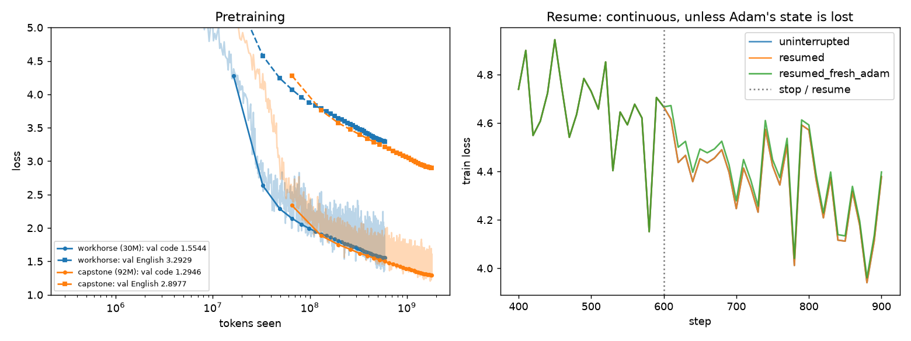

# Stage 11 — The Real Pretraining Run

Everything so far has been a rehearsal: runs of minutes, models of a few
million parameters. This stage is the performance: the model every later stage
fine-tunes, aligns, quantizes and serves. It is trained once, for roughly a
day, on the 2.36B-token code + English corpus from Stage 02.

A long run fails in ways a short one cannot. The power goes out at hour 19.
The loss spikes at hour 7 and you need to know whether to wait or restart. The
resumed run quietly re-reads data it already saw. This stage is mostly about
those failures, and the habits that survive them.

What is in this stage:

- **two models**: the ~30M **workhorse**, trained first and used to find
  every bug, and the capstone **base model**;
- **checkpointing and resuming** that is actually correct: model, optimizer,
  data position and random state;
- **evaluation during training**, and why validation loss alone is not enough;
- **logging**, and how to read a long loss curve;
- **loss spikes** and what to do about them;
- **determinism and seeds**;
- the ablation: stop the run, resume it, and prove the curve is continuous.

---

## 1. Why two models

The project rule (CLAUDE.md): **never debug on the capstone.** A bug found
after 20 hours costs 20 hours. The same bug found on a 2-hour run costs 2.

The workhorse uses exactly the same code path, config format, tokenizer, data
and loop as the capstone; only the size differs. Anything that breaks on the
capstone and not the workhorse is about scale (memory, numerics), which narrows
the search a lot.

---

## 2. What a checkpoint must hold

A checkpoint that holds only the model's weights lets you *use* the model.
To *continue training* it, you need everything that affects the next step:

| Piece | Why | What breaks if it is missing |
|---|---|---|
| model weights | obviously | nothing to resume |
| **optimizer state** (Adam's `m` and `v`) | Adam's step size per weight depends on them (Stage 08 §2) | resumed run behaves like step 1 of a new one: every weight jumps ±lr, a visible loss spike |
| **step number** | the learning-rate schedule is a function of it | warmup reruns, or the cosine restarts at the peak |
| **data position** (sampler epoch, position, RNG) | which windows come next | the model re-reads data it already saw, or skips some |
| **random number state** (torch CPU and CUDA) | dropout masks, sampling | runs are not reproducible across a resume |
| config | to rebuild the same model | a silent shape or setting mismatch |

The **data position** is the one people forget. A resumed run that restarts
the sampler at epoch 0 will feed the model the first hours of data again. The
loss on it drops slightly (it has seen it), which looks like good progress and
is not.

Our trainer (`llmfs/train/trainer.py`, Stage 08) saves all six. Our sampler
(Stage 02) was designed for this: its epoch permutation is a pure function of
`(seed, epoch)`, so its whole state is two integers.

**Saving safely.** Write the checkpoint to a temporary file, then rename it
over the old one. A rename is atomic on Linux; a crash halfway through
`torch.save` then leaves the previous checkpoint intact instead of a
half-written file.

---

## 3. Evaluating during training

Every few hundred steps the trainer computes loss on fixed validation windows:
the same windows every time, so the numbers are comparable along the run.

Validation loss answers "is the model still improving on data it has not
seen?" It does not answer "is the model any good at what we want?" Two
models with the same loss can differ in what they get right. For us the real
target is writing working Python (Stage 22's HumanEval). So the run also
logs:

- **separate code and English val loss**: the mix ratio means one can
  improve while the other stalls;
- **samples** from fixed prompts at fixed seeds, every few thousand steps:
  the fastest way to see that something is off (repetition, broken
  indentation);
- **gradient norm** every step: spikes show up here first.

---

## 4. Reading a long loss curve

Over a long run, the train loss falls roughly as a power law: fast at first,
then slower and slower. On a log-log plot that is close to a straight line.
Three things to watch for:

- **The end-of-schedule drop.** As the cosine schedule brings the learning
  rate down, loss falls faster again. This is not the model "suddenly
  learning": smaller steps let it settle into the minimum it was circling
  around (Stage 08 §4).
- **Spikes.** A sudden jump in loss, usually with a jump in gradient norm.
  Most recover within a few hundred steps. One that does not recover, or
  that grows, means the run has diverged.
- **Train/val gap.** With ~1 epoch of data, train and val loss should track
  each other closely. A growing gap means repeated data is being memorised,
  or the val set differs in kind from train.

### Loss spikes: what to do

From the big-model literature (PaLM, OPT, BLOOM logbooks):

1. **Wait** a few hundred steps. Most spikes recover.
2. If not: **roll back** to a checkpoint before the spike and **skip the
   batches** around it. Many spikes are caused by specific bad data.
3. If spikes keep coming: **lower the learning rate**, or check the numerics
   (bf16 overflow in attention logits, which QK-norm fixes; Stage 12).

Our safety rails (warmup, clipping, β₂ = 0.95, bf16, pre-norm) are each a
lesson from these logbooks. At our scale, spikes should be rare.

---

## 5. Determinism

Same seed, same code, same data should give the same run. In practice, GPU
training is **not bitwise deterministic** by default: some kernels (atomic
adds in backward passes) sum in a different order each time, and floating
point addition is not associative. Two runs from the same seed drift apart at
the `1e-6` level after the first step, and the gap grows.

That is acceptable. What matters is **statistical reproducibility**: the same
final loss to within the seed-to-seed spread. Stage 05 measured that spread
as about ±0.01-0.03 for our small models. What is *not* acceptable is a
resume that changes the curve by more than that spread. §8b tests exactly that.

---

## 6. The plan

From Stage 09's throughput and Stage 10's measurements, with one GPU:

| | workhorse | capstone |
|---|---|---|
| shape | 8 layers, C=512, 8 heads | 12 layers, C=768, 12 heads (GPT-2 small's body) |
| parameters | 30M (25.2M non-embedding) | 92M (85.1M non-embedding) |
| context | 1,024 | 1,024 |
| tokens per step | 16 × 1,024 × 2 = 32,768 | 8 × 1,024 × 8 = 65,536 |
| steps | 18,000 | 27,500 |
| tokens | 590M (~20 per parameter) | 1.80B (~20 per parameter) |
| peak lr, warmup | 1e-3, 500 | 6e-4, 1,000 |
| attention | QK-norm (Stage 10 §8f) | QK-norm |
| expected time | ~2.4 h at 70k tokens/s | ~20 h at 25.4k tokens/s |
| data | 85% code / 15% English, shuffled windows | same |

Why these numbers:

- **The capstone's size is set by the hardware.** 12 layers × 768 is the
  largest GPT-2-family shape that trains at a useful speed in 8 GB (B=16
  does not fit, Stage 09 §9d). Its 92M parameters (vs GPT-2's 124M) are the
  same body with our 8,196-entry table instead of 50,257.
- **~20 tokens per parameter** is Chinchilla's rule. Our own sweep (Stage 10)
  is far too small to extrapolate a frontier to `1e18` FLOPs; at `1e16` it
  put the optimum at fewer tokens per parameter, which would argue for a
  larger model we cannot fit. A 20 h run is the time budget; 1.8B tokens is
  what that budget buys at this size.
- **1.8B tokens at 85/15 is 1.15 epochs of our code and 0.27 of the English.**
  Stage 10 §8e measured 4 epochs costing 0.11 nats (with a diversity
  confound); 1.15 epochs is much closer to fresh data, though not measured.
- **QK-norm** because the plain recipe diverged in Stage 10 at long run
  lengths; the capstone is the longest run in the project.

---

## 7. Acceptance criteria

- workhorse run completes; its val loss and samples are logged;
- resume test: a run stopped at step `s`, resumed, gives a curve that
  overlays the uninterrupted run within the seed spread, with no spike at
  `s`;
- a run resumed **without** optimizer state, as a control, does show the spike;
- capstone run completes, with log, config, checkpoints and samples;
- the capstone's val loss is better than the workhorse's by an amount
  consistent with Stage 10's fits.

---

## 8. Experiments

### 8a. The workhorse

29,941,760 parameters, 18,000 steps × 32,768 tokens = **590M tokens** in
**2 h 18 min** (71k tokens/s, as Stage 09 predicted).

```
step         0     3,000   6,000   9,000   12,000   15,000   18,000
val code   9.06    1.994   1.809   1.714   1.636    1.583    1.554
val Eng.   9.08    3.877   3.645   3.514   3.411    3.333    3.293
```

Gradient norm: 7.7 at step 0, then never above **1.49** after step 1,000. No
spikes, no instability: QK-norm and the warmup did their jobs. The last
third of the run (cosine decay) still bought 0.08 nats of code loss.

For scale: the Stage 06 model (5M, 98M tokens) ended at 2.358 code loss on
256-token windows; the workhorse is 0.8 nats better with 6× the parameters
and 6× the data.

What it writes from `import os\nimport json\n\n\ndef load_config(path):`
at τ = 0.8:

```python
def load_config(path):
	try:
		config = load(path)
	except Exception as e:
		raise e

import pprint
import requests

from requests.utils import parse_qs
from requests.exceptions import HTTPError
```

Real Python idioms, real library names, a plausible `try/except`, and then it
wanders off into a new file. Greedy decoding loops (`def fibonacci(n):
return (n - 1) * (n - 1)` repeated, Stage 07's failure mode). One detail
matters for the benchmarks later: given a class indented with four spaces,
it continues with **tabs**, because both are common in its training data.
Mixed indentation is a syntax error in Python 3, and it will cost pass rate
in Stage 16 and 22.

### 8b. Resume, and resume done wrong

The 4-layer model, 1,200 steps, three ways: uninterrupted; stopped after
step 600 (process exits) and resumed from the checkpoint; and resumed with
everything restored **except** Adam's `m` and `v`.

**The first attempt crashed.** Resuming raised `RNG state must be a
torch.ByteTensor`: the trainer loads checkpoints with `map_location="cuda"`,
which also moved the saved CPU random-number state onto the GPU. One line
fixed it (`.cpu()` on restore). This is exactly why the resume test runs
before the capstone: the same bug at hour 12 of a 20-hour run would have
been a crashed restart and an evening lost.

After the fix:

```
step               580     600     610     620     640     660    final val
uninterrupted     4.151   4.667   4.615   4.437   4.358   4.435    3.9158
resumed           4.151   4.667   4.615   4.437   4.358   4.435    3.9158
resumed, no Adam  4.151   4.667   4.672   4.500   4.397   4.477    3.9323
```

**The resumed run is bit-identical** to the uninterrupted one: every logged
loss, gradient norm and the final validation loss agree to all printed
digits. Model, optimizer, sampler position and both random-number generators
are restored exactly, and this short uncompiled run is deterministic.

**Losing Adam's state** shows as a step: +0.057 at step 610, still +0.04
fifty steps later, +0.017 at the end. Not a dramatic spike, because the
learning rate at step 600 of a cosine schedule is already halfway down; but a
permanent mark on the curve, from one forgotten dictionary entry. Forgetting
the sampler position instead would leave no mark on the loss at all, and
silently show the model data it had already seen.

### 8c. The capstone base model

92,138,496 parameters, 27,500 steps × 65,536 tokens = **1.80B tokens**
(19.6 per parameter). The run was paused by the owner at step 10,500 on
2026-11-08 and resumed from the checkpoint five days later; training time
was about 20.4 GPU-hours in total (7.7 h before the pause, 12.7 h after,
~2.7 s per step).

```
step        3,000   6,000   9,000   12,000  15,000  18,000  21,000  24,000  27,500
val code    1.752   1.584   1.503   1.440   1.393   1.364   1.330   1.310   1.295
val Eng.    3.573   3.338   3.217   3.126   3.065   3.003   2.956   2.919   2.898
```

| | workhorse (30M, 590M tokens) | capstone (92M, 1.80B tokens) |
|---|---|---|
| val code | 1.554 | **1.295** (−0.26) |
| val English | 3.293 | **2.898** (−0.40) |
| GPU time | 2.3 h | ~20.4 h |
| max grad norm after step 1,000 | 1.49 | **1.03** |

**The resume across the pause was continuous**: step 10,500's loss and
gradient norm equal the pre-pause log's exactly, and later steps agree to
within 0.0003 (journal). Not bitwise, because this run is compiled and
bf16 (§5); the Stage-11 resume test, uncompiled, was.

**No spike in 27,500 steps.** The gradient norm stayed below 1.03 after
warm-up; QK-norm and the recipe from Stages 08-10 held at 3× the workhorse's
length. The loss never stopped falling: the last 3,500 steps (cosine tail)
bought 0.015 on code. Per token seen, the capstone is *behind* the workhorse
until about 120M tokens (twice the batch, 60% of the learning rate, and three
times the parameters to move), then ahead for the rest of the run: a bigger
model is slower to start and better at the end, Stage 10's picture again.

What it writes. From `import os\nimport json\n\n\ndef load_config(path):`,
greedy, the capstone now writes a correct body before it starts repeating
itself:

```python
def load_config(path):
	config = json.load(open(path))
	return config
```

At τ = 0.8 it writes plausible, idiomatic code that wanders (nested
functions, `json.load(config_file)`, a loop over the result). The English is
grammatical at the sentence level and meaningless beyond it ("Higgins stands
for the manuscript"). Greedy decoding still loops on every prompt, and the
tab/space mixing seen in the workhorse is still there. 92M parameters and
1.8B tokens buy local fluency, not intent.



---

## 9. What we found

| Question | Answer, measured |
|---|---|
| Does the resume path work? | Yes: bit-identical (uncompiled test) and continuous to 1e-4 (compiled capstone, across a 5-day pause) |
| What does dropping Adam's state cost? | A visible step: +0.057 at once, +0.017 at the end of a short run |
| Workhorse | 30M, 590M tokens, 2.3 h: val code 1.554, English 3.293 |
| Capstone | 92M, 1.80B tokens, ~20.4 h: val code **1.295**, English **2.898** |
| Instabilities | None: grad norm ≤ 1.03 after warm-up across 27,500 steps |
| Bugs found by the workhorse first | The RNG-restore device bug (resume test) |

One habit from this stage: **run the resume test before the long run, and
keep the long run's log honest.** The resume test found a real bug in a
minute; the pause found that a log can run past its checkpoint, and those
lines have to go before resuming.
