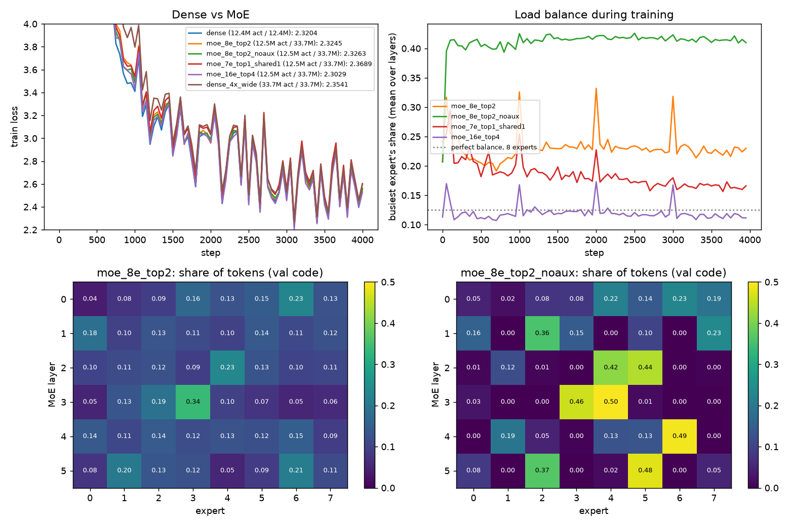

# Stage 13 — Mixture of Experts

Every model so far has been **dense**: every parameter is used for every
token. Making the model bigger makes every token more expensive.

A **Mixture of Experts** (MoE) model breaks that link. It replaces each MLP
with many smaller MLPs, the **experts**, and a small **router** that sends
each token to just a few of them. The model can hold 4×, 8× or 50× more
parameters while each token still pays for only the few experts it visits.
Mixtral 8x7B has 47B parameters and uses 13B per token. DeepSeek-V3 has 671B
and uses 37B.

This stage builds an MoE layer from scratch, trains it head to head against
a dense model with the same **active** parameters, and then breaks the
router to watch the classic failure, **expert collapse**.

Shape letters: `N` tokens in the batch (`B·T`, flattened, because routing is
per token), `C` width, `E` experts, `k` experts per token.

---

## 1. The picture

```
 dense block:          x ── MLP (C → 4C → C) ── + x
                             every token, every weight

 MoE block:            x ── router ── probabilities over E experts
                        │              (N, E)
                        │      pick the top k (here k = 2)
                        │
                        ├──→ expert 3 ──┐ × 0.7
                        ├──→ expert 6 ──┤ × 0.3       the other E−k experts
                        │               │             never see this token
                        └───────────── (Σ) ── + x
```

Attention, norms and embeddings stay dense and shared. Only the MLP is split.
That is where two thirds of a block's parameters are (Stage 05 §5), and it is
the part where each token is processed alone, so tokens can be sent to
different places without breaking anything.

---

## 2. Total vs active parameters

Our setup: a dense SwiGLU MLP has hidden size `Hd`. The MoE layer has `E = 8`
experts, each a SwiGLU with hidden size `Hd/2`, and each token uses `k = 2`.

```
dense MLP:     3 · C · Hd                  params, all used per token
one expert:    3 · C · Hd/2
MoE total:     8 · 3 · C · Hd/2 = 4 × dense
MoE active:    2 · 3 · C · Hd/2 = 1 × dense     ← same FLOPs per token
```

So the MoE model has about 4× the MLP parameters with **the same compute per
token**. That is the fair comparison the curriculum asks for: an
**active-parameter-matched** dense baseline. If the MoE wins, it won by having
more parameters to store knowledge in, not by doing more arithmetic.

The cost is memory: all experts must be in GPU memory, even though each token
uses two. That is why MoE models are cheap to *run per token* but expensive
to *host*.

---

## 3. The router

The router is one linear layer, `C → E`, followed by a softmax:

```
logits = x · W_router            (N, E)
probs  = softmax(logits)         (N, E), rows sum to 1
w, idx = top-k(probs)            (N, k): which experts, and how much
w      = w / sum(w)              renormalise over the chosen k
y      = Σ_j  w_j · expert_{idx_j}(x)
```

**Why the weights matter.** If every chosen expert were weighted 1, the router
would get no gradient at all: `top-k` is a hard selection, and you cannot
differentiate "which one was picked". Multiplying by `w` makes the output
depend smoothly on the router's probabilities, so the router learns: an
expert that helped the loss gets a larger weight next time.

Top-k picking is still discontinuous. A token whose second- and third-choice
experts have nearly equal probability can flip between them from one step to
the next. This is part of why MoE training is noisier than dense training.

---

## 4. The hard part: load balance

### 4a. Collapse

Picture the start of training. By chance, expert 3 is slightly better than
the others. The router sends it more tokens. Expert 3 gets more gradient, so it
improves faster. The router sends it even more. The other experts get almost
no tokens and almost no gradient, and never catch up.

This feedback loop ends in **expert collapse**: one or two experts process
nearly everything, and the rest are dead weight. The model has 4× the
parameters on paper and the quality of a dense model in practice (or worse,
since its working experts are half-size).

### 4b. The auxiliary load-balancing loss

The Switch Transformer (Fedus et al. 2021) adds a loss that is smallest when
the load is even. For each expert `i`:

- `f_i` = the fraction of token assignments that went to expert `i`
  (counted from the hard top-k choices);
- `P_i` = the average router probability for expert `i` over the batch.

```
aux = E · Σ_i  f_i · P_i
```

**Why this form.** `f_i` is a count: it has no gradient. `P_i` is smooth: it
does. The product says "for experts that are already overloaded (large `f_i`),
push their probability `P_i` down". The gradient of `aux` with respect to
`P_i` is `E · f_i`, so overloaded experts are pushed hardest.

**Why multiply by `E`.** With perfect balance, `f_i = P_i = 1/E` for every
expert, and `aux = E · E · (1/E)(1/E) = 1`. With total collapse onto one
expert, `f = P = 1` for that expert and `aux = E`. So `aux` runs from 1
(balanced) to `E` (collapsed) whatever `E` is, and one coefficient (we use
0.01) works across expert counts. `test_moe.py` checks both ends.

### 4c. Capacity and dropped tokens

In a real distributed system each expert lives on a GPU with a fixed buffer.
The **capacity factor** sets the buffer size:

```
capacity = capacity_factor · N · k / E          tokens per expert per batch
```

With factor 1.0 and perfect balance, every slot is used. Any imbalance means
some expert gets more tokens than it has slots. The overflow tokens are
**dropped**: they skip the MLP for this layer and pass through on the residual
stream alone. Factors of 1.25-2.0 are common. Our layer supports a capacity,
and by default it has none (every token is processed), because on one GPU
there is no fixed buffer to overflow.

---

## 5. Router z-loss

ST-MoE (Zoph et al. 2022) found that router logits tend to grow large over
training. Large logits make the softmax nearly one-hot and numerically
fragile in bf16, a source of loss spikes. The **z-loss** penalises their size:

```
z = mean over tokens of ( logsumexp(logits) )²
```

`logsumexp` is close to the largest logit, so this keeps the largest logit
near zero. Coefficient 0.001. It is a stability measure, like QK-norm
(Stage 12 §5) for attention.

---

## 6. Shared and fine-grained experts

DeepSeek-MoE (2024) changed two things, both now common:

- **Fine-grained experts.** Instead of 8 experts of hidden size `Hd/2` with
  top-2, use 32 experts of `Hd/8` with top-8. The same active compute, but far
  more ways to combine experts: C(8,2) = 28 possible pairs versus C(32,8)
  ≈ 10.5 million combinations. Experts can specialise more narrowly.
- **Shared experts.** One or two experts that every token always uses, plus
  the routed ones. Common knowledge (syntax, frequent words) goes into the
  shared expert once, instead of being copied into every routed expert.

Our MoE layer supports both (`n_shared`, and any `E`, `k`). §9d measures them.

---

## 7. What we do not build: expert parallelism

On one GPU, all experts live in one memory, and our dispatch is a loop over
experts. At scale, experts are spread across GPUs: GPU 0 holds experts 0-7,
GPU 1 holds 8-15, and so on. Each MoE layer then needs two **all-to-all**
communications: every GPU sends each of its tokens to the GPU holding that
token's experts, and the results come back.

```
GPU 0 tokens ──┐     ┌──→ GPU 0 experts ──┐     ┌──→ GPU 0 tokens
GPU 1 tokens ──┼─────┼──→ GPU 1 experts ──┼─────┼──→ GPU 1 tokens
GPU 2 tokens ──┘     └──→ GPU 2 experts ──┘     └──→ GPU 2 tokens
          all-to-all              compute         all-to-all back
```

This is why load balance matters even more in production: an overloaded
expert's GPU makes every other GPU wait.

**Why MoE is harder to fine-tune and serve.** Fine-tuning on a narrow dataset
can shift routing and unbalance it again, and the experts each see only a
fraction of the fine-tuning data. Serving needs every expert resident in
memory (all 47B of Mixtral's parameters, for 13B active), and batching is
less efficient because different tokens in a batch need different experts.

---

## 8. Build order and acceptance criteria

`llmfs/model/moe.py` (the layer) and the `n_experts` switch in
`llmfs/model/llama.py`.

- one expert with top-1 equals the dense MLP with the same weights;
- the output equals the hand-computed weighted sum of the chosen experts;
- `aux` = 1 when balanced and `E` when collapsed; its gradient reaches the
  router;
- capacity drops exactly the overflow;
- active parameters of the 8-expert top-2 model equal the dense model's
  within 1%;
- a dense model and the active-matched MoE trained head to head;
- the expert-utilisation histogram, with and without the aux loss.

---

## 9. Experiments

Same base as Stage 12 (6 layers, C=384, 8 query heads / 2 kv heads, RoPE,
RMSNorm), T=512, B=16, 4,000 steps: 33M tokens of the 85/15 mix, lr 1e-3.
Only the MLP changes. MoE runs are uncompiled (data-dependent routing
recompiles constantly); the dense baseline here is uncompiled too.

### 9a. Dense vs MoE, same active parameters

| model | total params | active params | val code | val English | time |
|---|---|---|---|---|---|
| dense (SwiGLU, hidden 1,024) | 12.4M | 12.4M | 2.320 | 4.153 | 354 s |
| MoE, 8 experts × 512, top-2 | 33.7M | 12.5M | 2.325 | 4.119 | 466 s |
| MoE, 16 experts × 256, top-4 (fine-grained) | 33.7M | 12.5M | **2.303** | **4.109** | 560 s |
| MoE, 7 routed × 512 top-1 + 1 shared | 33.7M | 12.5M | 2.369 | 4.203 | 458 s |
| dense, hidden 4,096 (same *total* params) | 33.7M | 33.7M | 2.354 | 4.140 | 643 s |

At this budget, MoE is **roughly a tie with the dense model** on code
(+0.005 for 8×top-2, −0.017 for the fine-grained 16×top-4) and a little better
on English (−0.03 to −0.04). The textbook MoE win, "more parameters for the
same compute", needs each expert to see enough data: with 8 experts and top-2,
each expert sees a quarter of the tokens, about 8M here. Our 33M-token
runs are short for that, the same lesson as Stage 10's "a big model on few
tokens loses".

Two comparisons are informative anyway:

- **MoE beats a dense model of the same total size** by 0.03-0.05. The
  33.7M-parameter dense model at 1 token per parameter is badly undertrained
  (Stage 10) and costs 2.7× the compute per token. MoE gets those parameters
  without paying for them per token.
- **Fine-grained experts are the best MoE here** (−0.022 vs 8×top-2), as
  DeepSeek-MoE reported: more, smaller experts, more combinations.
- **The shared-expert variant is the worst** (+0.049). Its routed part is
  top-**1** over 7 experts, so each token gets one routed expert instead of
  two: half of its active MLP is fixed, half chosen from 7. At this scale, the
  routing flexibility mattered more than the always-on expert.

MoE costs wall-clock time: +32% for 8 experts, +58% for 16, from our
loop-over-experts dispatch (§7). A grouped-matmul kernel removes most of
that; ours is written to be read.

### 9b. Turning the aux loss off

Same 8×top-2 model, with the load-balancing and z-losses set to 0. "Share"
below is an expert's fraction of all top-2 assignments, so a balanced
expert has 0.125 and an expert chosen for *every* token has 0.5:

| | busiest expert's share (mean over layers) | aux loss value | val code |
|---|---|---|---|
| with aux loss | 0.21-0.33 during training, 0.23 at the end | 1.09 | 2.325 |
| **without** | **0.41-0.43 from step 100 on** | **2.46** | 2.326 |

The collapse is fast and severe: by step 100 the busiest expert in each layer
takes 0.41 of the assignments, meaning it sees about 83% of all tokens.
Per layer, on val code, at the end of training:

```
                 expert:  0     1     2     3     4     5     6     7
without aux   layer 3   0.03  0.00  0.00  0.46  0.50  0.01  0.00  0.00
              layer 4   0.00  0.19  0.05  0.00  0.13  0.13  0.49  0.00
with aux      layer 3   0.05  0.13  0.19  0.34  0.10  0.07  0.05  0.06
              layer 4   0.14  0.11  0.14  0.12  0.13  0.12  0.15  0.09
```

Without the aux loss, layer 3 runs on two experts; the other six get
essentially nothing and never train. In the middle MoE layer, **4 of 8
experts are dead** (zero tokens as anyone's first choice). With it, every
expert carries 5-34%.

**And the loss barely moved: 2.326 vs 2.325.** With experts this size and
this little data, two live experts per layer are about as good as eight
half-trained ones. The cost of collapse is the wasted capacity, 75% of the
MoE parameters doing nothing, which would show up as a quality gap only when
there is enough data to train eight experts. The aux loss is what keeps that
capacity available.

### 9c. What the experts specialise in

With the aux loss on, each token's first-choice expert in the middle MoE
layer, on 32 windows of val code and 32 of val English:

| expert | English share of its tokens | its most frequent code tokens |
|---|---|---|
| 0 | **96%** | `from`, newline + indent, ` def`, `self` |
| 7 | **83%** | ` import`, `.`, `(`, ` models` |
| 6 | 70% | newline, `#`, ` def`, ` the`, `param` |
| 2 | 1% | `(`, ` =`, `=`, `,`, `_` |
| 4 | 1% | `,`, newline + indents, ` =`, `):` |
| 3 | 14% | `_`, `.`, `0`, `2`, ` self` (identifiers and digits) |

Nobody told the router which tokens are English. It sent prose mostly to
experts 0, 6 and 7, and split code between a "punctuation and indentation"
expert (4), a "call and assignment syntax" expert (2) and an
"identifiers and numbers" expert (3). This is the surface-level
specialisation real MoE studies report: by token type and syntax, not by
topic or "skill".



### 9d. Fine-grained and shared experts

Covered in §9a's table: fine-grained (16 × 256, top-4) is the best MoE variant
here; one shared expert plus top-1 routing is the worst. In the balance plot,
read each curve against its own balanced value: 1/8 = 0.125 of assignments
for 8 experts, 1/16 = 0.0625 for 16. The 16-expert model's busiest expert sits
at 0.11-0.12, about 1.8× its balanced share; the 8-expert model's at 0.23,
about 1.8× too. The aux loss holds both at the same relative imbalance.

---

## 10. What we found

| Question | Answer, measured |
|---|---|
| MoE vs active-matched dense, 33M tokens | Tie on code (2.325 vs 2.320), −0.03 on English |
| Best MoE variant | Fine-grained 16 × top-4: 2.303 (−0.017 vs dense) |
| MoE vs same-total-size dense | MoE better by 0.03-0.05, at 37% of the compute per token |
| Aux loss off | Busiest expert 0.41-0.43 of assignments (vs 0.23); 4 of 8 experts dead in the middle layer; aux value 2.46 vs 1.09 |
| Did collapse hurt loss? | Not at this budget: 2.326 vs 2.325. It wasted 75% of the MoE capacity |
| What do experts learn? | Token types: English vs code, punctuation/indentation, identifiers/digits |
| Cost | +32% (8 experts) to +58% (16) wall time with a loop dispatch |

One habit from this stage: **measure utilisation, not only loss.** The
no-aux run's loss looked fine; the histogram showed half the model dead.
