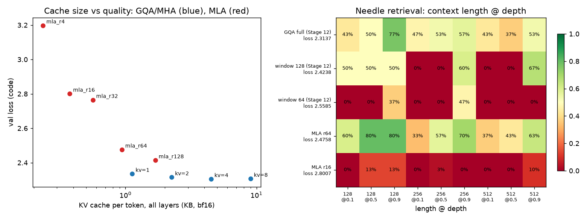

# Stage 14 — Attention Variants and Long Context

Stage 12 shrank the KV cache by sharing key/value heads (GQA). This stage
looks at three more radical answers to the same pressure. Attention's cost
grows with the length of the text: the cache grows linearly, and the compute
for a full forward pass grows quadratically.

- **MLA**, multi-head latent attention (DeepSeek-V2, 2024): cache a small
  compressed vector per token instead of full keys and values.
- **Linear attention**: rewrite attention so that the past is summarised in a
  fixed-size state, the way an RNN does.
- **State-space models** (S4, Mamba): skip attention entirely and use a
  learned linear recurrence, which can be computed either step by step or all
  at once.

Then a different question: **how do we know a model actually uses long
context?** Average loss hides it. A needle-in-a-haystack test shows it.

---

## 1. Three ways to remember the past

```
                 what is kept per token      cost to read the past at step t
full attention   k, v: 2 · H · d numbers     O(t)   (all of it)
GQA              k, v: 2 · Hk · d            O(t)   (Hk/H of it)
MLA              latent: r + d_rope          O(t)   (tiny, then expanded)
linear attn      nothing per token: one      O(1)   (fixed state)
  / SSM          d × d (or D) state total
```

The first three still store something for every token and read all of it at
every step. They only make each token's record smaller. The last row is the
qualitative change: memory does not grow with `t` at all. The price is that a
fixed-size state must **compress** an unbounded past, and things get lost.

---

## 2. MLA: compress keys and values into a latent

### 2a. The idea

GQA makes heads share keys and values. MLA keeps every head's keys and values
different, but makes them all **derived from one small vector** per token:

```
c   = RMSNorm(x · W_down)        (r,)        the latent: r numbers, cached
k_h = c · W_up_k[h]              (d,)        head h's key, rebuilt when needed
v_h = c · W_up_v[h]              (d,)        head h's value
```

Only `c` is cached: `r` numbers per token per layer, instead of `2 · H · d`.
DeepSeek-V2 uses `r = 512` against `2 · 128 · 128 = 32,768` for MHA: a 64×
smaller cache, and in their experiments **better** quality than MHA, where
GQA is usually slightly worse.

Why can it be better? GQA forces groups of heads to share *exactly the same*
keys. MLA forces every head's keys into the same *r-dimensional space*, but
each head can read a different direction of it. It is a low-rank constraint,
not a sharing constraint. If the useful information in keys and values really
is low-rank, little is lost.

### 2b. The catch: RoPE

RoPE (Stage 03 §4) rotates each key by an angle that depends on its position.
If `k = c · W_up_k` and RoPE is applied after, the rotation has to be applied
to the rebuilt `k` at every step, for every cached position. That is cheap
enough in our simple implementation, but it blocks the trick that makes MLA
fast in practice: **absorbing** `W_up_k` into the query, so attention is
computed directly against the latents without ever rebuilding `k`. A rotation
sitting between `c` and the dot product does not commute with that matmul.

DeepSeek's fix is **decoupled RoPE**: split each key into two parts.

```
k_h = [ c · W_up_k[h]   ;   RoPE( x · W_rope ) ]
        content: no rotation      position: d_rope dims, SHARED by all heads
q_h = [ q_content_h     ;   RoPE( q_rope_h ) ]
```

The content part goes through the latent and carries no position. The
position part is a small extra key (we use `d_rope = 16`) shared by all heads,
like MQA. It is cached too. Cache per token per layer: `r + d_rope` numbers.

### 2c. Cache arithmetic for our model

`L = 6`, `H = 8`, `d = 48`, bf16, per token across all layers:

| Variant | numbers per layer | bytes per token |
|---|---|---|
| MHA | 2 · 8 · 48 = 768 | 9,216 |
| GQA, 2 kv heads | 2 · 2 · 48 = 192 | 2,304 |
| MQA | 2 · 1 · 48 = 96 | 1,152 |
| MLA, r = 64 | 64 + 16 = 80 | 960 |
| MLA, r = 16 | 16 + 16 = 32 | 384 |

The ablation shrinks `r` until quality cracks (§7b).

---

## 3. Linear attention and the kernel trick

Softmax attention for one query (Stage 04 §2):

```
out_t = Σ_{s≤t} exp(q_t · k_s) v_s  /  Σ_{s≤t} exp(q_t · k_s)
```

The `exp` couples `q_t` and `k_s`, so the sum has to be recomputed for every
new query. Katharopoulos et al. (2020) replaced `exp(q · k)` with a product of
**feature maps**, `φ(q) · φ(k)`, with `φ(x) = elu(x) + 1` to keep it
positive. Then the query factors out of the sum:

```
out_t = φ(q_t)ᵀ [ Σ_{s≤t} φ(k_s) v_sᵀ ]  /  φ(q_t)ᵀ [ Σ_{s≤t} φ(k_s) ]
                 └──── S_t: (d, d) ────┘            └── z_t: (d,) ──┘
```

`S_t` and `z_t` are running sums. Each new token adds one outer product to
`S`. The past is a `d × d` matrix, whatever the length. That is an **RNN**,
derived from attention.

Two forms of the same computation:

- **parallel** (training): build the `T×T` matrix of `φ(q)·φ(k)`, mask it,
  multiply by `v`. GPU-friendly.
- **recurrent** (inference): carry `S` and `z`, one token at a time. Constant
  memory.

`test_variants.py` checks they agree to 1e-10. The cost: `φ(q)·φ(k)` is a
much blunter similarity than `exp(q·k)`. It cannot make one key dominate the
way softmax can, so precise look-ups ("copy the token after the last `(`")
suffer. Pure linear attention lost to softmax attention on language; the ideas
survive in hybrids and in the SSM line below.

---

## 4. State-space models and Mamba

A **linear state-space model** (SSM) carries a hidden state `h` and updates it
with a linear recurrence, per channel:

```
h_t = a ⊙ h_{t-1} + b ⊙ x_t         a in (0, 1): how much of the past to keep
y_t = c ⊙ h_t
```

Like linear attention, it has two forms:

- **recurrent**: one step at a time, constant memory, ideal for generation;
- **parallel**: unroll it, and `h_t = Σ_{s≤t} (a^{t−s}) b x_s`, which is a
  convolution or, in general, a **scan** that a GPU computes in `O(log T)`
  parallel steps.

This **recurrence/parallel duality** is the core of S4 (Gu et al. 2021) and
Mamba (Gu & Dao 2023). Training uses the parallel form; generation uses the
recurrent form; they are the same function. `test_variants.py` checks our
`ssm_recurrent` against `ssm_parallel`.

Mamba's addition is **selectivity**: `a`, `b` and `c` are computed from the
input at each step, so the model decides per token what to remember and what
to forget. With fixed `a`, an SSM can only fade the past at a set rate. With
input-dependent `a`, it can hold a variable name for 1,000 tokens and drop a
comment immediately.

**Hybrids.** Recent models (Jamba, Zamba, several 2025 releases) mix a few
attention layers into a mostly-SSM stack. The SSM layers handle the bulk
cheaply; the occasional attention layer gives exact look-up when needed. We
build the two forms and test their equality; we do not train an SSM language
model in this stage. The scan kernel that makes Mamba fast is its own project.

---

## 5. Perplexity hides long-range failure

Average loss over a 512-token window is dominated by tokens whose prediction
needs only the last few dozen tokens: the next character of an identifier, a
closing bracket, an indent. A model that cannot see past 64 tokens loses very
little average loss. Stage 12's sliding-window runs measure exactly how little.

The **needle-in-a-haystack** test (Kamradt 2023) asks a sharper question.
Hide a fact at a chosen depth in a long context and ask for it at the end:

```
<real Python from the val set ...>
SECRET_KEY = "48213"                      ← at depth 10% / 50% / 90%
<more real Python ...>
assert SECRET_KEY == "                    ← the model must continue 4 8 2 1 3
```

Our tokenizer splits every digit, so this is five exact copies from far back.
A model that only looks at the last 64 tokens should get it right only when
the needle is within 64 tokens of the end; a full-attention model should get
it right anywhere it has learned to copy.

Real long-context evaluation goes further (RULER, multi-needle, reasoning over
retrieved facts). One needle is the simplest test that average loss cannot
fake.

---

## 6. Acceptance criteria

- MLA's cached decode equals its full forward pass (1e-4), and its cache
  is `r + d_rope` numbers per token per layer (`test_llama.py`);
- parallel and recurrent linear attention agree to 1e-10; so do parallel and
  recurrent SSMs (`test_variants.py`);
- MLA trained against Stage 12's GQA/MHA runs with the identical recipe, a
  table of cache bytes vs loss;
- the latent ablation, `r` ∈ {128, 64, 32, 16, 4};
- the needle harness run on full-attention, sliding-window and MLA models,
  next to their val losses.

---

## 7. Experiments

Same base and recipe as Stage 12 (6 layers, C=384, 8 heads of 48, RoPE,
SwiGLU, T=512, 4,000 steps). The GQA/MHA points are Stage 12's runs; only the
attention module changes.

### 7a. MLA vs GQA

| attention | KV cache per token (all layers, bf16) | params | val code |
|---|---|---|---|
| MHA, 8 kv heads | 9,216 B | 13.77M | 2.306 |
| GQA, 2 kv heads | 2,304 B | 12.44M | 2.315 |
| MQA, 1 kv head | 1,152 B | 12.22M | 2.335 |
| **MLA, r = 128** | 1,728 B | 13.22M | 2.414 |
| MLA, r = 64 | 960 B | 12.77M | 2.476 |

**At our scale, MLA loses to GQA at every cache size.** MLA with a 128-number
latent has a smaller cache than GQA-2 and is 0.10 nats worse; MQA, with a
cache two thirds the size of MLA-128's, is 0.08 better. DeepSeek-V2 reports
MLA beating MHA. Three differences that plausibly explain the gap, none of
which we tested:

- **Scale and training length.** DeepSeek trained for trillions of tokens; the
  up-projections `W_up_k`, `W_up_v` here had 33M tokens to learn how to
  rebuild 8 heads' keys and values from one latent.
- **Head size.** Their content heads are 128 wide with a 64-wide rope part;
  ours are 48 with 16. The decoupled-rope key, shared by all heads, is a
  larger fraction of a small head.
- **Their latent is 512 against 32,768 numbers of MHA cache (1.6%);** ours at
  r=128 is 128 + 16 against 768 (19%). We are not compressing harder; we are
  compressing a model that has less redundancy to compress.

### 7b. Shrinking the latent

| r | cache per token | val code | Δ vs r=128 |
|---|---|---|---|
| 128 | 1,728 B | 2.414 | — |
| 64 | 960 B | 2.476 | +0.06 |
| 32 | 576 B | 2.765 | +0.35 |
| 16 | 384 B | 2.801 | +0.39 |
| 4 | 240 B | 3.198 | +0.78 |

Quality cracks between r = 64 and r = 32: halving the latent there costs 0.29
nats, against 0.06 for the halving before it. At r = 16 and r = 4 the model is
leaning almost entirely on the 16-number shared rope key, which carries
position but no content: a model that knows *where* things are but not
*what* they were.

### 7c. Needles

30 cases per cell (so each percentage has a standard error of about ±9
points), greedy, the 5-digit `SECRET_KEY` needle at depth 10/50/90% of a
context of real val code:

| model | val code loss | mean retrieval | needle outside the window |
|---|---|---|---|
| GQA, full attention | **2.314** | 51% | — |
| window 128 | 2.424 | 31% | **0%** (4 of 4 cells) |
| window 64 | 2.559 | 9% | **0%** (7 of 7 cells) |
| MLA r = 64 | 2.476 | **58%** | — |
| MLA r = 16 | 2.801 | 4% | — |

**Perplexity hides long-range failure, in both directions.**

- The window-128 model is only 0.11 nats worse than full attention on
  average, and it **cannot retrieve anything** further back than 128 tokens:
  0% in every cell where the needle is outside its window, 50-67% where it
  is inside. The average loss counts the long-range tokens, but there are
  few of them, and they are a small share of the total.
- MLA r = 64 has **worse loss** than GQA (+0.16) and **better retrieval**
  (58% vs 51%, about one standard error). Loss is dominated by short-range
  prediction; copying five digits from far back is a different skill.

Our full-attention model also only manages about half the needles. A 12M
model after 33M tokens has a partial copying ability, independent of
distance here (43-77% across the grid with no length trend). The retrieval
does not get worse at 512 than at 128: what limits it is the skill, not the
reach.



---

## 8. What we found

| Question | Answer, measured |
|---|---|
| Is MLA exact under caching? | Yes, 1e-4 against the full pass, multi-token chunks included |
| Do the two forms of linear attention / SSMs agree? | To 1e-10 / 1e-8 (float64) |
| MLA vs GQA at our scale | MLA worse at every cache size: r=128 2.414 vs GQA-2 2.315 |
| Where does the latent crack? | Between r = 64 (2.476) and r = 32 (2.765) |
| Does a window hurt retrieval? | 0% beyond the window, while average loss rises only 0.11-0.24 |
| Do loss and retrieval agree? | No: MLA-64 is worse on loss and better on needles than GQA |

Two habits from this stage:

- **Test the capability you need directly.** For code, that includes
  "use something defined far above". No average loss stands in for it.
- **A published win at 100B parameters is a hypothesis at 10M.** MLA's
  advantage did not transfer to our scale; we report that rather than tuning
  until it did.
