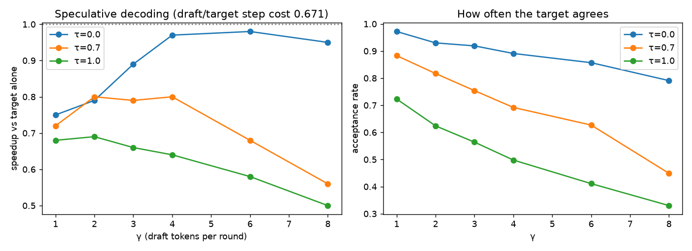
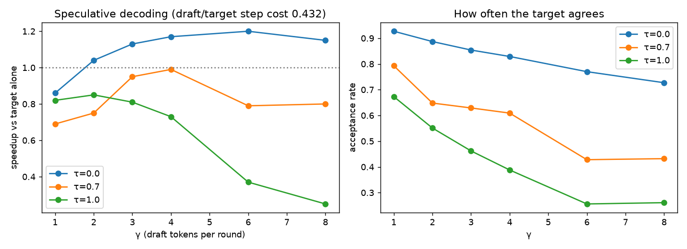

# Stage 15 — Faster Decoding: Speculative Decoding

Stage 07 found that decoding is limited by memory, not arithmetic: each step
reads every weight of the model from GPU memory to produce **one** token. The
GPU's arithmetic units mostly wait.

Speculative decoding uses that idle arithmetic. A small, fast **draft** model
guesses several tokens ahead. The big **target** model then checks all the
guesses **in a single forward pass**, which costs about the same as producing
one token, because reading the weights is the expensive part and it happens
once either way. If the target agrees with the first three guesses, three
tokens came out of one target step.

The remarkable part: with the right acceptance rule, the output distribution
is **exactly** the target model's. Speculative decoding is not an
approximation. It is a faster way to sample from the same distribution.

---

## 1. One round

```
context: ... def is_prime(n):\n
                                    draft proposes γ = 4:   "    if  n  <  2"
target, ONE forward pass over all 4  → its own distribution at each position
compare position by position:
    "    "  target agrees      ✓ accept
    "if"    target agrees      ✓ accept
    " n"    target agrees      ✓ accept
    " <"    target prefers " <=" sometimes... test says reject ✗
            → sample a replacement from what the target wanted instead
output this round: "    if n" + replacement = 4 tokens for 1 target call
```

If every guess is accepted, the target's forward pass also gave its
distribution for the position *after* the last guess, so one more token comes
for free: up to `γ + 1` tokens per target call.

---

## 2. The acceptance rule, and why it is exact

At one position, the draft's distribution is `q` and the target's is `p`. The
draft sampled token `x` from `q`.

```
accept x with probability  min(1, p(x) / q(x))
if rejected: sample from   r = max(0, p − q) / Σ max(0, p − q)
```

**Why the result is distributed exactly as `p`.** Split the target's
distribution into the part the draft already covers and the part it misses:

- For a token where the draft is *under*-confident (`q(x) ≤ p(x)`), every draw
  of `x` is accepted. The draft produces it with probability `q(x)`.
- For a token where the draft is *over*-confident (`q(x) > p(x)`), draws are
  accepted only `p(x)/q(x)` of the time: probability `q(x) · p(x)/q(x) =
  p(x)`. Exactly right.
- Under-confident tokens are still short by `p(x) − q(x)`. That missing mass
  is exactly what the rejections redistribute: the total rejection
  probability equals `Σ max(0, p − q)`, and the replacement is drawn from
  `max(0, p − q)` normalised.

Adding the two routes gives `p(x)` for every `x`. A worked example with three
tokens:

```
           p      q      accept prob   P(output via accept)   leftover p−q
token A   0.5    0.3        1.0             0.3                  0.2
token B   0.3    0.6        0.5             0.3                  0
token C   0.2    0.1        1.0             0.1                  0.1
                                          ─────                ─────
                                            0.7  accepted       0.3 rejected
replacement drawn from [0.2, 0, 0.1] / 0.3:
   A gets 0.3 · 2/3 = 0.2,   C gets 0.3 · 1/3 = 0.1
final: A 0.3+0.2 = 0.5,  B 0.3,  C 0.1+0.1 = 0.2   =  p  ✓
```

After the first rejection, the round stops: later guesses were conditioned on
a token we just replaced, so they are no longer valid.

For greedy decoding (temperature 0), `p` and `q` are one-hot, and the rule
becomes "accept while the draft's token is the target's argmax". The output
is then token-for-token identical to plain greedy decoding with the target,
which is the first test.

---

## 3. When does it pay off?

Let `α` be the probability that the target accepts a draft token, and `c` the
cost of one draft step relative to one target step. With `γ` guesses per
round, the expected number of tokens per round (Leviathan et al.) is

```
E[tokens] = (1 − α^(γ+1)) / (1 − α)
```

and each round costs `γ · c + 1` target-step-equivalents. Speedup:

```
speedup = (1 − α^(γ+1)) / ((1 − α)(γ·c + 1))
```

| α | c | best γ | speedup |
|---|---|---|---|
| 0.8 | 0.05 | 8 | 3.09× |
| 0.6 | 0.05 | 4 | 1.92× |
| 0.6 | 0.3 | 1 | 1.23× |
| 0.4 | 0.3 | 1 | 1.08× |

**The acceptance rate decides everything.** A draft that agrees with the
target 80% of the time on cheap tokens pays well. A draft that agrees 40% of
the time is close to useless, however fast it is. And `c` matters more than
it looks: at our tiny sizes, the "draft" is not much cheaper than the target
per step, because both are dominated by fixed per-step overhead (Python, kernel
launches) rather than by reading weights. We measure both and expect a modest
speedup. This is the honest result at 30M parameters; the 3× numbers in papers
come from 70B targets with 1B drafts, where `c ≈ 0.02`.

Code is a good case for speculation: much of it is predictable (indentation,
closing brackets, repeated identifiers), so `α` is high on those stretches.

---

## 4. Variants

- **Self-speculation / Medusa** (Cai et al. 2024): instead of a separate draft
  model, add a few extra output heads to the target, each predicting a token
  further ahead (`t+2`, `t+3`, ...) from the same final hidden state. No
  second model to host. Medusa uses a tree of candidates and a relaxed
  acceptance rule, which trades exactness for speed.
- **EAGLE** (Li et al. 2024): a light draft head that reads the target's
  hidden features rather than tokens, which gives much higher acceptance.
- **Multi-token prediction** as a training objective (Gloeckle et al. 2024;
  DeepSeek-V3): train the model from the start with extra heads predicting
  several tokens ahead. It improves the representations a little, and the
  heads double as a built-in draft at inference.

We build the original draft-model version, because its exactness is the
interesting property and it can be tested.

---

## 5. Acceptance criteria

`stages/15_speculative/speculative.py`, `test_speculative.py`:

- greedy speculative output equals plain greedy target output, for several γ;
- a draft identical to the target accepts 100% and gives `γ + 1` tokens per
  target call;
- sampled output: the joint distribution of the first two tokens matches the
  target's exact distribution (enumerated) within sampling noise
  (total variation < 0.05 over 6,000 draws on a 6-token vocabulary).

---

## 6. Experiments

Target: the Stage 11 **workhorse** (30M). Draft: the Stage 06 4-layer model
(5M), same tokenizer. bf16, batch 1, 160 new tokens from four code prompts.
One draft step costs **0.43** of a target step: at these sizes both are mostly
per-step overhead (Stage 07 §8a), so the draft is not nearly as cheap as its
6× fewer parameters suggest.

| τ | γ | acceptance | tokens per target call | speedup |
|---|---|---|---|---|
| 0 (greedy) | 1 | 0.93 | 1.92 | 0.86× |
| 0 | 2 | 0.89 | 2.74 | 1.04× |
| 0 | 4 | 0.83 | 4.29 | 1.17× |
| 0 | **6** | 0.77 | 5.59 | **1.20×** |
| 0 | 8 | 0.73 | 6.62 | 1.15× |
| 0.7 | 4 | 0.61 | 3.42 | 0.99× |
| 1.0 | 1 | 0.67 | 1.67 | 0.82× |
| 1.0 | 8 | 0.26 | 3.08 | 0.25× |

- **Greedy acceptance is high**: the 5M draft agrees with the 30M target on
  83% of tokens at γ = 4. Much of code is predictable to both (indentation,
  brackets, repeated names), and both loop in similar ways.
- **The speedup is small anyway: 1.20× at best.** The formula from §3, with
  α = 0.83, c = 0.43, γ = 4, predicts 1.31×; we measure 1.17×. The gap is
  the Python acceptance loop, which the formula does not charge for. The
  ceiling is set by `c`: with a draft costing 43% of the target, eight draft
  steps cost 3.4 target steps.
- **Sampling makes it worse.** At τ = 1, acceptance falls to 0.26-0.67 and
  every γ is a slowdown, down to 0.25× at γ = 8. The draft and target agree
  on the *most likely* token far more often than their full distributions
  agree on a random one.
- **Exactness**: in fp32, greedy speculative output is identical to plain
  greedy decoding on all 4 prompts. In bf16, 3 of 4 are identical and one
  diverges at token 130, where the target's top two logits differ by
  0.031: verification scores five tokens in one pass, plain decoding scores
  one, and the different bf16 rounding flips a near-tie (journal).

**A bigger pair, worse ratio.** With the 92M capstone as target and the 30M
workhorse as draft (`run.py sweep --tag capstone`), greedy acceptance rises
to 0.97 (γ = 1) and 0.89 (γ = 4), and every output is token-identical to plain
greedy decoding. But a 30M draft step costs **0.67** of a 92M target step, so
the best speedup is **0.98×** (γ = 6), and τ = 1 runs at 0.50-0.75×. The §3
formula with α = 0.89, c = 0.67, γ = 4 predicts 1.09×. Better agreement
cannot make up for a draft that is almost as slow as the target.



Speculative decoding is a technique for large targets with cheap drafts. On
our hardware at our sizes the precondition fails, and the measurement shows
exactly how much: the acceptance rate was there, the cost ratio was not.



---

## 7. What we found

| Question | Answer, measured |
|---|---|
| Is the output distribution the target's? | Yes: TV 0.03 on an enumerable case (test); greedy identical in fp32 |
| Greedy acceptance, 5M draft for a 30M target | 0.93 (γ=1) to 0.73 (γ=8) |
| Best speedup | 1.20× (greedy, γ=6) |
| Why so small? | Draft step costs 0.43 of a target step; both are overhead-bound |
| Sampling at τ=1 | acceptance 0.26-0.67, always slower |
| bf16 exactness | 1 of 4 prompts flips at a near-tie (top-2 gap 0.031) |
| 92M target, 30M draft | acceptance 0.89 @γ4, identical outputs, best speedup 0.98× (draft costs 0.67) |
