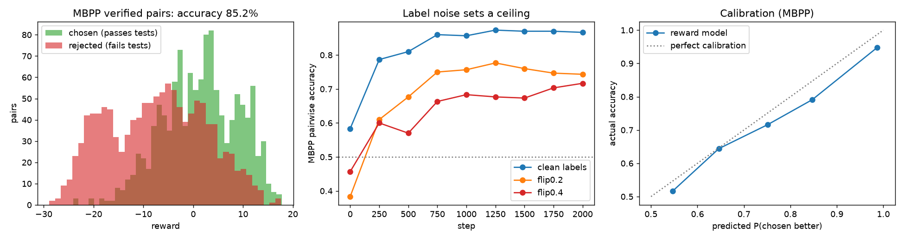

# Stage 18 — Reward Modeling

SFT (Stage 16) shows the model good answers. It never shows it *bad* ones, so
it cannot learn what makes one answer better than another. RLHF's answer is a
**reward model**: a network that reads a prompt and a response and outputs a
single number, "how good is this?". Once you have one, you can push a policy
towards responses it scores highly (Stage 19's PPO), or use it to rank
samples.

This stage trains one. Our domain lets us do it without any human labels,
and then check it against an objective ground truth, which most reward-model
work cannot do.

---

## 1. Why learn a reward at all?

For many tasks there is no formula for "good": helpfulness, tone, whether an
explanation is clear. People can still *compare* two responses and say which
they prefer, quickly and fairly consistently. A reward model turns many such
comparisons into a function that can score responses no one has seen.

The data format is a **preference pair**: a prompt, a **chosen** response and
a **rejected** one. No absolute scores: humans are bad at "rate this 1-10"
and much better at "which of these two".

---

## 2. Bradley-Terry: from comparisons to scores

The **Bradley-Terry** model (1952, invented for ranking chess players and
sports teams) assumes each item has a hidden score `r`, and the probability
that `a` beats `b` is

```
P(a ≻ b) = exp(r_a) / (exp(r_a) + exp(r_b)) = σ(r_a − r_b)
```

where `σ` is the sigmoid. Only the **difference** of scores matters: adding
the same constant to every score changes nothing. A difference of 0 gives a
50/50 chance; a difference of 2 gives 88%.

Training the reward model is then maximum likelihood on the observed
preferences. For one pair, the probability of what we saw (chosen beat
rejected) is `σ(r_c − r_r)`. Its negative log is the loss:

```
loss = −log σ(r_c − r_r)
```

That is logistic regression on the score difference. Worked numbers:

| `r_c − r_r` | `σ` | loss |
|---|---|---|
| 0 | 0.50 | 0.693 (= ln 2, the starting point) |
| 1 | 0.73 | 0.313 |
| 3 | 0.95 | 0.049 |
| −1 | 0.27 | 1.313 (ranked the wrong way) |

The gradient pushes `r_c` up and `r_r` down, by `1 − σ(r_c − r_r)`: hard when
the model ranks the pair wrong, gently when it already ranks it right.

---

## 3. The architecture: a language model with a different head

Take the SFT model, drop the `C → V` output head, and add a `C → 1` head that
reads the hidden state at the **last token** of the response:

```
<im_start>user ... <im_end> <im_start>assistant  def f(x): ... return y <im_end>
                                                                          ↑
                                                       hidden state here → Linear(C, 1) → r
```

Why the last token: with causal attention, it is the only position that has
seen the whole response. Why start from the SFT model rather than from
scratch: understanding code is the hard part, and the pretrained network
already has it. The reward head only has to learn to read it out.

With padding, "last token" means the last *real* token of each row, not the
last column. Reading the pad position instead is a classic bug: the reward
then depends on how much padding the batch needed.
(`test_reward_reads_last_real_token`.)

---

## 4. Accuracy is a ceiling on everything after

Everything downstream optimises against this model: PPO maximises its score,
best-of-n picks by it. If the reward model prefers the right answer 70% of
the time, nothing trained against it can reliably do better than its idea of
"right". Pairwise **accuracy** on held-out pairs (the fraction where
`r_c > r_r`) is the number to report.

**Calibration** asks a second question: when the model says `σ(r_c − r_r) =
0.9`, is it right 90% of the time? A well-calibrated reward model's margins
mean something.

**Annotator noise** limits accuracy from the data side. Human annotators
agree with each other on 60-75% of pairs in typical chat preference
datasets. A reward model cannot be "more right" than its labels: when 20% of
labels are flipped, the best possible agreement with them is 80%. §8c flips
labels on purpose.

---

## 5. Our preference data: code with a planted bug

We have something chat data does not: **a machine check for correctness**.
So we generate preferences instead of collecting them:

- **chosen**: a real, working function;
- **rejected**: the same function with **one** mutation: a comparison
  flipped (`<` → `>=`), an operator swapped (`+` → `-`), a constant nudged by
  one, `and` ↔ `or`, a `return x` replaced by `return None`, a `not` dropped.

```
 chosen                              rejected
 if x < lo:                          if x >= lo:          ← one character of meaning
     return lo                           return lo
```

Two sources:

- **train**: CodeSearchNet functions (Stage 16's data). No tests, so a mutant
  is only *very likely* to be broken. Some mutations are harmless (changing
  an unused default, `x + 0` → `x - 0`). That is label noise, built in.
- **test**: MBPP reference solutions, where every mutant is **run against the
  tests** and kept only if it fails. These labels are certain.

**The trap: formatting.** The mutant is produced by parsing the code into a
syntax tree, changing one node, and printing it back with `ast.unparse`.
Printed-back code has normalised formatting: quotes, spacing, parentheses. If
the chosen side kept its original formatting, every pair would differ in
formatting too, and the reward model would learn "unparse-style formatting =
bad", reaching high accuracy without reading the logic at all. So **both
sides** go through `ast.unparse`. The only difference left is the bug.

This is what reward hacking looks like from the data side: any systematic
difference between chosen and rejected that is not the property you care
about becomes a shortcut.

---

## 6. Reward hacking and over-optimisation

A reward model is an approximation of what we want, fitted on a finite set of
pairs. Push a policy hard enough against it and the policy finds the
approximation's errors: responses that score highly for the wrong reason.
Gao et al. (2022) measured this: as a policy is optimised against a reward
model, the **true** quality first rises, then falls, while the reward model's
score keeps going up. The KL penalty in RLHF (Stage 19) exists to stop the
policy from going far enough to find these holes.

Our setting will show its own version: a reward model trained on single-
mutation pairs has learned "does this look like a subtly broken version of
some function?". It has not learned "does this solve the problem?". Stage 20
avoids the issue by using the tests themselves as the reward.

---

## 7. Acceptance criteria

`stages/18_reward/reward.py`, `test_reward.py`:

- mutation keeps both sides in canonical formatting and changes behaviour;
- the Bradley-Terry loss gives ln 2 at equal scores and the table values;
- the reward is read at the last real token, independent of padding;
- `run.py`: RM from the SFT model, trained on CodeSearchNet pairs; accuracy
  on held-out CodeSearchNet pairs and on MBPP verified pairs; histograms of
  `r_c` and `r_r`; calibration of `σ(r_c − r_r)`;
- the ablation: 20% (and 40%) of training labels flipped.

---

## 8. Experiments

Backbone: the Stage 16 SFT workhorse (30M). Training: 40,000 CodeSearchNet
correct-vs-mutant pairs, 2,000 steps of 16 pairs (2 micro-batches of 8,
sequences capped at 640 tokens), lr 2e-5 (head 2e-4). Test: 1,000 held-out
CodeSearchNet pairs and **1,218 MBPP pairs** whose rejected side was run and
fails the tests.

### 8a. Accuracy

| | before training (random head) | after |
|---|---|---|
| CodeSearchNet held-out pairs | 50.7% | **82.6%** |
| MBPP, test-verified bugs | 56.8% | **85.2%** |

A model that passes 1.2% of HumanEval (Stage 16) picks the working version
of a function over its single-mutation twin **85% of the time**.
Discriminating is far easier than generating. Accuracy on the MBPP pairs,
which the reward model never trained on and whose labels are certain, is as
high as on held-out pairs from the training distribution: what it learned
transfers.

By kind of bug (MBPP pairs, clean labels):

| mutation | pairs | accuracy |
|---|---|---|
| `return x` → `return None` | 376 | **100%** |
| arithmetic operator swapped | 324 | 82% |
| constant nudged / other | 345 | 78% |
| comparison flipped | 153 | 76% |
| `and` ↔ `or` | 20 | 65% |

The easy bug is visible in the text alone (a function that returns `None` is
rarely right). The hard ones need the model to know what the code is *for*:
`x < y` and `x >= y` are equally plausible Python until you know the
intended behaviour.

### 8b. Calibration

Grouping MBPP pairs by the model's confidence `σ(r_c − r_r)`:

| predicted P(chosen better) | pairs | actual accuracy |
|---|---|---|
| 0.5-0.6 | 118 | 52% |
| 0.6-0.7 | 87 | 64% |
| 0.7-0.8 | 95 | 72% |
| 0.8-0.9 | 110 | 79% |
| 0.9-1.0 | 808 | 95% (mean confidence 98.7%) |

Well calibrated in the middle, mildly over-confident at the top: when it is
"98.7% sure" it is right 95% of the time. Two thirds of the pairs land in
the top bucket, mostly the `return None` bugs.

The reward histogram (figure, left) shows something calibration tables hide:
**absolute rewards overlap almost completely** between chosen and rejected
functions across problems. A good function for one problem can score below a
bad function for another. Bradley-Terry only constrains differences, so only
differences within the same prompt mean anything. Anything downstream that
compares rewards across prompts (thresholding "good enough", best-of-n
across tasks) is using a number the training never calibrated.

### 8c. Label noise

The same run with 20% and 40% of training pairs' labels swapped:

| labels flipped | CodeSearchNet held-out | MBPP verified |
|---|---|---|
| 0% | 82.6% | 85.2% |
| 20% | 78.3% | 76.6% |
| 40% | 64.0% | 71.6% |

Accuracy falls as noise rises, but it does not fall to `1 − noise`: with 40%
flipped, the model still ranks 72% of MBPP pairs correctly. That is the
majority vote at work: at 40% noise, 60% of the labels for any kind of bug
still point the right way, and a model fitting the average learns the
majority direction. The cost shows up as slower learning, a lower ceiling,
and worse accuracy on the subtle bugs (`and`/`or`: 65% → 35%, below chance)
while the easy `return None` bug barely moves (100% → 97%).



### 8d. The capstone as a judge

Same recipe on the 92M capstone's SFT model (activation checkpointing on):

| | 30M workhorse | 92M capstone |
|---|---|---|
| before training (random head) | 50.7% / 56.8% | 44.1% / 44.7% |
| CodeSearchNet held-out | 82.6% | **87.1%** |
| MBPP verified | 85.2% | **86.5%** |
| pairs with confidence 0.9-1.0 | 808 of 1,218, 94.8% right | 977 of 1,218, 93.3% right |

Three times the parameters buys +4.5 points on held-out pairs from the
training distribution and only +1.3 on MBPP. The capstone is also more
confident: 80% of its MBPP judgements land in the top bin, against 66% for
the workhorse, at slightly lower accuracy there. Most of what "this code is
broken" takes at this level, the 30M model already had.

---

## 9. What we found

| Question | Answer, measured |
|---|---|
| Can a 30M model learn "working beats broken"? | 85.2% on test-verified MBPP pairs it never trained on |
| Which bugs are easy? | `return None` 100%; comparisons 76%; `and`/`or` 65% |
| Calibrated? | Mostly; over-confident at the top (98.7% → 95%) |
| Are absolute rewards meaningful? | No: chosen and rejected overlap across prompts; only within-prompt differences are |
| Does a 3× bigger backbone judge better? | Slightly: 87.1% vs 82.6% held-out, 86.5% vs 85.2% on MBPP |
| 20% / 40% flipped labels | 76.6% / 71.6% on MBPP; subtle bugs degrade first |

One habit from this stage: **check what the reward model can see.** The
easy wins (`return None`) are textual; the hard ones need understanding.
A reward model's average accuracy is mostly a statement about the mix of
easy and hard pairs in the test set.
