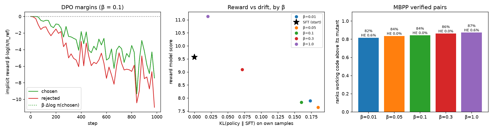

# Stage 19 — RLHF: PPO, DPO, GRPO

Stage 18 built a model of "which response is better". This stage uses
preferences to change the policy itself. Three methods, in historical order:

- **PPO** (2017, used for InstructGPT/ChatGPT): sample responses, score them
  with the reward model, reinforce the good ones. Powerful and notoriously
  fiddly.
- **DPO** (Rafailov et al. 2023): a derivation showing that the same goal
  can be reached with a simple classification-style loss on preference
  pairs. No reward model, no sampling during training.
- **GRPO** (DeepSeekMath, 2024): PPO without the value network, using a group
  of samples as its own baseline. Stage 20 builds it.

We read and diagram PPO, implement DPO from scratch and run it, and sweep
DPO's one hyperparameter, β.

---

## 1. Text generation as reinforcement learning

Reinforcement learning (RL) is learning from rewards for actions. The mapping
to a language model:

| RL term | Language model |
|---|---|
| state | the prompt plus the tokens written so far |
| action | the next token |
| policy `π` | the model's next-token distribution |
| episode | one complete response |
| reward | the reward model's score for the complete response (0 for every token before the last) |

The goal: change `π` so its responses get high reward, **without drifting
too far** from the SFT model. Drifting far is how the policy finds the reward
model's mistakes (Stage 18 §6) and loses the fluency it already had. The
standard objective makes the drift explicit:

```
maximise   E_{y ~ π(·|x)} [ r(x, y) ]  −  β · KL( π(·|x) ‖ π_ref(·|x) )
```

`π_ref` is the frozen SFT model. `KL` (Kullback-Leibler divergence) measures
how different two distributions are: 0 when identical. `β` sets the price of
drifting.

---

## 2. PPO, read and diagrammed

PPO needs **four models** in memory at once:

```
 prompts ──→ [ policy π ] ──samples y──→ [ reward model ] ──→ r(x, y)
                 │                                              │
                 │ log π(y)       [ reference π_ref ] ──→ KL penalty per token
                 │                                              │
                 └──────────→ [ value model V ] ──→ baseline, advantage via GAE
                                                                │
                              clipped policy-gradient update of π, regression update of V
```

1. **Policy** `π`: being trained.
2. **Reference** `π_ref`: frozen SFT copy, for the KL penalty.
3. **Reward model**: frozen, scores whole responses.
4. **Value model** `V`: trained alongside, predicts the expected future reward
   from each token position. It turns one end-of-response reward into a
   per-token signal.

**Advantage.** For each token, "was this better or worse than expected?":
`A_t ≈ (reward that followed) − V(state_t)`. **GAE** (generalised advantage
estimation) blends multi-step estimates of that difference to trade bias for
variance with one parameter `λ`.

**The clipped objective.** The update reuses each batch of samples for a few
gradient steps. To stop one batch from moving the policy too far, PPO clips
the probability ratio `ρ = π_new(y_t)/π_old(y_t)` to `[1 − ε, 1 + ε]`
(ε = 0.2):

```
L = −E_t [ min( ρ_t · A_t,  clip(ρ_t, 1−ε, 1+ε) · A_t ) ]
```

If an action was good (`A > 0`), its probability can rise by at most 20% per
batch; if bad, fall by at most 20%. Our GRPO implementation (Stage 20) uses
exactly this loss, and `test_clip_stops_large_ratio_gains` checks it.

**Why it is a memory nightmare.** Four models of the policy's size, plus
optimizer state for two of them, plus a generation loop in the middle of
training. For a 7B policy that is far beyond one GPU. And it is fiddly: the
value model, GAE, KL coefficient, clipping and learning rates all interact.

---

## 3. DPO: the derivation that removes the reward model

The KL-regularised objective in §1 has a known exact solution. For any reward
function `r`, the best policy is

```
π*(y|x) = π_ref(y|x) · exp( r(x, y) / β ) / Z(x)
```

where `Z(x)` normalises. In words: start from the reference, and reweight each
response by the exponential of its reward. Responses the reward likes get
more probability, by an amount controlled by β.

Now **turn it around**. Take logs and solve for `r`:

```
r(x, y) = β · log( π*(y|x) / π_ref(y|x) ) + β · log Z(x)
```

Any policy implicitly defines a reward: β times its log-ratio to the
reference, plus a term that depends only on the prompt. Put this into the
Bradley-Terry preference model from Stage 18, `P(c ≻ r) = σ(r(x, c) − r(x, r))`.
The awkward `log Z(x)` appears in both rewards and **cancels in the
difference**:

```
P(chosen ≻ rejected) = σ( β log π(c|x)/π_ref(c|x)  −  β log π(r|x)/π_ref(r|x) )
```

So we can fit the policy *directly* to preference pairs, by maximum likelihood,
exactly as Stage 18 fitted the reward model:

```
loss_DPO = −log σ( β [ (log π(c|x) − log π_ref(c|x)) − (log π(r|x) − log π_ref(r|x)) ] )
```

No reward model, no sampling, no value network. Two models in memory (policy
and frozen reference). The training loop looks like SFT on pairs.

`log π(y|x)` is the **sum** of the response's token log-probabilities, with
the prompt masked out (Stage 16's mask). The quantity `β (log π − log π_ref)`
is the **implicit reward**; we plot it for chosen and rejected responses as
training goes.

**What the gradient does.** It raises `log π(c)` and lowers `log π(r)`, weighted
by `σ(−margin)`: hard on pairs the policy currently ranks wrong, little on
pairs it already ranks right. At the start (`π = π_ref`), the margin is 0 and
the loss is exactly `ln 2` (`test_dpo_at_reference_is_ln2`).

**The β knob.** Small β (0.01): the KL price is low, the policy may move far
from the reference to fit the preferences. Large β (1.0): the policy stays
close; preferences barely change it. In the loss, β also scales the margin: a
large β makes the loss saturate after small log-ratio changes.

**A known failure.** DPO only constrains the *difference* between chosen and
rejected. Both log-probabilities can fall at once, as long as rejected falls
faster. In practice the chosen log-prob often *decreases* during DPO, and the
probability mass goes to responses that are neither. We watch for it.

---

## 4. Which method when

| | PPO | DPO | GRPO |
|---|---|---|---|
| needs a reward model | yes | no | no (needs a reward *function*) |
| samples during training | yes | no | yes |
| models in memory | 4 | 2 | 2 (+ reward function) |
| data | prompts | fixed preference pairs | prompts + verifier |
| best when | rich learned reward, big compute | a preference dataset exists | the reward can be computed (tests, math) |

For our project, preferences are synthetic (correct vs mutated code), so DPO
is the natural fit here, and the unit-test verifier makes GRPO the natural
fit for Stage 20.

---

## 5. Our setup

- **policy and reference**: the Stage 16 SFT model;
- **pairs**: Stage 18's CodeSearchNet correct-vs-mutant pairs, in chat format
  (user: signature + docstring; chosen/rejected: the two functions);
- **evaluation**:
  - preference accuracy of the implicit reward on held-out MBPP verified
    pairs: does the policy now rank working code above broken code?
  - **win rate vs SFT**, judged by the tests themselves: on HumanEval and
    MBPP, pass@1 of DPO vs SFT;
  - the Stage 18 reward model's mean score on the policy's own samples;
  - KL from the reference on the policy's samples;
- **ablation**: β ∈ {0.01, 0.05, 0.1, 0.3, 1.0}.

---

## 6. Acceptance criteria

`llmfs/post/dpo.py`, `stages/19_dpo/test_dpo.py`:

- the loss is `ln 2` when policy = reference;
- the gradient raises chosen and lowers rejected, with magnitude `β σ(−margin)`;
- the loss depends only on log-ratios to the reference;
- `run.py`: DPO runs; implicit reward margins plotted; pass@1 and
  preference accuracy vs SFT; β sweep with KL vs reward.

---

## 7. Experiments

Policy and reference: the Stage 16 SFT workhorse (30M). Data: 20,000
CodeSearchNet correct-vs-mutant pairs in chat format. 1,000 steps of 8 pairs,
lr 5e-6. Measured: preference accuracy of the implicit reward on 1,218
test-verified MBPP pairs; the Stage 18 reward model's score of the policy's
own greedy samples on 64 held-out prompts; KL to the SFT model on those
samples; HumanEval and MBPP pass@1.

### 7a. One run, β = 0.1

```
step                       0      200     400     600     800    1000
MBPP pair accuracy        0.50    0.83    0.84    0.83    0.82    0.84
β·Δlog π(chosen)          0      −0.91   −1.84   −5.27   −3.50
β·Δlog π(rejected)        0      −1.52   −3.01   −7.47   −6.64
RM score, own samples     9.56    7.71    7.87    7.61    7.30    7.84
KL to SFT                 0       0.04    0.10    0.14    0.15    0.16
```

DPO learns the preference quickly: the implicit reward ranks working code
above its mutant on 84% of MBPP pairs by step 400 (it starts at exactly 50%:
policy = reference, every margin 0). Then the **failure §3 described**: both
log-probabilities fall, the rejected faster. By step 600 the chosen
functions are **53 nats less likely** than under the SFT model. The margin
grows by making everything less likely, and the probability goes somewhere
else: to the policy's own generations, which the reward model likes
**less** (9.56 → 7.84) and which pass fewer tests (HumanEval 1.2% → 0%).

### 7b. The β sweep

| β | MBPP pair accuracy | RM score, own samples | KL to SFT | HumanEval |
|---|---|---|---|---|
| SFT (start) | 0.50 | 9.56 | 0 | 1.2% |
| 0.01 | 0.816 | 7.89 | 0.173 | 0.6% |
| 0.05 | 0.835 | 7.64 | 0.185 | 0.0% |
| 0.1 | 0.842 | 7.84 | 0.160 | 0.0% |
| 0.3 | 0.861 | 9.10 | 0.071 | 0.0% |
| **1.0** | **0.873** | **11.13** | **0.020** | 0.6% |

The pattern is the alignment-vs-divergence trade-off of §1, with a twist.

- **Small β drifts far and hurts**: KL 0.16-0.19, and the reward model's
  score of the policy's own samples falls from 9.56 to 7.6-7.9. The policy
  over-optimises the pairwise margin and moves away from good generations.
  That is the over-optimisation region, and it starts at β ≤ 0.1 here.
- **β = 1.0 is best on every axis**: highest preference accuracy (0.873),
  the only setting that **raises** the reward model's score (11.13 against
  9.56), and the smallest drift (KL 0.02). A large β makes the loss saturate
  after small log-ratio changes, so the policy stops pushing once the pairs
  are separated instead of dragging all probabilities down.
- **None of it moves pass@1.** HumanEval stays at 0-1 problem out of 164.
  DPO on single-mutation pairs teaches the model to prefer correct-looking
  code among two candidates, which is a ranking skill; writing a correct
  function from a docstring is a generation skill it does not reach.



### 7c. The capstone, β = 1

The best setting from the sweep, run once on the 92M capstone (its own SFT
model as policy and reference, its own reward model as judge):

| | MBPP pair accuracy | RM score, own samples | KL to SFT | HumanEval | MBPP |
|---|---|---|---|---|---|
| capstone SFT (start) | 0.563 | 20.41 | 0 | 1.22% | 0.4% |
| **capstone DPO** | **0.895** | **25.37** | 0.027 | 1.22% | 0.4% |
| workhorse DPO, for scale | 0.873 | 11.13 (its own RM) | 0.020 | 0.6% | 0.0% |

The bigger model learns the ranking a little better (0.895 against 0.873),
its reward model likes its samples more after DPO (+4.96), and it stays as
close to the SFT model as the workhorse did. And the tests do not move at
all: the same two HumanEval problems and the same two MBPP problems are
solved before and after. The reward scores are not comparable across the
two models: each reward model has its own scale.

---

## 8. What we found

| Question | Answer, measured |
|---|---|
| Does DPO learn the preference? | Yes: MBPP pair accuracy 0.50 → 0.84 by step 400 (β = 0.1) |
| Do chosen log-probs rise? | No: −53 nats by step 600; rejected fall faster |
| Over-optimisation point | β ≤ 0.1: KL 0.16-0.19 and the reward model scores samples lower than SFT's |
| Best β | 1.0: accuracy 0.873, RM 11.13 (SFT 9.56), KL 0.02 |
| On the 92M capstone (β = 1) | Pair accuracy 0.563 → 0.895, RM 20.4 → 25.4, KL 0.027; same problems solved, pass@1 unchanged |
| Win rate vs SFT, by tests | No win: HumanEval 1.2% → 0-0.6%; MBPP 0% both |

One habit from this stage: **track the chosen log-probability, not just the
margin.** A growing margin with a falling chosen likelihood means the model
is learning what not to do by forgetting what to do.
