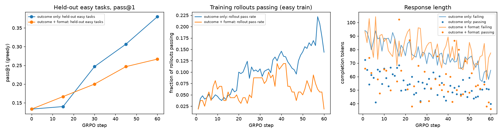

# Stage 20 — Reasoning and Verifiable Rewards

This is the stage the domain choice was made for (`docs/domain_choice.md`).
For code, "is this answer good?" has an objective answer that a computer
can check for free: **run the tests**. No human preference labels, no
learned reward model to hack (Stage 18 §6), no LLM judge. The reward is a
program.

Training a policy against a programmatic checker is **RLVR**: reinforcement
learning with verifiable rewards. It is how DeepSeek-R1 and its successors
learned long chains of reasoning for math and code. Here we build its
algorithm, **GRPO**, from scratch, and run it on MBPP with reward = "do the
unit tests pass".

The honest expectation, stated up front: our models are small. Most MBPP
problems are beyond them, and RL cannot reinforce successes that never
happen. What we can measure is whether the pass rate on the problems at the
edge of the model's ability goes up, and what happens to response length.

---

## 1. Chain of thought as inference-time compute

A model that answers immediately gets one forward pass per output token to
"think". A model that first writes out intermediate steps gets many: each
written step is computed, then read back as input. **Chain of thought** (CoT)
trades more generated tokens for more computation per answer, and on
reasoning tasks that trade pays (Wei et al. 2022).

For code, the analogue is writing helper variables, comments, or test calls
before the final answer. Whether a 30-100M model can benefit from this is an
open question we can only probe.

---

## 2. RLVR: the reward is a program

```
prompt (MBPP problem + one example assert)
   │
   ▼  policy samples G completions
 ┌─────┬─────┬─────┬─────┬─────┬─────┬─────┬─────┐
 │ y1  │ y2  │ y3  │ y4  │ y5  │ y6  │ y7  │ y8  │
 └──┬──┴──┬──┴──┬──┴──┬──┴──┬──┴──┬──┴──┬──┴──┬──┘
    ▼     ▼     ▼     ▼     ▼     ▼     ▼     ▼     each run in a sandbox with the
  fail  PASS  fail  fail  PASS  fail  fail  fail    problem's 3 hidden asserts, 5 s timeout
   0     1     0     0     1     0     0     0      reward
```

The verifier is the same sandboxed executor as the evaluation harness (Stage
22): a separate `python -I` process, empty temp directory, CPU, memory and
file-size limits, a wall-clock timeout. Generated code is untrusted; an
infinite loop must cost 5 seconds, not the run.

"Un-hackable-ish": the policy can still find holes in a verifier. Classic
ones are printing the expected output instead of computing it, special-casing
the visible test, or exiting with status 0 before the asserts run (`import os;
os._exit(0)`). Our sandbox catches the last one: exit status 0 is not
enough, a sentinel line printed *after* the asserts must also appear
(`test_sandbox_rejects_early_exit_hack`); the first two are a reason MBPP
keeps two of its three tests hidden from the prompt.

---

## 3. Why GRPO

PPO (Stage 19 §2) needs a value model to tell "this response was better than
expected" from "this prompt is easy". **GRPO** (Group Relative Policy
Optimization, Shao et al. 2024) drops the value model and uses the **group**
of samples for the same prompt as the baseline:

```
A_i = (R_i − mean(R_1..R_G)) / (std(R_1..R_G) + ε)
```

In the picture above, `mean = 0.25`, `std = 0.43`: the two passing samples
get advantage `+1.73`, the six failing ones `−0.58`. Every token of a passing
completion is pushed up; every token of a failing one, down a little.

Two consequences:

- **A group where every sample gets the same reward teaches nothing.** All
  pass or all fail, the advantages are all zero. For a weak model on hard
  problems, most groups are all-fail. We therefore skip such groups and fill
  the batch with others (DAPO's "dynamic sampling", Yu et al. 2025), and
  report what fraction of sampled groups had any signal at all.
- **No value model**: half of PPO's memory, and one fewer thing to tune.

The update is PPO's clipped objective with a KL penalty to the reference,
using the unbiased `k3` estimator per token (`ratio − log ratio − 1`, always
≥ 0):

```
L = − mean_tokens [ min(ρ A, clip(ρ, 1−ε, 1+ε) A) ]  +  β · KL_k3(π ‖ π_ref)
```

---

## 4. Reward shaping and format rewards

With almost no successes, a pure pass/fail reward gives almost no gradient. A
**format reward** gives partial credit for the parts that are easy to check
and on the way to a correct answer:

- the completion contains a function definition with the name the test
  calls;
- it parses as Python;
- it ends with `<|im_end|>` instead of running on.

DeepSeek-R1 used format rewards for its `<think>` tags. The danger is the same
as any proxy: the policy may learn to satisfy the format and stop there. The
ablation compares **outcome only** with **outcome + format** (0.1 per
check, so a correct answer, worth 1.0, always dominates).

---

## 5. The "aha moment", and what is really going on

R1-Zero's training curves showed response length growing steadily, and the
model starting to write things like "wait, let me check that". It was widely
read as emergent self-reflection. Later analyses (e.g. Liu et al. 2025,
"Understanding R1-Zero-like training") found that much of the length growth
comes from a bias in the loss: averaging the loss over tokens *per sequence*
means long wrong answers are penalised less per token than short wrong
answers, so the policy drifts towards long ones. And the "reflection"
phrases already appear in base models' samples, at low rates.

We log mean response length, separately for passing and failing samples, so
we can see which way our run drifts.

**Process vs outcome supervision.** Our reward judges only the final program
(**outcome** supervision). **Process** supervision scores each intermediate
step (Lightman et al. 2023, "Let's verify step by step"). It needs step-level
labels or a trained process reward model. For code, partial test passing is a
weak form of process signal; we use all-or-nothing.

---

## 6. Setup

- **start**: the Stage 16 SFT model (it already knows the chat format);
- **prompts**: MBPP train + validation (464 problems), in the SFT chat format;
- **reward**: 1.0 if all three asserts pass; optional format reward (§4);
- **G = 8** samples per prompt, temperature 1.0, up to 256 new tokens;
- **4 prompts** with signal per step (dynamic sampling), 2 PPO epochs per
  batch, clip 0.2, β = 0.04, lr 1e-6;
- **eval** every 25 steps: MBPP test pass@1 (greedy, 500 problems) and
  HumanEval pass@1;
- **logged**: reward, fraction of groups with signal, response length
  (passing vs failing), KL to the reference, clip fraction.

---

## 7. Acceptance criteria

`llmfs/post/grpo.py`, `stages/20_grpo/test_grpo.py`:

- group advantages have zero mean and are exactly zero for uniform groups;
- on-policy with no KL, the loss is minus the mean advantage;
- the clip caps the gain from a large ratio at `1 + ε`;
- the `k3` KL estimate is non-negative;
- `run.py`: pass@1 and length curves over training, for outcome-only and
  outcome + format rewards.

---

## 8. Experiments

### 8a. MBPP: no signal at all

The plan of §6, on the SFT workhorse (30M): MBPP train + validation prompts,
8 rollouts each at τ = 1.0. Three steps tried 72 problems, **576 programs,
and none passed**. Every group's rewards were identical (all 0), so every
advantage was 0 and the update was exactly nothing. We stopped the run: 100
steps of this would have spent 2.5 hours changing no weights.

This is the hardest constraint on RL from verifiable rewards, and it is not
specific to small models: **GRPO can only amplify successes that already
happen.** If pass@8 on the training prompts is 0, there is no signal; the
format reward of §4 exists precisely to give a gradient before the first
real success. R1-style training starts from a base model that already solves
a fraction of its math problems.

### 8b. A curriculum the model can sometimes solve

`stages/20_grpo/easy_tasks.py` generates templated, test-verified tasks
("return x plus 13", "return the string reversed", "return the largest number
in a list"; 16 templates), with random names and constants: 400 for training
and 150 different ones held out.

A first attempt phrased them like MBPP, as prose. The SFT model scored
**0 of 80** even on these, answering `def write_function(function):`.
Phrased as Stage 16's SFT format (signature, docstring, one doctest):

```
def last_of_val(lst):
    """Return the last element of a list.
    >>> last_of_val([56, 53, 42])
    42
    """
```

the same model scored 7.5% greedy and 13.3% on the held-out set. A 30M model
learns one request format in SFT and does not transfer it to another. That
is also why its MBPP chat-mode score is 0.

### 8c. GRPO on the curriculum

60 steps; each step samples groups of 8 rollouts (τ = 0.8) until 4 groups
with mixed results are found (at most 16 tries), 2 PPO epochs per batch,
clip 0.2, β = 0.04, lr 1e-6. Two reward schemes: **outcome only** (1 if all
hidden asserts pass) and **outcome + format** (+0.1 each for: parses, defines
the right function name, ends with `<|im_end|>`).

| step | 0 | 15 | 30 | 45 | 60 |
|---|---|---|---|---|---|
| held-out easy pass@1, outcome only | 13.3% | 14.0% | 24.7% | 30.7% | **38.0%** |
| held-out easy pass@1, outcome + format | 13.3% | 16.7% | 20.0% | 24.7% | 26.7% |

| at step 60 | outcome only | outcome + format |
|---|---|---|
| training rollouts passing (first 10 → last 10 steps) | 4.6% → **18.6%** | 5.3% → 6.2% |
| failing completion length (tokens) | 94 → 65 | 93 → 78 |
| KL to the SFT model | 0.022 | 0.004 |
| HumanEval pass@1 (SFT: 1.2%) | **2.4%** (4/164) | 1.2% |
| MBPP pass@1 (SFT: 0%) | 0.2% (1/500) | 0% |

**Outcome-only GRPO nearly triples held-out pass@1 in 60 steps** (16
minutes), and the improvement transfers a little outside the curriculum: two
more HumanEval problems and the first MBPP problem ever solved by this model.

**The format reward hurt.** It gives a gradient in every group (all four
groups tried had signal), but the signal points at "parse, name the
function, stop": things the SFT model mostly did already. Correctness moved
far less (26.7% vs 38.0%) and the training pass rate barely changed. The
risk named in §4, satisfying the proxy instead of the goal, shows up even
with a 10× weight on the real reward.

**Length went down, not up.** Failing completions shrank from ~94 to ~65
tokens and passing ones from ~70 to ~40. These tasks reward short, direct
code; there is no reasoning to lengthen. The "longer and longer chain of
thought" of R1-Zero needs problems where thinking helps, a base model able
to do it, and (per Liu et al.) a loss that does not favour long wrong answers.



### 8d. The capstone

Outcome-only GRPO with the same settings, on the 92M capstone's SFT model
(activation checkpointing on, 17 minutes):

| step | 0 | 15 | 30 | 45 | 60 |
|---|---|---|---|---|---|
| held-out easy pass@1, workhorse (30M) | 13.3% | 14.0% | 24.7% | 30.7% | 38.0% |
| held-out easy pass@1, **capstone (92M)** | **27.3%** | 38.0% | 42.0% | 53.3% | **73.3%** |

| at step 60 | workhorse | capstone |
|---|---|---|
| training rollouts passing (first 10 → last 10 steps) | 4.6% → 18.6% | 9.0% → 24.4% |
| train tasks solved at least once | 129 of 400 | 158 of 400 |
| KL to the SFT model | 0.022 | 0.018 |
| HumanEval pass@1 (its SFT model) | 2.4% (1.2%) | **3.05%** (1.22%) |
| MBPP pass@1 (its SFT model) | 0.2% (0%) | 0.4% (0.4%) |

The capstone starts twice as high and **gains more**: +46 points against +25.
That is §6's rule from the other side. RL sharpens what the model can already
sometimes do, so a model that solves more at the start has more to sharpen,
and more groups carry signal from the first step. Held-out pass@1 rose by 20
points between steps 45 and 60 alone; the curve had not flattened when the
run ended.

The transfer to HumanEval is real but small: 2 → 5 problems. Five is exactly
what the capstone *base* model solved when prompted as plain code (Stage 16
§8d). In HumanEval terms, SFT then GRPO bought back what SFT lost, plus the
chat format; GRPO's large gain stayed mostly on the kind of task it trained
on.

---

## 9. What we found

| Question | Answer, measured |
|---|---|
| GRPO on MBPP with our 30M model? | 0 of 576 rollouts passed: no signal, no update |
| Does the request format matter? | Prose prompts 0/80; signature + docstring 7.5% on the same tasks |
| GRPO on a reachable curriculum | Held-out easy tasks 13.3% → 38.0% in 60 steps |
| Transfer | HumanEval 1.2% → 2.4%; MBPP 0 → 0.2% |
| On the 92M capstone | 27.3% → 73.3% in 60 steps (+46, against the workhorse's +25); HumanEval 1.22% → 3.05% |
| Outcome-only vs + format | 38.0% vs 26.7%: the format reward diluted the signal |
| Response length | Fell (94 → 65 tokens failing): no "aha", short tasks reward short code |

One habit from this stage: **check pass@k before planning RL.** The number
that decides whether reinforcement learning can work at all is how often
the model already succeeds.
