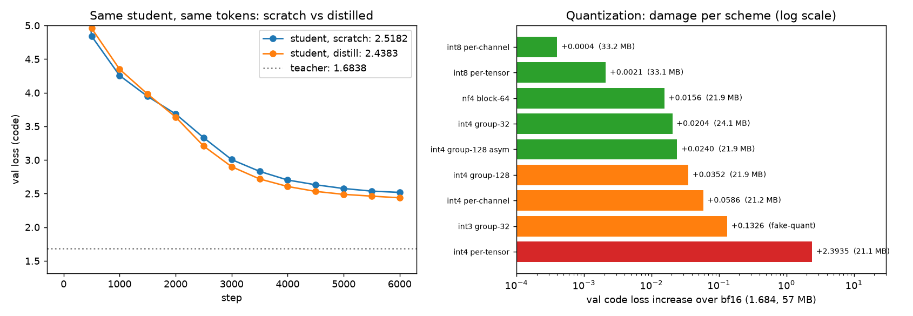

# Stage 21 — Distillation and Quantization

Two ways to make a trained model cheaper to run:

- **distillation**: train a *smaller* model to imitate the big one;
- **quantization**: keep the same model, but store its numbers in fewer bits.

Both trade a little quality for a lot of size or speed. This stage builds
both by hand and measures the trade.

---

## 1. Distillation: learning from a teacher's whole distribution

A normal training target is a **hard label**: the next token was `return`,
so push the probability of `return` up and everything else down. But a
trained model, the **teacher**, knows more than that. After `def add(a, b):\n`
its distribution might be:

```
"    return"  0.62      "    \"\"\""  0.21      "    if"  0.05      "    result" 0.04 ...
```

That says "a docstring is also quite plausible here, an `if` less so". A hard
label throws that away. **Soft targets** keep it: train the **student** to
match the teacher's whole distribution (Hinton et al. 2015).

```
loss = α · T² · KL( softmax(z_teacher / T) ‖ softmax(z_student / T) )
     + (1 − α) · CE(z_student, true next token)
```

- **KL divergence** measures how far the student's distribution is from the
  teacher's. Zero when they match.
- **Temperature `T`** (as in Stage 07) softens both distributions so the small
  probabilities, the "dark knowledge", are large enough to learn from.
- **`T²`**: dividing logits by `T` shrinks the gradients by `1/T²`;
  multiplying back keeps the KL term's scale independent of `T`.
- `α` mixes in the ordinary hard-label loss.

**Why soft targets carry more signal.** A hard label is one number per
position, about `log₂ V ≈ 13` bits of information at most, and usually far
less. A teacher distribution is a full vector over 8,196 entries. Each training
token tells the student how the teacher ranks every alternative, which is
why a distilled student learns faster from the same tokens than one trained
on raw data.

**On-policy vs off-policy.** We distil on the training data (**off-policy**:
the student imitates the teacher on text neither of them wrote). On-policy
distillation (Agarwal et al. 2024, "GKD") has the student generate and the
teacher score the student's own samples, which fixes the mismatch between
training on real text and generating its own. It needs sampling in the loop;
we note it and stay off-policy.

---

## 2. Quantization: fewer bits per number

Our weights are 16- or 32-bit floats. Most of those bits are precision a
network does not need. **Quantization** maps each weight to one of a few
integer levels and keeps a **scale** to map back:

```
quantize:    q = clamp( round(w / s) + z,  q_min, q_max )
dequantize:  ŵ = (q − z) · s
```

**Worked example**, int8 symmetric, weights `[0.50, −1.27, 0.00, 1.27]`:

```
s = max|w| / 127 = 1.27 / 127 = 0.01
q = round(w / s) = [50, −127, 0, 127]           one byte each instead of four
ŵ = q · s       = [0.50, −1.27, 0.00, 1.27]     exact here; usually off by up to s/2
```

`test_worked_example_int8_symmetric` checks it.

### 2a. Symmetric vs asymmetric

**Symmetric**: `z = 0`, levels centred on 0: `[−127, 127]` for int8,
`[−7, 7]` for int4. Zero is represented exactly, and dequantization is a
single multiply. **Asymmetric**: map `[min, max]` onto `[0, 255]` (or
`[0, 15]`) using a zero-point `z`. Better when the values are lopsided, such as
activations after a ReLU, which are never negative. Weights are roughly
symmetric, so symmetric is usual for them.

### 2b. Granularity: how many weights share one scale

| | one scale per | overhead (fp16 scale) | robust to outliers |
|---|---|---|---|
| per-tensor | whole matrix | ~0 | no |
| per-channel | output row | 2 B per row | some |
| group-wise | `g` consecutive weights (32-128) | 16/g bits per weight | yes |

The problem a scale has to solve: **one large weight sets the scale for
everyone sharing it.** If one weight in a row is 100× larger than the rest,
`s = max/7` (int4) puts every normal weight in the bottom one or two levels:
they all round to 0 or ±1. Group-wise scaling confines the damage to one
group of 64. `test_outlier_hurts_per_tensor_not_per_group` measures it: the
error is more than 50× larger per-tensor than per-group with a single outlier.

### 2c. Bits per weight, all in

```
int8 per-channel:   8 bits + 16/C  ≈ 8.0
int4 group-128:     4 bits + 16/128 = 4.125
int4 group-32:      4 bits + 16/32  = 4.5
NF4 block-64:       4 bits + 16/64  = 4.25       (Stage 17)
```

---

## 3. Post-training quantization vs quantization-aware training

**PTQ** (post-training quantization): take the trained weights, quantize them,
done. What we build. Round-to-nearest (RTN) is the simplest PTQ.

Smarter PTQ methods use a little calibration data:

- **GPTQ** (Frantar et al. 2022): quantize one column at a time and adjust
  the not-yet-quantized columns to compensate for the error just made, using
  second-order (Hessian) information from calibration activations.
- **AWQ** (Lin et al. 2023): find the ~1% of weight channels that multiply the
  largest activations and scale them up before quantization (and the
  activations down by the same factor), so they lose less precision.

**QAT** (quantization-aware training): simulate quantization during training
("fake quant" in the forward pass, straight-through gradients), so the model
learns weights that survive rounding. Best quality, needs a training run.

---

## 4. Outliers, and why naive int8 broke big models

Dettmers et al. (2022, "LLM.int8()") found that above about 6.7B parameters,
transformers develop **outlier features**: a handful of hidden dimensions
whose activations are 20-100× larger than the rest, in every layer. Stage 06
met their cousin in GPT-2 small: residual-stream values near **3,000** in a
few dimensions. Quantizing such activations with one scale wipes out every
other dimension's information. LLM.int8() keeps the outlier dimensions in
fp16 and quantizes the rest. Weight-only quantization (what we do) avoids the
problem on the activation side entirely.

**KV-cache quantization** applies the same ideas to the cache (Stage 07 §6d):
at long context the cache, not the weights, dominates memory, and int8 or
int4 keys and values halve or quarter it.

---

## 5. The frontier: quality, size, speed

Quantization's speed benefit comes from **memory bandwidth** in decoding
(Stage 07 §6c): reading 4-bit weights moves a quarter of the bytes of bf16.
That needs a **fused kernel** that reads the packed codes and dequantizes in
registers. Our `QuantLinear` dequantizes the whole matrix in PyTorch and then
calls an ordinary matmul. That is **slower** than bf16, not faster. Its
memory savings and quality numbers are real; its speed numbers are honest
about missing kernels. We report all three.

---

## 6. Acceptance criteria

`llmfs/post/quant.py`, `stages/21_distill_quant/test_quant.py`:

- the int8 worked example; asymmetric maps `[min, max]` exactly;
- round-trip error ≤ half a quantization step for every granularity;
- a single outlier: per-tensor int4 error ≫ group-wise;
- `QuantLinear` equals fake-quant math; 4-bit codes take 0.5 byte per weight;
- `run.py distill`: student trained from scratch vs distilled from the
  teacher, same steps and tokens;
- `run.py quant`: a size / val-loss / tokens-per-second table for bf16,
  int8 (per-tensor, per-channel), int4 (per-tensor, per-channel, group 128,
  group 32, asymmetric group 128), NF4 block 64;
- the ablation: per-tensor vs per-group int4 on the same weights.

---

## 7. Experiments

### 7a. Distillation

Teacher: the Stage 11 workhorse (30M, val code 1.684 on these windows).
Student: the 4-layer, C=256 GPT (5.4M). Both student runs see the same
6,000 steps × 16 × 512 tokens, same seed and order. The distilled one uses
`0.5 · T²·KL(teacher ‖ student) + 0.5 · CE` with `T = 2`.

| step | 1,000 | 2,000 | 3,000 | 4,500 | 6,000 |
|---|---|---|---|---|---|
| from scratch | 4.25 | 3.68 | 3.006 | 2.632 | **2.518** |
| distilled | 4.35 | 3.64 | 2.901 | 2.533 | **2.438** |

**The distilled student is 0.080 nats better on the same tokens**, and it is
ahead from step 2,000 to the end. Early on (step 1,000) it is slightly
behind: matching a full distribution is a harder target than predicting one
token, until the student is good enough to use the extra information.

The price is compute: every training step runs the 30M teacher too, so the
distilled run took **1,126 s** against 380 s, 3× the wall time. Whether
distillation "beats training from scratch" depends on what is held fixed.
With the same *tokens*, it wins clearly. With the same *GPU time*, the
scratch run could have seen 3× the tokens; Stage 10 says that is worth more
than 0.08 for a model this size. Distillation is the right tool when data,
not compute, is the limit, or when the teacher's outputs can be computed once
and reused.

### 7b. Quantization

The workhorse (30M), weights only, every `nn.Linear` except the tied output
head; embeddings and norms stay bf16. Val loss on 256 code windows, size as
stored, decoding speed at batch 1:

| scheme | val code | Δ vs bf16 | size | tokens/s |
|---|---|---|---|---|
| bf16 | 1.6838 | — | 57.1 MB | 725 |
| int8 per-channel | 1.6842 | +0.0004 | 33.2 MB | 416 |
| int8 per-tensor | 1.6859 | +0.0021 | 33.1 MB | 276 |
| **NF4, block 64** | 1.6994 | **+0.0156** | 21.9 MB | 178 |
| int4 group-32 | 1.7042 | +0.0204 | 24.1 MB | 289 |
| int4 group-128, asymmetric | 1.7078 | +0.0240 | 21.9 MB | 289 |
| int4 group-128 | 1.7190 | +0.0352 | 21.9 MB | 292 |
| int4 per-channel | 1.7424 | +0.0586 | 21.2 MB | 295 |
| int3 group-32 (simulated) | 1.8164 | +0.1326 | — | — |
| **int4 per-tensor** | **4.0773** | **+2.3935** | 21.1 MB | 290 |



Reading it:

- **int8 is free.** +0.0004 per channel. 256 levels are more than these
  weights need.
- **The ablation: per-tensor vs per-group int4 is +2.39 vs +0.035**, a
  70× difference in damage for the same 4 bits. With one scale per matrix,
  the largest weight in the whole matrix sets the step size, and with 15
  levels most ordinary weights round to 0 or ±1 step. The model is broken
  (loss 4.08 is worse than the 5M student). Per channel (+0.059) and per
  group (+0.035 at 128, +0.020 at 32) confine each outlier's damage to its
  own row or group. The unit test showed the mechanism on a planted outlier;
  real weights have them too.
- **NF4 is the best 4-bit scheme**, +0.016 at block 64: levels placed where
  the weights are (Stage 17 §5) beat evenly spaced int4 at the same block
  size and storage.
- **Asymmetric helps a little** (+0.024 vs +0.035 at group 128): weight
  groups are not perfectly centred on zero.
- **3 bits** (simulated) costs 0.13: the frontier bends sharply below 4.
- **Every quantized model is slower**, 178-416 tokens/s against 725. That is
  the honest result of §5: our `QuantLinear` dequantizes the whole matrix in
  PyTorch on every forward, then calls a normal matmul. The memory saving is
  real (57 → 22 MB), the speed needs a fused kernel we did not write.

**The capstone (92M), same schemes:**

| scheme | Δ val code, workhorse (30M) | Δ val code, capstone (92M) | capstone size |
|---|---|---|---|
| int8 per-channel | +0.0004 | **+0.0000** | 95.1 MB |
| int8 per-tensor | +0.0021 | +0.0021 | 94.7 MB |
| NF4, block 64 | +0.0156 | **+0.0134** | 56.8 MB |
| int4 group-32 | +0.0204 | +0.0156 | 64.4 MB |
| int4 group-128, asymmetric | +0.0240 | +0.0184 | 56.8 MB |
| int4 group-128 | +0.0352 | +0.0254 | 56.8 MB |
| int4 per-channel | +0.0586 | +0.0456 | 54.6 MB |
| int3 group-32 (simulated) | +0.1326 | +0.1096 | — |
| int4 per-tensor | +2.3935 | **+3.2174** | 54.2 MB |

(bf16: val code 1.4233, 175.7 MB, 451 tokens/s.) The ranking is identical.
Every fine-grained scheme hurts the bigger model a little less (NF4 +0.013
against +0.016, int4 group-128 +0.025 against +0.035), which matches the
usual observation that larger models quantize more gracefully. The one
coarse scheme hurts it **more**: per-tensor int4 breaks the capstone worse
(+3.22, loss 4.64) than the workhorse (+2.39). Bigger matrices hold more
weights, so the single largest one, which sets the step for all of them,
sits further from the typical weight.

The size column stops at 21 MB, not 57 / 4 = 14: the 8,196 × 512 embedding
table (8.4 MB in bf16) and the norms stay unquantized, and every group carries
a 16-bit scale.

---

## 8. What we found

| Question | Answer, measured |
|---|---|
| Distilled vs scratch student, same tokens | 2.438 vs 2.518 (−0.080), ahead from step 2,000 |
| Cost of distillation | 3× wall time per step (teacher forward) |
| int8 | +0.0004 (per channel): free; 57 → 33 MB |
| Best 4-bit | NF4 block-64, +0.016; 22 MB |
| Per-tensor vs per-group int4 | +2.39 vs +0.035: one scale per matrix breaks the model |
| int3 | +0.13 |
| Speed | All quantized variants slower (178-416 vs 725 tokens/s) without a fused kernel |

One habit from this stage: **say what is held fixed.** "Distillation wins"
is true for equal tokens and false for equal GPU time; "4-bit is nearly free"
is true per group and catastrophically false per tensor.
