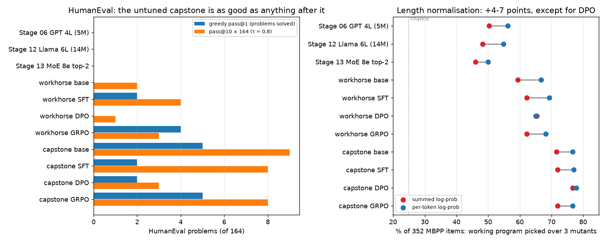

# Stage 22 — Evaluation That Means Something

Every stage so far produced a number. This stage asks which numbers deserve
trust, puts all our checkpoints through one harness, and produces one
table.

What is in this stage:

- what **perplexity** is good for, and where it misleads;
- **multiple-choice scoring** by log-likelihood, and **length normalisation**;
- **generative** benchmarks: HumanEval and MBPP, **pass@k** and its estimator;
- **LLM-as-judge**, its position bias, pairwise win rates and Elo, and why we
  do not use them;
- **contamination**: did the test leak into the training data?
- why published benchmark numbers are often not comparable.

---

## 1. Perplexity: necessary, not sufficient

**Perplexity** is `exp(loss)`: "the model is as unsure as if it were choosing
uniformly among this many tokens". Our capstone's code loss of about 1.5
nats is a perplexity of about 4.5.

Uses: comparing models **with the same tokenizer on the same text** (every
stage up to now); spotting training problems; a smooth signal that moves with
every change.

Limits:

- **Not comparable across tokenizers.** A tokenizer with longer tokens has
  fewer, harder predictions per byte. Use **bits per byte** instead (Stage 06
  did this to compare against GPT-2).
- **Dominated by easy tokens.** Most code tokens are predictable (closing
  brackets, indentation, the rest of an identifier). A model can lower average
  loss a lot while getting no better at the rare tokens that decide whether a
  program is correct. Stage 14 showed a window-64 model with almost the same
  loss as full attention and very different long-range retrieval.
- **Not the task.** We want working programs. Loss says nothing directly about
  whether a sampled function passes its tests.

---

## 2. Multiple-choice scoring and length normalisation

Benchmarks like HellaSwag and MMLU give a question and several candidate
answers. A base model is scored by asking which candidate it finds most
likely:

```
score(answer) = log P(answer | question) = Σ_t log P(token_t | question, tokens_<t)
pick the answer with the highest score
```

The problem: a **sum** of log-probabilities favours **short** answers, since
every extra token adds a negative number. A three-token wrong answer can beat
a ten-token right one just by being short. **Length normalisation** divides
by the number of tokens (or by bytes, which is tokenizer-independent):

```
score_norm(answer) = (1/len) · Σ_t log P(token_t | ...)
```

Neither is "correct". Different leaderboards use different ones (lm-eval-harness
reports both `acc` and `acc_norm`), and they can rank models differently.

**Our version, for code.** For each MBPP problem: the reference solution and
three single-mutation variants (Stage 18) that **fail the tests**. The model
must give the working one the highest score. Mutations change length a little:
`x < y` → `x >= y` adds a token, `return x` → `return None` changes several.
§8c scores this with and without normalisation and shows how much the
ranking of our checkpoints depends on that choice.

---

## 3. Generative benchmarks and pass@k

**HumanEval** (Chen et al. 2021): 164 hand-written Python problems, each a
signature and docstring, with hidden unit tests. **MBPP** (Austin et al. 2021):
974 short problems in plain English with three asserts each; we use the 500
test problems, showing one assert in the prompt (the standard setup).

The model writes code; the code is run; it passes or not. No judgement
involved. This is the objective number the whole project was designed around.

**pass@k**: the probability that at least one of `k` samples passes. Sampling
exactly `k` times per problem is noisy. Chen et al.'s **unbiased estimator**
samples `n ≥ k` times, counts the `c` that pass, and computes the probability
that a random subset of `k` contains at least one pass:

```
pass@k = 1 − C(n − c, k) / C(n, k)
```

Example: `n = 10, c = 3, k = 2`: `1 − C(7,2)/C(10,2) = 1 − 21/45 = 0.533`.
(`test_pass_at_k_estimator`.) pass@1 with greedy decoding (`n = 1`,
temperature 0) is the most common single number; pass@10 at temperature
0.8 measures "can it get there at all".

**Our harness is tested before it is trusted**: all 164 HumanEval reference
solutions pass through it, at least 99% of MBPP's references pass, and
`return None` stubs fail (`stages/22_evaluation/test_eval.py`). A harness that
scores the reference solutions below 100% is measuring itself.

**Honest expectations.** Published small code models: codegen-350M-mono gets
12.8% HumanEval pass@1; GPT-2-sized general models get ~0%. Our 30M and
~100M models, trained on 1-2B tokens, should land in the low single digits
or at zero. The number matters because it is objective and comparable, not
because it is large.

---

## 4. LLM-as-judge, and why not here

For open-ended tasks (chat, summaries) there are no unit tests, so a strong
model is asked to judge: "which of these two answers is better?" Known
problems (Zheng et al. 2023, "Judging LLM-as-a-judge"):

- **position bias**: judges prefer the first (or second) answer shown. The
  control: judge every pair in both orders, count a win only if it survives
  the swap;
- **verbosity bias**: longer answers win;
- **self-preference**: models prefer outputs like their own.

Pairwise judgements are aggregated into **win rates** or **Elo** ratings (the
chess rating system: each comparison moves both ratings by an amount that
depends on how surprising the result was). Chatbot Arena does this with
human votes.

At 100M parameters, our models' open-ended answers are too poor for a judge's
preferences to measure anything but noise, and we have tests. We use tests.

---

## 5. Contamination

If test problems (or their solutions) appear in the training data, the model
may have **memorised** them, and the score measures memory, not skill.
HumanEval was written by hand in 2021 to avoid this, but solutions to it have
since been posted all over GitHub. MBPP problems are textbook exercises that
exist in many forms.

**Detection**: search the training data for long exact overlaps with each
benchmark's solutions. We hash every 13-token window of each reference
solution (in our tokenizer) and scan all 1.33B training code tokens for
matches. 13-gram overlap is the GPT-3 paper's contamination test. A problem is
flagged if any 13-gram of its solution appears in training.

Caveats: an exact 13-gram match can be innocent (`for i in range(len(arr)):`
is common), and a paraphrased leak has no exact matches. It is a screen, not
proof. We report pass@1 on flagged and unflagged problems separately.

---

## 6. Why papers' numbers are often not comparable

The same benchmark name can hide different prompts, few-shot examples,
decoding settings, stop sequences, answer extraction, normalisation, and
test subsets. MBPP alone has been reported with 0, 1 or 3 tests in the prompt,
on the 500-problem test set or the 427-problem sanitized subset. A 2-point gap
between two papers is often smaller than the gap between two harnesses run on
the same model. Comparing our own checkpoints with **one harness** is the
honest thing we can do; for external comparison we state every setting.

Our settings: greedy pass@1, max 256-300 new tokens, completions cut at the
first top-level statement after the function, MBPP test split (500) with one
assert in a docstring prompt, HumanEval as published. Base models continue the
raw prompt; chat models get it as a user turn.

---

## 7. Acceptance criteria

- harness: reference solutions pass, stubs fail, the early-exit hack fails,
  pass@k matches the formula (`test_eval.py`);
- `run.py table`: one row per checkpoint: val loss (code, English),
  bits per byte, HumanEval pass@1, MBPP pass@1, and pass@10 for the main
  models;
- `run.py contamination`: flagged problems and pass@1 split by flag;
- `run.py mc`: mutant-discrimination accuracy with and without length
  normalisation, and the model ranking under each.

---

## 8. Experiments

### 8a. The table

Every checkpoint through one harness (§6 settings). Val loss on the same 256
windows of 512 tokens; bits per byte for code (comparable across tokenizers,
§1); greedy pass@1; pass@10 from 10 samples at τ = 0.8 with the unbiased
estimator, for the two real models' checkpoints. Base models continue the
raw prompt; SFT / DPO / GRPO models get it as a chat turn.

| model | params | val code | val English | bpb code | HumanEval pass@1 | pass@10 | MBPP pass@1 | pass@10 |
|---|---|---|---|---|---|---|---|---|
| Stage 06 GPT, 4 layers | 5.3M | 2.356 | 4.118 | 1.087 | 0 | — | 0 | — |
| Stage 12 Llama, 6 layers | 12.4M | 2.271 | 4.116 | 1.048 | 0 | — | 0 | — |
| Stage 13 MoE, 8 experts top-2 | 33.7M (total) | 2.325 | 4.119 | 1.073 | 0 | — | 0 | — |
| workhorse base | 29.9M | **1.684** | **3.341** | 0.777 | 0 | 1.22% | 0 | 0 |
| workhorse SFT | | 1.832 | 3.646 | 0.846 | 1.22% | 2.44% | 0 | 0.4% |
| workhorse DPO (β = 1) | | 2.013 | 3.697 | 0.929 | 0 | 0.61% | 0 | 0 |
| workhorse GRPO | | 1.833 | 3.646 | 0.846 | **2.44%** | 1.83% | 0.2% | 0 |
| capstone base | 92.1M | **1.423** | **2.950** | **0.657** | **3.05%** | **5.49%** | 0.2% | 0.4% |
| capstone SFT | | 1.582 | 3.261 | 0.730 | 1.22% | 4.88% | 0.4% | 0.4% |
| capstone DPO (β = 1) | | 1.632 | 3.274 | 0.753 | 1.22% | 1.83% | 0.4% | 0.6% |
| capstone GRPO | | 1.582 | 3.260 | 0.730 | **3.05%** | 4.88% | 0.4% | 0.6% |

Reading it:

- **Loss orders the models exactly as size and data do**, and pass@1 is zero
  for everything below the workhorse. The three small models differ by up to
  0.085 nats of code loss and are identical on both benchmarks: loss sees
  differences that tests cannot yet.
- **The best HumanEval model is the capstone base model**, prompted as plain
  code: 3.05% greedy, 5.49% pass@10. No post-training stage beat it on
  HumanEval. SFT lowered greedy pass@1 to 1.22% while barely touching pass@10
  (4.88%): the right answer was still among the samples, just not first.
  GRPO brought greedy back to 3.05%.
- **Every post-training stage raised the pretraining loss**: SFT by 0.15-0.16
  nats of code, DPO by a further 0.05-0.18. DPO is the most expensive in loss
  and the least useful in tests (Stage 19: it pushes log-probabilities of chosen
  and rejected answers down together).
- **The numbers are tiny and noisy.** One HumanEval problem is 0.61 points.
  Stage 19 measured workhorse DPO at 1 of 164 with the same settings; here it
  is 0 of 164. Greedy decoding in bf16 flips at near-ties, and the batch a
  prompt is generated in changes the arithmetic slightly (Stage 15 saw the
  same). Differences of one or two problems are not findings.
- **pass@10 below pass@1 (workhorse GRPO: 1.83% vs 2.44%)** is not a bug: the
  two come from different decoding. Greedy picks the single most likely
  completion, which RL sharpened; τ = 0.8 samples spend most of their tries
  elsewhere.

**What got solved, and was it in the training data?** Every problem any
checkpoint solved:

| model | problems solved (HumanEval / MBPP) | any 13-gram in training? |
|---|---|---|
| capstone base | HumanEval 23, 28, 29, 35, 53; mbpp 242 | none |
| capstone GRPO | HumanEval 23, 28, 29, 35, 53; mbpp 127, 242 | none |
| capstone SFT, DPO | HumanEval 28, 34; mbpp 127, 242 | none |
| workhorse GRPO | HumanEval 23, 28, 35, 53; mbpp 336 | none |
| workhorse SFT | HumanEval 23, 28 | none |

HumanEval 23 is `strlen`, 28 `concatenate`, 29 `filter_by_prefix`, 35
`max_element`, 53 `add`: one-line bodies. **None of the solved problems has a
single 13-token window of its reference solution in our 1.33B training
tokens**, so the four heavily overlapping problems of §8b contributed
nothing. The scores are small, and they are clean.

### 8b. Contamination

Every 13-token window of each reference solution (HumanEval: prompt +
canonical solution; MBPP: reference code), hashed and searched for in all
**1.33B training code tokens**:

| share of a problem's 13-grams found in training | HumanEval (164) | MBPP test (500) |
|---|---|---|
| any (≥ 1 window) | 69 | 50 |
| ≥ 5% | 16 | 20 |
| ≥ 20% | 1 | 3 |
| ≥ 50% | **0** | **0** |

"Any match" flags 42% of HumanEval, and it means almost nothing: the shared
windows are boilerplate (`from typing import List\n\n\ndef`, docstring
openings, `for i in range(len(`). No problem has half its solution in our
training data. The most-overlapping ones are textbook snippets that exist in
thousands of repositories:

```python
# HumanEval/55, 23% of 13-grams in training
    if n == 0:
        return 0
    if n == 1:
        return 1
    return fib(n - 1) + fib(n - 2)

# mbpp/102, 40%
def snake_to_camel(word):
        import re
        return ''.join(x.capitalize() or '_' for x in word.split('_'))
```

Neither is a leak of the benchmark; both are code any Python corpus
contains. We treat problems with ≥ 20% overlap as "heavily overlapping" and
report pass@1 split by that flag in the table: if a model solves only those,
the score is suspect.

### 8c. Length normalisation

352 MBPP test problems where the reference passes its tests and three
distinct single mutations each fail them (Stage 18's mutator). Four options,
so chance is 25%. Each option is scored by the log-probability the model
gives it after the prompt: **summed** over its tokens, or **per token**.

| model | summed | per token | change |
|---|---|---|---|
| Stage 06 GPT (5M) | 50.3% | 56.2% | +5.9 |
| Stage 12 Llama (12M) | 48.3% | 54.8% | +6.5 |
| Stage 13 MoE (34M total) | 46.0% | 50.0% | +4.0 |
| workhorse base | 59.4% | 66.8% | +7.4 |
| workhorse SFT | 62.2% | 69.3% | +7.1 |
| workhorse DPO | **65.3%** | 65.1% | −0.2 |
| workhorse GRPO | 62.2% | 68.2% | +6.0 |
| capstone base | 71.6% | 76.7% | +5.1 |
| capstone SFT | 71.9% | 77.0% | +5.1 |
| capstone DPO | **76.7%** | **77.8%** | +1.1 |
| capstone GRPO | 71.9% | 76.7% | +4.8 |

Three things:

- **Every model is far above chance, including the 5M one.** Picking the
  working program out of four near-identical ones is much easier than
  writing it: the models that score 0 on HumanEval get half of these right.
  This is Stage 18's finding (a model that cannot write code can judge it)
  without any reward-model training.
- **Normalising helps by 4-7 points**, except for DPO. Mutations change
  length by a token or two in either direction (§2). A sum charges for every
  token, so a mutant that happens to be shorter gets a head start it did not
  earn; dividing by length removes it. (We did not count how many mutants
  are shorter; the size of the gain says it is a common case.)
- **The ranking depends on the choice.** Summed, workhorse DPO is the best
  workhorse checkpoint (65.3%); per token, it is the worst (65.1%, below
  base's 66.8%). DPO was trained on exactly this kind of pair, and with a
  summed objective (Stage 19's loss sums log-probabilities over the
  answer), so it learned to win on summed scores. That is a benchmark result
  that measures how the model was trained as much as what it knows; the
  same thing happens when a leaderboard reports `acc` and a paper reports
  `acc_norm`.



---

## 9. What we found

| Question | Answer, measured |
|---|---|
| Does the harness measure itself? | No: 164/164 HumanEval references pass, ≥ 99% of MBPP's, stubs and the early-exit hack fail |
| Best HumanEval model | The capstone **base** model as plain code: 3.05% greedy, 5.49% pass@10 |
| What did post-training buy on HumanEval? | Nothing net: SFT 3.05 → 1.22%, GRPO back to 3.05%; DPO stayed at 1.22% |
| Do models under 30M solve anything? | No: 0 on both benchmarks, though their code losses differ by 0.085 |
| Contamination | 69 HumanEval problems share some 13-gram with training, none share half; every solved problem shares **none** |
| Noise floor | One problem = 0.61 points; the same checkpoint scored 0 and 1 of 164 in two runs |
| Choosing the working program of four | 46-78%, all far above 25% chance; the 5M model gets 56% |
| Length normalisation | +4 to +7 points, and it reorders models: DPO is best summed, worst normalised among workhorse checkpoints |

The habits from this stage:

- **Test the harness on the answers before testing a model on the
  questions.** The trailing-newline trap emptied every base-model completion
  until one was read raw.
- **Evaluate each model in its best format.** Comparing an SFT model in chat
  mode against its base model in chat mode made SFT look like a gain; in
  the base model's own format it was a loss.
- **Below about ten problems, report counts, not percentages.** "3.05%" is
  five one-line functions.
