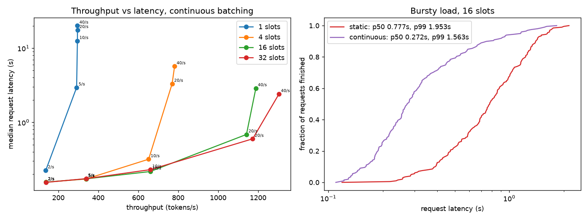

# Stage 23 — Inference and Serving

A model that answers one request at a time on one GPU wastes almost all of
that GPU. This stage builds a small inference server that answers many
requests at once, and measures what the key idea of modern serving,
**continuous batching**, buys under a realistic, bursty load.

---

## 1. The one fact that explains serving

Stage 07 split generation into two phases:

- **Prefill**: the whole prompt in one forward pass. Many tokens per weight
  read, so the GPU's arithmetic is busy: **compute-bound**.
- **Decode**: one token per step. Every step reads every weight (and the KV
  cache) from memory to do a little arithmetic for one token:
  **memory-bandwidth-bound**.

During decode the expensive part, reading the weights, is the same whether
the step produces 1 token or 32. So **batching decode steps across requests is
almost free**: 32 requests decoding together take barely longer per step than
one. Every serving system is built on that.

Two latency numbers follow:

- **TTFT** (time to first token): queueing + prefill. What a user feels as
  "it started answering".
- **TPOT** (time per output token): one decode step. What a user feels as
  "how fast it types".

And one throughput number: **tokens per second** across all requests.

---

## 2. Static vs continuous batching

**Static batching**: collect a batch of requests, run them together until
**all** are finished, then take the next batch.

```
slot 1: ████████████████████████████████  (long answer)
slot 2: ████████░░░░░░░░░░░░░░░░░░░░░░░░  done early, slot idles
slot 3: ███████████████░░░░░░░░░░░░░░░░░
slot 4: ███░░░░░░░░░░░░░░░░░░░░░░░░░░░░░
                                          new requests wait for the whole batch
```

Two problems: finished requests leave their slot **idle** until the longest one
ends, and new requests **wait** for the whole batch, however short it would be
for them.

**Continuous batching** (Orca, Yu et al. 2022): the batch is rebuilt **every
decode step**. A finished request leaves immediately; a waiting request joins
on the next step after a quick prefill.

```
slot 1: ████████████████████████████████
slot 2: ████████▓▓▓▓▓▓▓▓▓▓▓▓▓▓▓▓▓▓█████   new request joins at once
slot 3: ███████████████▓▓▓▓▓▓▓▓▓▓▓▓▓▓▓▓
slot 4: ███▓▓▓▓▓▓▓▓▓▓████▓▓▓▓▓▓▓▓▓▓▓▓▓▓
```

Requests of very different lengths can now share the GPU without the short
ones paying for the long ones. Under bursty load this shows up most in the
**tail**: the p99 latency (the slowest 1% of requests).

---

## 3. Our engine

`llmfs/serve/engine.py`:

- `S` **slots**, each holding one request's KV cache rows;
- every step: **admit** waiting requests into free slots (prefill each one
  into its slot), then **one batched decode** over all active slots, each
  slot attending only to its own cache rows via a length mask, then
  **retire** finished requests;
- the same engine runs **static** mode by admitting only when it is empty.

`test_engine.py` checks that every request's output, served in a batch with
others joining and leaving, is **token-for-token identical** to running that
request alone with Stage 07's sampler. Batching is an optimisation; it must
not change answers.

---

## 4. PagedAttention and KV-cache fragmentation

Our cache reserves `T_max` positions for every slot, whether the request uses
50 or 1,000. With requests of mixed lengths most of that reservation is empty:
**internal fragmentation**. Since the cache size is what limits how many
requests fit at once (Stage 07 §6d), wasted cache means a smaller batch and
lower throughput.

**PagedAttention** (vLLM, Kwon et al. 2023) borrows virtual memory from
operating systems. The cache is split into fixed-size **blocks** (say 16
tokens). Each request has a **block table** mapping its logical positions to
physical blocks, allocated on demand as it grows. No reservation, almost no
waste; the attention kernel follows the block table. Bonus: identical prefixes
(a shared system prompt) can point to the **same** physical blocks:
**prefix caching**.

We do not build paging: on one small model and one GPU, our cache fits
comfortably. The fragmentation it would fix is reported (§7) as "cache
reserved vs cache used".

---

## 5. Chunked prefill and what real servers add

A long prompt's prefill can take as long as dozens of decode steps, and while
it runs, every other request's decoding stalls: a spike in their TPOT.
**Chunked prefill** splits a long prompt into pieces processed alongside
decode steps, so no single step is huge.

vLLM and SGLang add, on top of continuous batching and paging: fused
attention kernels over paged caches, CUDA graphs to remove launch overhead,
speculative decoding (Stage 15), quantized weights and caches (Stage 21),
prefix caching with a radix tree (SGLang), and multi-GPU tensor parallelism.

**vLLM comparison, honestly.** The curriculum asks for vLLM on the same
weights. vLLM pins its own PyTorch and CUDA builds (several GB), and the disk
has about 26 GB free with checkpoints still to write. We do not install it.
The reference point we use instead is Hugging Face `generate` on the same
weights exported to GPT-2 format, batched and unbatched, which is also what
vLLM's own papers compare against.

---

## 6. Acceptance criteria

- engine outputs equal single-request greedy outputs, in both modes;
- `run.py curve`: throughput and latency against offered load (requests per
  second), for continuous batching at several slot counts;
- `run.py bursty`: the same bursty trace (Poisson arrivals with bursts, mixed
  output lengths) served by static and continuous batching: p50/p99
  latency, TTFT, throughput;
- cache reserved vs used under that trace.

---

## 7. Experiments

Model: the Stage 11 workhorse (30M), bf16. Requests: prompts are real val
code windows of 32-256 tokens; output lengths are heavy-tailed (16 tokens
plus a Pareto draw, capped at 256; mean 66), greedy, 200 requests per run,
Poisson arrivals.

### 7a. Throughput against latency

| slots | 2 req/s | 5 | 10 | 20 | 40 |
|---|---|---|---|---|---|
| 1 | 137 tok/s · 0.23 s | 292 · 2.95 s | 295 · 12.5 s | 296 · 17.5 s | 295 · 20.1 s |
| 4 | 138 · 0.16 s | 339 · 0.17 s | 652 · 0.32 s | 770 · 3.31 s | 782 · 5.69 s |
| 16 | 138 · 0.16 s | 340 · 0.17 s | 660 · 0.22 s | 1,142 · 0.69 s | 1,189 · 2.88 s |
| 32 | 138 · 0.16 s | 340 · 0.17 s | 661 · 0.23 s | 1,173 · 0.60 s | **1,304** · 2.40 s |

(tokens per second across all requests · median request latency)

At low load every configuration serves the offered rate with ~0.16 s median
latency: throughput is just what arrives. As load rises, each configuration
hits its ceiling and latency explodes, the "hockey stick" of the figure.
**One slot saturates at ~295 tokens/s**: a single sequence decoding one token
at a time (Stage 07's overhead-bound regime). **Batching raises the ceiling
4.4×**, to 1,304 tokens/s at 32 slots, because one decode step for 32
sequences costs little more than one for a single sequence. Time per output
token rises from 3.4 ms (1 slot) to 21 ms (32 slots, full): the per-step cost
does grow with batch, just much more slowly than the tokens it produces.

### 7b. Static vs continuous batching under bursty load

Same 16 slots, a trace with Poisson arrivals at 10 requests/s plus bursts
(15% of arrivals land at once with the previous one):

| | static | continuous | ratio |
|---|---|---|---|
| median latency | 0.777 s | **0.272 s** | 2.9× |
| p99 latency | 1.953 s | **1.563 s** | 1.25× |
| median time to first token | 0.377 s | **0.008 s** | 47× |
| p99 time to first token | 1.190 s | 0.020 s | 60× |
| throughput | 696 tok/s | 725 tok/s | 1.04× |

Throughput is nearly the same: at this load the GPU is not the bottleneck.
What changes is **who waits**. Under static batching a new request waits for
the whole running batch to finish, including its one 256-token straggler,
before its prefill even starts: a median 0.38 s of pure queueing. Under
continuous batching it is prefilled on the next step, 8 ms later. The p99
improves less (1.25×) because the slowest requests are the long ones, and a
long request takes long under any policy.

**Cache reserved vs used**: requests used **21%** of the `T_max` cache rows
reserved for them on average. That 79% waste is exactly what PagedAttention
(§4) reclaims, and it would let roughly 4× more requests share the same cache
memory.



**The same trace on the 92M capstone:**

| | static | continuous | workhorse (30M), continuous |
|---|---|---|---|
| median latency | 0.911 s | **0.283 s** | 0.272 s |
| p99 latency | 2.130 s | 1.502 s | 1.563 s |
| median time to first token | 0.440 s | **0.008 s** (55×) | 0.008 s |
| throughput | 707 tok/s | 720 tok/s | 725 tok/s |

Three times the parameters and the serving numbers barely move: 720 against
725 tokens/s, the same 8 ms first token. At 16 slots and these lengths,
each decode step is dominated by fixed per-step costs (Python, kernel
launches, the scheduler), not by the matmuls the parameters feed, as Stage
07 found for the KV cache. The model would have to be much bigger, or the
batch much larger, before its size showed up here. (At batch 1 it does:
451 against 725 tokens/s, Stage 21.)

### 7c. Against Hugging Face `generate`

The workhorse's weights exported into a Hugging Face `GPT2LMHeadModel`
(transposing back to Conv1D layout). **The outputs do not match** (max
logit difference 12.2): the workhorse uses QK-norm (Stage 10 §8f), which
GPT-2's architecture does not have, so the exported model silently drops the
`q_gain`/`k_gain` tensors. The comparison is therefore of throughput only,
on a model with the same shapes and nearly the same FLOPs:

| | batch 1 | batch 16 |
|---|---|---|
| HF `generate` (static batch) | 425 tok/s | 3,170 tok/s |
| our engine (continuous) | 293 tok/s | 1,561 tok/s |

HF is 1.5-2× faster. Our engine writes each slot's keys and values with a
Python loop and builds a length mask every step; HF runs one padded batch
with its cache layout optimised for that. A production engine (vLLM) adds
CUDA graphs and paged-attention kernels on top. The lesson from §7b is the
scheduling one, not raw speed: continuous batching wins on latency even when
its per-step code is slower.

---

## 8. What we found

| Question | Answer, measured |
|---|---|
| Does batching change answers? | No: engine output equals single-request greedy, both policies (test) |
| Throughput ceiling, 1 → 32 slots | 295 → 1,304 tokens/s (4.4×) |
| Static vs continuous, bursty 10 req/s | p50 0.78 → 0.27 s; p99 1.95 → 1.56 s; TTFT p50 377 → 8 ms |
| KV cache actually used | 21% of reserved rows: the case for paging |
| vs HF `generate` | HF 1.5-2× faster per token; logits differ because HF GPT-2 has no QK-norm |

One habit from this stage: **measure the latency distribution, not the
average.** The median and the time-to-first-token showed the policy change
plainly; throughput alone said nothing happened.
