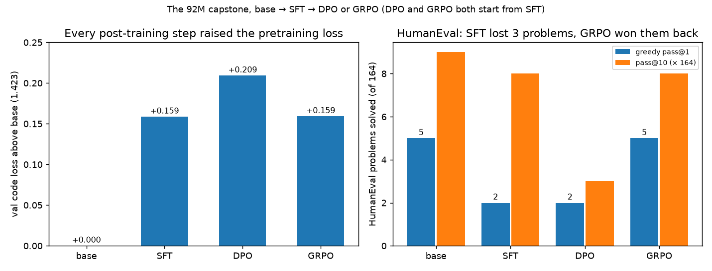

# Stage 24 — Capstone

One model, taken the whole way:

```
tokenizer (01) → data (02) → pretrain (11) → SFT (16) → DPO (19) → GRPO (20)
             → quantize (21) → evaluate (22) → serve (23)
```

Every step below uses code built and tested in its own stage. Nothing here is
new machinery; this stage is about putting it on one page, with one set of
numbers, and being honest about what the result can and cannot do. The model
card is `MODEL_CARD.md` at the repository root; every number in it comes
from `results/24_capstone/pipeline.json`, which is assembled from the stage
result files without recomputing anything.

---

## 1. The pipeline, with its numbers

The model: GPT-2 layout (12 layers, width 768, 12 heads, learned positions,
LayerNorm, GELU, tied embeddings) plus QK-norm, **92,138,496 parameters**,
our 8,196-row tokenizer, context 1,024.

```
                     val code   HumanEval      MBPP     what this step was measured on
pretrain (11)          1.295*     3.05%        0.2%     1.80B tokens, ~20 GPU-hours, max grad-norm 1.03
  └─ SFT (16)          1.582      1.22%        0.4%     119k docstring → function pairs, 3,000 steps
       ├─ DPO (19)     1.632      1.22%        0.4%     pair accuracy 0.563 → 0.895, KL 0.027
       └─ GRPO (20)    1.582      3.05%        0.4%     easy held-out 27.3% → 73.3% in 60 steps
reward model (18)                                        86.5% on test-verified MBPP pairs
quantize (21)          NF4 +0.013, int8 +0.000, int4 per-tensor +3.22;  176 → 57 MB
serve (23)             720 tok/s; first token p50 0.44 s (static) → 0.008 s (continuous)
```

\* 1.295 is Stage 11's validation set (all windows, 1,024 tokens). Every
other loss in this stage comes from Stage 22's harness (256 windows of 512
tokens), where the same base model scores **1.423**. Shorter windows give
each prediction less context, so the loss is higher; compare numbers only
within one column's source.

HumanEval and MBPP are greedy pass@1 from the Stage 22 harness. Base models
continue the raw prompt; the SFT, DPO and GRPO models get it as a chat turn.

What each step did, in one line each:

| step | what it bought | what it cost |
|---|---|---|
| pretraining | everything the model knows: val code 1.295; on the Stage 22 harness 0.66 bits per byte (workhorse 0.78) | 20 GPU-hours |
| SFT | the chat format and a stop token (completion loss 0.998 → 0.886, flat after step 250) | +0.16 code loss, +0.31 English; HumanEval 5 → 2 problems |
| reward model | a judge: 86.5% on MBPP pairs (workhorse 85.2%) | — |
| DPO | ranking: pair accuracy 0.895 | +0.05 code loss; no change in what it solves |
| GRPO | the only post-training step that moved a pass rate: 27% → 73% on its curriculum, HumanEval back to 5 problems | 17 minutes |
| quantization | 3.1× smaller at NF4 for +0.013 nats | slower without a fused kernel (106 vs 451 tok/s at batch 1) |
| serving | 55× faster first token under bursty load at the same throughput | — |

The **best checkpoint depends on the question**. For HumanEval, the base
model and the GRPO model tie at 5 problems (3.05%), and the base model has the
best pass@10 (5.49%). For telling a working program from a broken one, DPO is
best (77.8% normalised). For the curriculum it trained on, GRPO (73.3%).



---

## 2. What the model can and cannot do

**It can** write Python that looks like Python: imports, functions,
classes, docstrings, consistent naming. It solves one-line problems when
the docstring nearly says the answer:

```python
def filter_by_prefix(strings: List[str], prefix: str) -> List[str]:
    """ Filter an input list of strings only for ones that start with a given prefix.
    ...                                                   # HumanEval/29: the base
    """                                                   # model's greedy completion
    return [s for s in strings if s.startswith(prefix)]
```

The five HumanEval problems it solves are `strlen`, `concatenate`,
`filter_by_prefix`, `max_element` and `add`. Four are one line (`return
len(string)`, `return x + y`); `max_element` takes four, with a redundant
special case before `return max(l)`. None of them has a single 13-token
window in the training data (Stage 22 §8b).
It also picks the working program out of four near-identical ones 77% of
the time: it can judge code it cannot write.

**It cannot** write a function that needs two ideas in a row. On
HumanEval/0 ("is any pair of numbers closer than `threshold`?") it writes
`if len(numbers) == 2: return True`, then `== 3`, `== 4`, and on to the
token limit: the shape of a case analysis with nothing inside it. Greedy
decoding of `def fibonacci(n):`:

```python
def fibonacci(n):
	return n * (n - 1)

def fibonacci_n(n):
	return n * (n - 1)
```

and so on, for 200 tokens. Greedy decoding falls into repetition loops on
every prompt we tried, in English too ("The printing press is a very
important part of the printing press." eight times). Sampling at τ = 0.8
avoids the loop and produces fluent, wrong code. It has no facts about the
world beyond what code comments carry, no multi-step reasoning, and no
instruction following outside the docstring → function format SFT taught.
It has had no safety training and will continue any prompt.

These are the expectations CLAUDE.md set before the first line of code:
"HumanEval pass@1 will be low single digits." It is 3.05%. What the
project produced is not a useful model; it is a model of which every part
was built, tested against a reference, broken on purpose, and measured.

---

## 3. What was learned, part by part

**Foundations (Stages 00-07).** The tokenizer decided more than expected: a
code-specific 8,192-token vocabulary compresses our Python 1.5× better than
GPT-2's, and at small model sizes the embedding table is a large share of
the parameters (39% of our 5M model, 31% of GPT-2 small, 7% of the 92M
capstone with our vocabulary; it would be 30% with GPT-2's), so vocabulary
size is a model-size decision (Stages 01, 06). Data work
was most of the work: near-duplicate removal cut train/val leakage from 34%
to 8% (Stage 02). Every architectural piece has a failure you can produce on
purpose and measure: no positions (+0.83), no √d at width 256 (+0.95), no
residual (the model learns only unigram statistics, 6.86), post-norm at
depth (fails at 24 layers), no next-token shift (train loss 0, real loss
21.9). Loading OpenAI's GPT-2 weights into our own code and matching Hugging
Face's logits (float64 difference 2e-11) was the moment the model became
trustworthy (Stage 06).

**Training (Stages 08-11).** A training loop fails quietly. The one-batch
overfit test caught nothing because nothing was wrong, which is the point of
running it; the resume test caught a real checkpoint bug on its first run
(Stage 11). The biggest single speedup was not mixed precision but kernel
fusion (2.1×), because after bf16 the step was dominated by elementwise
operations (Stage 09). Scaling laws transferred to our scale: our IsoFLOP
optima sit within 15% of Chinchilla's 20 tokens per parameter (Stage 10).
But the first sweep diverged: attention scores grew to two million over long
runs of a small model, and QK-norm, borrowed early from Stage 12's list,
fixed it (Stage 10).

**Architecture (Stages 12-15).** Unbundled, GPT-2 → Llama is mostly one
change: RoPE is −0.230 of the −0.244 (Stage 12). GQA is free down to 2 kv
heads. MoE, MLA and speculative decoding all depend on scale or data we do
not have: MoE ties a dense model at 33M tokens, MLA loses to GQA at 12M
parameters, and speculative decoding reaches 1.2× because a 5M draft step
costs 43% of a 30M target step. Each is still worth building, because the
measurement says exactly which precondition is missing.

**Post-training (Stages 16-21).** SFT teaches a format in 250 steps and then
only forgets (Stage 16). LoRA at rank 1 matches full fine-tuning on that
format (Stage 17). A 30M model that cannot write code can still judge it: 85%
accuracy telling working functions from their one-mutation twins (Stage 18).
DPO learned that ranking and did not improve generation; at small β it
over-optimised, lowering the reward model's own opinion of its samples (Stage
19). GRPO with unit tests as the reward could not start on MBPP (0 of 576
rollouts passed) and nearly tripled pass@1 on a curriculum the model could
sometimes solve (Stage 20). Quantization granularity matters more than bit
width between 4 and 8 bits (Stage 21).

**Evaluation and serving (Stages 22-23).** The harness had to be tested
before the models: reference solutions must pass, stubs must fail, and an
early `os._exit(0)` must not count. A trailing newline in HumanEval's prompts
emptied every base-model completion until we read one raw (Stage 22).
Continuous batching changed who waits, not how fast the GPU runs: 47× faster
first token at the same throughput (Stage 23).

---

## 4. What is still fuzzy

- **Why small models' gradient norms creep upward over long runs** even with
  QK-norm (the 3-layer model's grew from 1.3 to 2.5 over 73k steps). Is it
  the embedding norm, the output logits, or Adam's `ε`?
- **Whether MoE and MLA win at a scale we can reach.** Both lost or tied at
  33M tokens; neither was tried at the workhorse's 590M.
- **What DPO on synthetic bug pairs would do with more data or a larger
  model**: whether pairwise preference can ever move pass@1, or only ranking.
- **How much of the HumanEval gap is format.** The SFT model scored 0% on
  prose-phrased tasks it solved 7.5% of the time when phrased as code. A
  mixed-format SFT set would answer it.
- **Repetition.** Four epochs cost 0.11 nats, more than published results;
  our repeated slice was also less diverse. Untangling those two needs a
  randomly sampled slice.

---

## 5. What to learn next

- **Multi-GPU training**: data, tensor and pipeline parallelism, and the
  communication that dominates them. Everything here fit on one GPU, which
  hid the hardest part of training large models.
- **Fused kernels**: a Triton kernel for the quantized matmul (Stage 21's
  missing speedup) and for paged attention (Stage 23's missing memory saving).
- **Data quality at scale**: classifier-based filtering (as FineWeb-Edu did)
  applied to code, and measured with the Stage 22 harness.
- **Reasoning that needs steps**: an RLVR curriculum where thinking helps
  (multi-step arithmetic, small algorithmic tasks), to see whether response
  length grows when it pays.
